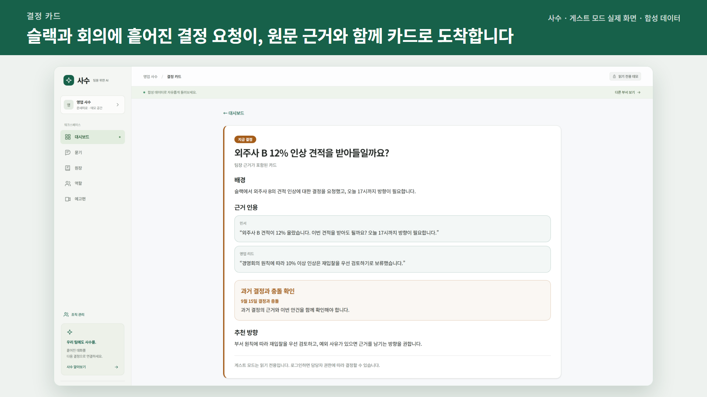
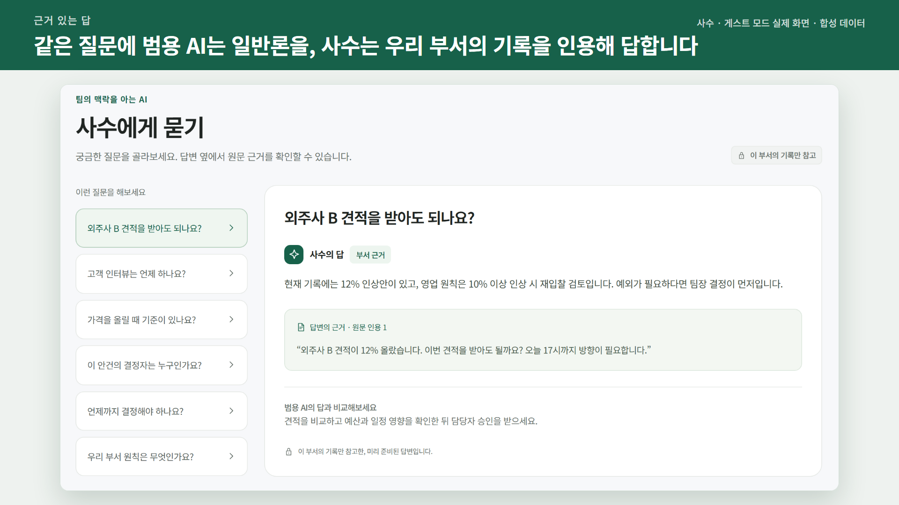
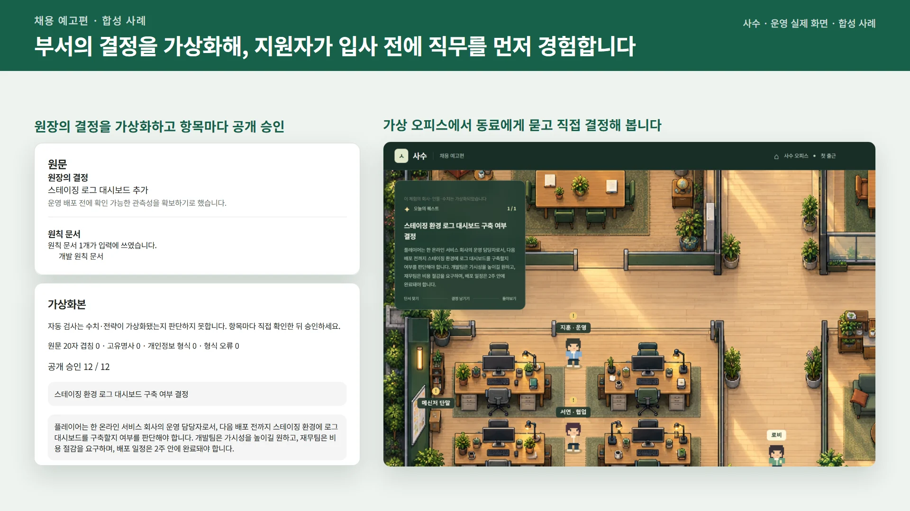

# 사수 · SASU

> 회의가 끝나면 회의록보다 결정 요청이 먼저 도착합니다.

사수는 슬랙과 온라인 회의를 관찰해 **지금 결정해야 할 안건**을 찾아 담당자에게 보내고,
내려진 결정을 근거와 함께 원장에 남기는 부서별 의사결정 AI입니다. 같은 질문에도 질문자의
권한과 부서 문맥에 맞는 근거만 사용해 답합니다.



## 문제

회의록은 남아도 실제 결정은 미뤄지고, 나중에는 “누가·언제·왜 그렇게 결정했는지”를 찾기
어렵습니다. 사수는 문서를 요약하는 데서 끝나지 않고 결정이 필요한 순간부터 실행합니다.

1. 슬랙 대화·회의 전사·부서 원칙 문서를 수집합니다.
2. 보류·미결·충돌 신호에서 결정 필요 안건을 추출합니다.
3. 담당자에게 마감·배경·과거 결정 인용이 담긴 카드를 보냅니다.
4. 카드에서 내린 결정을 append-only 결정 원장에 기록합니다.
5. 이후 질문에는 질문자가 볼 수 있는 근거만 인용해 답합니다.

## 핵심 기능

| 기능 | 설명 |
|---|---|
| 결정 카드 | 결정이 필요한 안건을 찾아 배경·원문 인용·추천 방향을 담아 담당자에게 보냄 |
| Slack DM | 담당자에게 DM으로 카드를 보내고 [결정]·[보류]·[반려] 버튼 제공 — [결정]은 사유를 받아 원장에 기록 |
| 회의 전사 | Zoom·Meet 전사 파일(.vtt/.txt)을 올려 안건을 정리 (회의 봇은 로드맵) |
| 결정 원장 | 누가·언제·왜·어떤 근거로 결정했는지 append-only 기록 |
| 권한 인지 Q&A | 질문자가 볼 수 있는 기록만 인용해 답변 (웹은 질문자 권한, 슬랙 채널 `@사수`는 팀원 권한) |
| 과거 결정 충돌 | 새 안건이 기존 원칙·결정과 충돌하면 카드에서 먼저 알림 |
| 문서 가져오기 | TXT·MD·CSV·JSON·PDF·DOCX 업로드와 근거 기반 요약 |
| 조직 관리자 | 부서·첫 부서장 초대·수집 채널·기록 조회 (관리자 권한만으로는 부서 내용을 볼 수 없음) |
| 채용 예고편 | 원장의 결정을 가상화한 업무 체험을 공개 링크로 발행 (합성 사례·합성 지원자로만 시연, 실제 지원자 채점은 꺼져 있음) |
| 게스트 모드 | 로그인과 외부 연동 없이 합성 데이터로 전체 흐름 체험 |





## 설계 원칙

- **인용 없는 문장은 렌더하지 않습니다.**
- **권한 판정은 SQL `can_see()` 하나로 집행합니다.**
- 사용자 요청 경로에서 service role로 RLS를 우회하지 않습니다.
- 결정은 수정·삭제 대신 `supersedes_id`로 정정하는 append-only 모델입니다.
- 미동의 구성원의 발언은 저장하지 않습니다.
- 게스트 모드는 LLM 호출과 DB 쓰기 없이 사전 계산 데이터만 사용합니다.

## 기술 스택

Next.js App Router · React · TypeScript · Supabase(Postgres, pgvector, RLS, Auth) ·
Slack Events API · Block Kit · Groq · Zod · Vitest · Playwright · Vercel

## AI를 활용한 개발

Claude로 PRD·아키텍처·완료 기준을 구체화하고, Codex가 명세에 따라 구현하는 SDD 절차를 사용합니다. 규칙 문서와 스킬이 작업 기준을 제공하고, 하네스가 맥락 전달·구현·검증·오류 수정을 이어갑니다. 훅과 Vitest·Playwright로 빌드와 기능·사용 흐름을 확인합니다.

Graft의 코드 의존 관계 탐색과 Archify의 구조·실행 흐름 시각화를 개발 절차에 추가했습니다. 단계별 역할과 결과 기록 방식은 [AI 개발 절차](docs/AI-DEVELOPMENT.md)에 정리했습니다.

## 로컬 실행

```bash
npm install
cp .env.example .env.local
npm run dev
```

검증:

```bash
npm run lint
npm run build
npm run test
npm run test:rls
npm run e2e
```

게스트 합성 데이터:

```bash
npx tsx scripts/seed-demo.ts
```

## 문서

구현의 최상위 입력은 [`docs/PRD.md`](docs/PRD.md)입니다.

| 문서 | 용도 |
|---|---|
| [AGENTS.md](AGENTS.md) / [CLAUDE.md](CLAUDE.md) | 보안·인용·개발 규칙 |
| [PRD](docs/PRD.md) | 범위, 완료 조건, 스키마, 화면, 일정 |
| [ARCHITECTURE](docs/ARCHITECTURE.md) | 구조, 데이터 흐름, 불변식 |
| [AI 개발 절차](docs/AI-DEVELOPMENT.md) | SDD·Graft·Archify·하네스·훅·검증과 최종 기능의 연결 |
| [ADR](docs/ADR.md) | 기술 결정과 포기한 대안 |
| [설정 가이드](docs/setup-guide.md) | 계정·환경 변수·외부 서비스 설정 |
| [제출 체크리스트](docs/submission-checklist.md) | 데모·스크린샷·영상·제출 항목 |

원티드 AI Championship 2026 제출용 MVP로 제작되었습니다.
