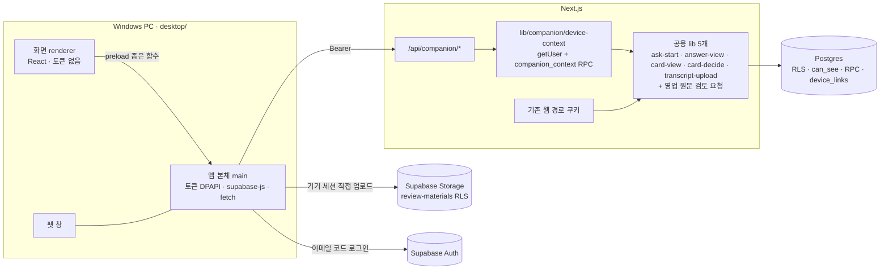

# desktop-companion Design

원천: [PRD §3-8 DC-01~12·§4·§8-1·§11](../../PRD.md) → [ARCHITECTURE §6-11 불변식 45~49·§8](../../ARCHITECTURE.md) → [ADR-081](../../ADR.md), [plan](../../01-plan/features/desktop-companion.plan.md). 제품 결정은 원천 문서에만 있다. 이 문서는 구현 계약과 §11 analyze 대조 목록이다.

## Context Anchor

| WHY | WHO | RISK | SUCCESS | SCOPE |
|---|---|---|---|---|
| 브라우저·슬랙 없이 묻기·결정·일 맡기기 | 부서원 전체(결정·회의 기록·영업 원문 검토는 기존 권한대로) | 새 인증 경로로 권한 누수·해제 지연, 로컬 원문 잔존, 서명 없는 설치 | 웹과 같은 답 · 알림 1분 · 펫에서 결정 · 설치·로그인 5분/해제 즉시 | Windows Electron 앱 + `/api/companion/*` + `device_links` + 공용 lib 5개 + 웹 연결 기기 화면 |

## 1. Overview

### 1.1 Design Goals
- 권한 판정은 웹과 같은 곳(SQL `can_see()`·RLS·RPC, 공용 lib)에서만 한다. 앱용 판정을 새로 쓰지 않는다.
- 토큰은 앱 본체(main process)만 갖는다. 화면(renderer)은 토큰·Node·네트워크에 직접 닿지 않는다.
- 기존 웹 경로의 동작·응답은 바뀌지 않는다. 바뀌는 것은 코드 위치(공용 lib 추출)뿐이며 회귀 테스트로 증명한다.

### 1.2 확인한 사실 (2026-10-01, origin/main `43334bc`)
| 사실 | 근거 | 설계 영향 |
|---|---|---|
| `requireMembership`은 쿠키 클라이언트를 만들고 실패 시 `redirect()` | `lib/supabase/membership.ts:26-61` | 앱 전용 `requireDeviceContext` 필요 |
| 핵심 RPC가 `auth.uid()`로 판정 | `ask_question`(0032)·`decide_request`(0017)·`create_review`/`queue_review_part`(0034)·`request_sales_review`(0066) | Bearer 클라이언트로 그대로 동작 |
| 처리 코드가 웹 경로·페이지 안에 직접 있음 | `answers/[id]/route.ts`(161줄)·`cards/[id]/decide`(226줄)·`meetings/transcript`(99줄)·`ask`(80줄)·카드 페이지 근거 조회 | 설계안 C: 5곳을 공용 lib로 추출 |
| "내 담당 미결정 카드" 목록 API 없음 | `decision_requests.assignee_id`·`status` | 새 조회 |
| `meetings`에 올린 사람 열 없음 | `0001:51` | 회의 기록은 진행 표시 제외 |
| 자료 검토함은 브라우저가 Storage에 직접 업로드 | `components/reviewed-materials.tsx:124-158`, `lib/adapters/review-audio` | 앱 본체가 같은 3단계 수행 |
| 운영 메일 기본 발송기 2통 뒤 429 | `docs/verification/daily-healthcheck.md:17` | 운영 반영 전제(SMTP) |
| `auth.sessions`·`session_id`를 다루는 마이그레이션 없음 | `supabase/migrations/*` | step 0 권한 실측 게이트 |
| 이 PC에 Rust·MSVC 없음, Node 24.18 | 2026-10-01 실측 | Electron |
| 본 저장소 private | `gh repo view` | 배포 전용 공개 저장소 |
| 루트 `tsconfig`·`eslint`가 `desktop/`까지 검사, vitest는 `tests/**`만 | `tsconfig.json`·`eslint.config.mjs`·`vitest.config.ts` | step 0에서 제외 설정 |

## 2. Architecture Options

| 안 | 방식 | 복잡도·위험 | 선택 |
|---|---|---|---|
| A 최소 변경 | 웹 경로가 Bearer도 받게 `createServerSupabaseClient` 분기 | 낮음·모든 웹 경로 공격면 확대, 불변식 47 위반 | 제외 |
| B 깔끔한 분리 | 웹 경로 7개 본문 전부 `lib/actions/*`로 이동 | 높음·회귀 범위 큼 | 제외 |
| **C 실용 균형** | 권한·인용·작업 실행 코드 5곳만 공용 lib로 추출, 입력 검사·응답 변환은 경로별 | 중간·웹은 추출 지점만 변경 | **선택(2026-10-01)** |



### 2.3 Dependencies
- 서버: 기존 `@supabase/supabase-js`·`zod`만. 새 패키지 없음.
- 앱(`desktop/package.json`, 루트와 분리): `electron`, `electron-vite`, `electron-builder`, `electron-updater`, `react`, `react-dom`, `@supabase/supabase-js`, `zod`, `vitest`, `typescript`. 루트 `lib/contracts.ts`·`lib/adapters/review-audio.ts`는 Vite 별칭 `@sasu/*`로 가져온다(브라우저 안전 순수 모듈만).

## 3. Data Model

### 3.1 `supabase/migrations/0069_device_links.sql`

```sql
create table public.device_links (
  id uuid primary key default gen_random_uuid(),
  user_id uuid not null references auth.users on delete cascade,
  dept_id uuid not null references public.departments on delete cascade,
  auth_session_id uuid not null,
  device_name text not null check (char_length(device_name) between 1 and 60),
  app_version text not null check (char_length(app_version) between 1 and 20),
  created_at timestamptz not null default now(),
  last_seen_at timestamptz not null default now(),
  revoked_at timestamptz,
  revoked_reason text check (revoked_reason in ('user','membership','relink','signout')),
  check ((revoked_at is null) = (revoked_reason is null))
);
create unique index device_links_one_active_session on public.device_links (auth_session_id) where revoked_at is null;
create index device_links_user_active on public.device_links (user_id) where revoked_at is null;
alter table public.device_links enable row level security;
create policy device_links_own_read on public.device_links for select to authenticated using (user_id = auth.uid());
revoke all on public.device_links from public, anon, authenticated;
grant select on public.device_links to authenticated;
grant all on public.device_links to service_role;
```

### 3.2 RPC (모두 `security definer set search_path = public, pg_temp`, `revoke all … from public, anon, authenticated, service_role; grant execute … to authenticated`)

| 함수 | 판정·동작 | 반환 |
|---|---|---|
| `private.current_session_id()` | `nullif(auth.jwt()->>'session_id','')::uuid`. 없으면 null | uuid |
| `link_device(p_dept uuid, p_device_name text, p_app_version text)` | `auth.uid()`·세션 ID 필수 → 그 부서 멤버이고 `consented_at is not null` → 부서의 `orgs.is_demo=false`, 데모 계정 아님 → 본인 활성 연결 5개 미만 → 같은 세션의 기존 활성 행은 `relink`로 해제 → insert | `device_links.id` |
| `companion_context()` | 현재 세션 ID의 활성 행 + 현재 멤버십 조인. 멤버십이 없으면 그 행을 `membership`으로 해제하고 0행. `last_seen_at`이 5분보다 오래되었으면 갱신 | `link_id, dept_id, dept_name, role, display_name, consented_at` 0~1행 |
| `revoke_device_link(p_link uuid)` | `user_id = auth.uid()`인 활성 행만 → `revoked_at=now()`, 사유 `user`(본인 기기에서 부르면 `signout`) → `delete from auth.sessions where id = auth_session_id and user_id = auth.uid()` 같은 트랜잭션 | boolean |

예외 코드: 미멤버·미동의 `42501`, 데모 `42501`(메시지로 구분하지 않음), 연결 한도 `P0001 device_link_limit`, 세션 ID 없음 `22023`.

### 3.3 보안 하니스
- `scripts/verify-security-sql.mjs`: PGlite에 `auth.sessions(id uuid, user_id uuid)` 스텁과 `auth.jwt()`의 `session_id` 스텁 추가. 쓰기 매트릭스에 `device_links`(authenticated 쓰기 없음), `authenticatedFunctions`에 위 3개 공개 함수, `privateFunctions`에 `current_session_id` 등록.
- `scripts/verify-device-links-sql.mjs`(새로): 본인만 읽기 · 다른 사용자 행 0건 · 미동의/비멤버/데모 연결 거부 · 6번째 연결 거부 · 재연결 시 이전 행 `relink` · 멤버십 삭제 후 `companion_context` 0행+해제 · 해제 시 `auth.sessions` 행 삭제 · 다른 사람 연결 해제 false.

## 4. API Specification

공통: `Authorization: Bearer <access token>` 필수. 응답 헤더 `Cache-Control: private, no-store`. 쿠키를 읽지 않는다. 오류 본문 `{error: string, code: string}`(§6). 로그는 경로·상태·길이·코드만.

| # | Method · Path | 입력 | 처리(재사용) | 성공 |
|---|---|---|---|---|
| E01 | `GET /api/companion/departments` | — | `requireBearerUser` → 세션 클라이언트로 `members`+`departments` 본인 행(RLS) | 200 `{departments:[{id,name,role,consented}]}` |
| E02 | `POST /api/companion/link` | `{dept_id, device_name, app_version}` | `requireBearerUser` → RPC `link_device` | 201 `{link_id, dept:{id,name}, role}` |
| E03 | `GET /api/companion/link` | — | `requireDeviceContext` | 200 `{link_id, dept, role, display_name}` |
| E04 | `DELETE /api/companion/link` | — | `requireDeviceContext` → `revoke_device_link(ctx.linkId)` | 204 |
| E05 | `GET /api/companion/inbox` | — | 세션 클라이언트로 본인 `answers`(24시간)·내 담당 `decision_requests`(open, lead면 needs_review 포함)·본인 `reviewed_materials`(lead)·본인 영업 원문 검토 작업 → `lib/companion/inbox.ts`로 정규화 | 200 `{server_time, cards[], answers[], reviews[], sales[]}` |
| E06 | `POST /api/companion/ask` | `AskQuestionInput` | `lib/ask-start.ts` `startAsk` | 202 `{answer_id, job_id, truncated}` |
| E07 | `GET /api/companion/answers/[id]` | — | `lib/answer-view.ts` `readAnswerView` | 200(웹과 같은 본문) |
| E08 | `GET /api/companion/questions` | `?before&before_id` | RPC `my_question_history` | 200 `{questions, next}` |
| E09 | `GET /api/companion/cards/[id]` | — | `lib/card-view.ts` `loadCardView`(근거 포함·인용 포함 검증) | 200 |
| E10 | `POST /api/companion/cards/[id]/decide` | 웹과 같은 결정 본문 | `lib/card-decide.ts` `decideCard` | 웹과 같은 상태·본문 |
| E11 | `POST /api/companion/transcripts` | FormData(≤4MB) | `lib/transcript-upload.ts` `ingestTranscript` | 202 |
| E12 | `POST /api/companion/reviews` | `ReviewCreate` | RPC `create_review`(웹 경로와 같은 호출) | 201 `{id}` |
| E13 | `POST /api/companion/reviews/[id]/parts` | `{index}` | RPC `queue_review_part` + `kickWorker` | 202 |
| E14 | `GET /api/companion/sales-review/sources` | — | lead·동의·비데모 확인 → 웹과 같은 조회 + `salesReviewSourceCandidates` | 200 `{candidates}` |
| E15 | `POST /api/companion/sales-review` | `SalesSourceReviewRequest` | phase 41 웹 경로에서 추출한 공용 함수 `startSalesSourceReview` | 202 `{task_id}` |
| E16 | `GET /api/companion/sales-review/[taskId]` | — | 본인 작업 상태만(결과 본문은 웹에서) | 200 `{status, web_path}` |

웹 쪽 변경:
| # | 대상 | 변경 |
|---|---|---|
| W01 | `app/api/d/[dept]/ask/route.ts` | 본문을 `startAsk` 호출로 교체 |
| W02 | `app/api/d/[dept]/answers/[id]/route.ts` | `readAnswerView` 호출로 교체 |
| W03 | `app/(auth)/d/[dept]/cards/[id]/page.tsx` | 근거 조회를 `loadCardView`로 교체 |
| W04 | `app/api/cards/[id]/decide/route.ts` | `decideCard` 호출로 교체 |
| W05 | `app/api/d/[dept]/meetings/transcript/route.ts` | `ingestTranscript` 호출로 교체 |
| W06 | `app/api/d/[dept]/sales-review/ai/route.ts`(phase 41) | `startSalesSourceReview` 호출로 교체 |
| W07 | `app/api/devices/route.ts`(GET)·`app/api/devices/[id]/route.ts`(DELETE) | 쿠키 세션으로 본인 연결 목록·해제(`revoke_device_link`). `proxy.ts` 매처에 `/api/devices` 추가 |
| W08 | `components/settings-devices.tsx` + `components/settings-s5.tsx` | 멤버 탭의 "내 수집 동의" 다음에 "연결된 기기" 패널, 앱 받기 링크 |

### 4.1 공용 lib 계약 (모두 TDD, 클라이언트 주입)
```ts
// lib/companion/context.ts — 두 컨텍스트 모양을 하나로
type ActorContext = { client: SupabaseClient; userId: string; deptId: string; role: "lead"|"member"; consentedAt: string|null };
type Result<T> = { ok: true; status: number; body: T } | { ok: false; status: number; error: string; code: string };

startAsk(ctx, input: AskQuestionInput): Promise<Result<{answer_id; job_id; truncated}>>      // mask → 1000자 → ask_question → 핸들러 등록 → kickWorker
readAnswerView(ctx, answerId): Promise<Result<AnswerView>>                                  // 웹 경로 :63-152 그대로 이동
loadCardView(ctx, cardId): Promise<Result<CardView>>                                        // 카드 페이지 근거·충돌·인용 포함 검증 이동
decideCard(ctx, cardId, body): Promise<Result<DecideResponse>>                              // canAct·중복·RPC·오류 매핑 이동. 카드 부서 ≠ ctx.deptId면 404
ingestTranscript(ctx, file: File, meta): Promise<Result<{job_ids}>>                         // lead·데모·동의 화자만·수집 어댑터 insert
startSalesSourceReview(ctx, input: SalesSourceReviewRequest): Promise<Result<{task_id}>>    // phase 41 병합 뒤 추출
```
웹은 `requireMembership()` 결과로, 앱은 `requireDeviceContext()` 결과로 `ActorContext`를 만든다. `lib/companion/device-context.ts`는 `getUser()` → `companion_context` 호출만 하고 판정은 SQL에 맡긴다.

## 5. UI/UX Design

### 5.1 창
| 창 | 크기·속성 | 내용 |
|---|---|---|
| 펫 창 | 128×128, 투명·프레임 없음·항상 위(`floating`)·작업표시줄 숨김·크기 고정 | 캔버스 캐릭터(채용 예고편 `drawPerson()` 이식, 3색 프리셋) + 상태 표시. 클릭 → 패널 열기/닫기, 끌기 → 이동(위치 저장) |
| 패널 창 | 380×560, 프레임 없음, 펫 옆에 열림, 포커스 잃으면 닫힘(고정 핀 가능) | 탭 5개 |
| 트레이 | 아이콘·메뉴 | 열기 · 펫 숨기기/보이기 · 연결 해제 · 종료 |

### 5.2 펫 상태(앱 계산, 우선순위 순)
| 상태 | 조건 | 모양 |
|---|---|---|
| 확인 필요 | 내 담당 open 카드(lead는 needs_review 포함) 중 로컬에서 안 본 것 | 머리 위 "!" 말풍선 |
| 실패 | 최근 24시간 내 내 답 `failed`·검토 `failed`·영업 `failed` 중 안 본 것 | 회색 + "×" |
| 완료 | 안 본 `done`/`refused` 답, `ready` 검토·영업 | "✓" 말풍선 |
| 진행 중 | `pending` 답·`processing` 검토·`queued/processing` 영업, 보관 중 질문 | 걷는 동작(동작 줄이기 설정이면 정지 + 점 3개) |
| 쉬는 중 | 위 없음 | 기본 |

### 5.3 패널 탭
| 탭 | 내용 |
|---|---|
| 질문 | 입력창(5~1000자) · 보내기 · 답 표시(인용 목록: 따옴표 문장 + 출처 이름, "웹에서 원문 보기") · 거절 안내 · 하루 한도 안내 |
| 결정함 | 내 카드 목록(제목·마감) → 카드 화면(배경·추천·근거·충돌) → 결정/보류/반려(+결과·이유 입력) |
| 기록 | 내 지난 질문 20개씩, 누르면 답 다시 보기 |
| 일 맡기기 | 끌어다 놓기 영역: `.vtt/.txt` → 회의 기록(lead만 보임), 문서·음성 → 자료 검토함(lead만, 공개 범위·참여자·동의 확인). lead: "영업 원문 검토" — 원문 4건 고르기(역할별 목록) → 요청 → 진행 표시 → "웹에서 결과 보기" |
| 설정 | 펫 모양 3종 · 단축키 안내(`Ctrl+Alt+S`) · 연결 정보(부서·기기 이름) · 로그아웃(연결 해제) · 버전·업데이트 상태 |

처음 실행: 이메일 → 6자리 코드 → 부서 선택(동의 안 한 부서는 "웹에서 먼저 동의해 주세요" + 링크) → 펫 등장. 모든 문구는 `docs/wording-guide.md` 기준(W1~W7)을 따르고 `check:wording` 대상에 `desktop/src/renderer/**/*.tsx`를 넣는다.

### 5.4 UI 대조 목록
U01 펫 창 속성 · U02 상태 5종 모양·우선순위 · U03 동작 줄이기 · U04 끌기 이동·위치 저장 · U05 패널 탭 5개 · U06 로그인·부서 선택·미동의 안내 · U07 답 인용 표시·거절 · U08 결정 화면 근거·충돌 · U09 일 맡기기 lead 전용 표시 · U10 영업 원문 4건 선택 · U11 설정 펫 모양·로그아웃 · U12 트레이 메뉴 · U13 웹 "연결된 기기" 패널 · U14 Windows 알림(내용 없이 종류·건수)

## 6. Error Handling

| HTTP | code | 언제 | 앱 동작 |
|---|---|---|---|
| 401 | `no_token`·`session_invalid`·`device_revoked` | 토큰 없음/만료 복구 실패/`session_not_found`/연결 없음 | 토큰 삭제 → 로그인 화면 |
| 403 | `forbidden`·`consent_required`·`lead_only`·`demo` | RLS·RPC `42501`, 미동의, lead 전용 | 문장 안내, 펫 상태 변경 없음 |
| 404 | `not_found` | 다른 부서·안 보이는 대상 | "찾을 수 없어요" |
| 409 | `already_decided` 등 | 웹과 같은 매핑 | 목록 새로 고침 |
| 413 | `too_large` | 회의 기록 4MB 초과 | 자료 검토함 안내 |
| 422/400 | `invalid_input` | Zod 실패 | 입력 칸 안내 |
| 429 | `ask_daily_limit`·`device_link_limit`·`sales_daily_limit` | 한도 | 끊김 보관 안 함, 안내 |
| 5xx·네트워크 | — | 서버·연결 오류 | 질문만 끊김 보관, 상태 확인 백오프 30→60→120→300초 |

## 7. Security Considerations

| ID | 위협 | 대응 | 검증 |
|---|---|---|---|
| S1 | 웹 경로로 Bearer 우회 | Bearer 처리는 `lib/companion/device-context.ts`에만, `app/api/companion/**` 외 import 금지(ESLint `no-restricted-imports`) | 린트 + 기존 웹 경로에 Bearer만 보내면 401/리다이렉트 |
| S2 | 해제 후 계속 사용 | `companion_context` 매 요청 + `revoke_device_link`가 `auth.sessions` 삭제. **step 0 게이트 G1**: 로컬과 운영에서 `has_table_privilege('postgres','auth.sessions','DELETE')`와 함수 소유자 확인(읽기 전용 조회). 거부되면 구현을 멈추고 대안(서버가 해제된 연결의 다음 요청에서 admin `signOut(jwt,'local')`)을 사용자에게 올린다 | 하니스 + 실측 401 |
| S3 | 다른 부서·다른 사람 데이터 | 부서는 `device_links`에서만, 대상 조회는 RLS + 공용 lib의 부서 일치 검사 | E2E·하니스 교차 부서 403/404 |
| S4 | 토큰 탈취 | `safeStorage`(DPAPI, Windows 사용자 계정 단위)로만 저장, 화면에 전달 안 함, 로그 마스킹. 같은 계정 악성코드는 막지 못함을 명시 | 로컬 파일 평문 검사 |
| S5 | 화면 스크립트 주입 | `contextIsolation`·`sandbox`·`nodeIntegration:false`, CSP `default-src 'self'; connect-src 'none'; img-src 'self' data:`, `dangerouslySetInnerHTML` 금지, 외부 이동 차단·`setWindowOpenHandler` deny, 외부 링크는 앱 출처 https만 `shell.openExternal` | 정적 검사 + 실행 확인 |
| S6 | 로컬 원문 잔존 | 끊김 보관만 암호화 파일(20건·24시간), 보낸 뒤 삭제, 로그는 ID·길이·코드 | 파일·로그 grep |
| S7 | 알림으로 내용 노출 | Windows 알림은 "답이 도착했어요"·"결정할 카드 N건"만 | 실행 확인 |
| S8 | 악성 업데이트 | 배포 전용 공개 저장소 HTTPS + `latest.yml` SHA-512, 게시는 로컬 토큰·2FA. 코드 서명 없음은 PRD §8-1 제외 항목 | 업데이트 1회 실측 |
| S9 | 가입 우회·남용 | `shouldCreateUser:false`, Supabase OTP 한도, 연결 5개 한도 | 미가입 이메일 실패 확인 |
| S10 | 데모 | `link_device`가 데모 부서·계정 거부, 데모 계정 쓰기 트리거 유지 | 하니스 |

## 8. Test Plan

| 층 | 대상 | 방법 |
|---|---|---|
| L0 단위(TDD) | `lib/companion/{device-context,inbox,context}.ts`, `lib/{ask-start,answer-view,card-view,card-decide,transcript-upload}.ts`, `desktop/src/main/core/{pet-state,poller,outbox}.ts`, `desktop/src/shared/contracts.ts` | Vitest, Supabase·fetch mock. 공용 lib는 웹 경로의 기존 테스트를 옮겨 그대로 통과 |
| L1 SQL | §3.3 하니스 | PGlite `npm run verify:security`·`verify-device-links-sql.mjs` |
| L1 API | E01~E16 | 로컬 Supabase에서 실제 Bearer로: 토큰 없음 401, 해제 뒤 401, 교차 부서 404, member의 lead 전용 403, 웹과 같은 질문의 인용 가시성 동일 |
| L2 회귀 | W01~W06 | 기존 Vitest·E2E(묻기·결정·전사·영업) 무변경 통과 |
| L3 앱 | Playwright `_electron` | 로그인(로컬 Mailpit 코드) → 부서 → 질문 → 답 인용 → 카드 결정 → 연타 1건 → 웹 해제 → 로그인 화면 |
| L4 실측 | PRD §11 행 | 새 카드→알림 1분(시각), 깨끗한 Windows 사용자 계정에서 설치→첫 답 5분(화면 녹화), 업데이트 1회, 로컬·로그 원문 0건 |

시드: 로컬 QA 조직에 lead 1·member 1(동의), 다른 부서 1, 데모 부서 1, `leads_only` 소스 1, 담당 카드 2.

## 9. Clean Architecture

| 층 | 위치 | 규칙 |
|---|---|---|
| 판정 | SQL(`can_see`·RLS·RPC) | 유일한 권한 판정 |
| 공용 업무 | `lib/*.ts`, `lib/companion/*` | 클라이언트 주입, `next/*` import 금지(redirect·cookies 없음) |
| 서버 배선 | `app/api/companion/**`, 웹 경로 | 인증 컨텍스트 만들기·Zod·응답 변환만 |
| 앱 본체 | `desktop/src/main` | 토큰·네트워크·OS. `core/`는 순수 |
| 앱 화면 | `desktop/src/renderer` | IPC로만 요청, 토큰·네트워크 없음 |

## 10. Coding Convention Reference
- 파일·함수 이름은 기존 lib 규칙(kebab-case 파일, camelCase 함수). 계약은 `lib/contracts.ts`에 `Companion*` 접두사로 추가하고 앱은 별칭으로 같은 스키마를 쓴다.
- 핵심 파일 머리에 `// Design Ref: desktop-companion §n — 이유` 주석.
- 루트 설정: `tsconfig.json` `exclude`에 `desktop`, `eslint.config.mjs` ignores에 `desktop/**`, `scripts/check-wording.mjs`에 `desktop/src/renderer/**/*.tsx`, `scripts/hooks/tdd-guard.sh`에 ARCHITECTURE §8의 desktop 비대상 경로. 앱 검사는 `npm --prefix desktop run {lint,test,build}`.
- 환경 변수: 서버는 새 변수 없음. 앱은 빌드 시 `SASU_APP_URL`·`NEXT_PUBLIC_SUPABASE_URL`·`NEXT_PUBLIC_SUPABASE_ANON_KEY`(공개값)만 넣는다. 게시 토큰은 로컬 환경 변수로만, 리포에 두지 않는다.

## 11. Implementation Guide

### 11.1 File Structure
```
lib/companion/{context,device-context,inbox}.ts      lib/{ask-start,answer-view,card-view,card-decide,transcript-upload}.ts
lib/supabase/bearer.ts                              lib/sales-source-review-start.ts (phase 41 뒤)
app/api/companion/{departments,link,inbox,ask,questions,transcripts,reviews,sales-review}/…  app/api/devices/…
supabase/migrations/0069_device_links.sql           scripts/verify-device-links-sql.mjs
components/settings-devices.tsx
desktop/{package.json,electron.vite.config.ts,electron-builder.yml,vitest.config.ts,tsconfig.json}
desktop/src/main/{index,ipc,tray,shortcut,notify,updater}.ts  desktop/src/main/{windows,auth,api}/…  desktop/src/main/core/{pet-state,poller,outbox}.ts
desktop/src/preload/index.ts                        desktop/src/renderer/{App.tsx,components/…,pet/…}
desktop/src/shared/contracts.ts
```

### 11.2 비교 목록 (`/pdca analyze` 대조)
| # | 항목 | 종류 |
|---|---|---|
| 1 | `0069_device_links.sql` 표·인덱스·RLS·RPC 3개+private 1개·권한 | 테이블·함수 |
| 2 | 하니스 등록 + `verify-device-links-sql.mjs` 8개 사례 | 검증 |
| 3 | `lib/supabase/bearer.ts`·`lib/companion/{context,device-context,inbox}.ts` | 모듈 |
| 4 | 공용 lib 5개 + 웹 W01~W05 교체, 기존 테스트 통과 | 모듈·회귀 |
| 5 | E01~E13 | 엔드포인트 |
| 6 | E14~E16 + W06 (phase 41 병합 뒤) | 엔드포인트 |
| 7 | W07·W08 웹 연결 기기 | 엔드포인트·화면 |
| 8 | 루트 설정 4곳(tsconfig·eslint·check-wording·tdd-guard) | 설정 |
| 9 | 앱 본체: 토큰 저장·로그인·연결·API·IPC·창·트레이·단축키·알림 | 모듈 |
| 10 | 앱 core 3개 TDD | 모듈 |
| 11 | 화면 U01~U14 | 화면 |
| 12 | 업데이트·설치 파일 설정(게시 없음) | 설정 |
| 13 | §8 L1~L4 실행 기록 `docs/verification/desktop-companion-YYYY-MM-DD.md` | 검증 |

### 11.3 Session Guide

#### Module Map
| 모듈 | 비교 목록 | 의존 |
|---|---|---|
| module-0 사전 확인·설정 | 8 + 게이트 G1(`auth.sessions` 삭제 권한)·G2(로컬 OTP 코드 로그인) | — |
| module-1 DB | 1·2 | 0 |
| module-2 서버 인증 | 3 + E01~E04 + 7 | 1 |
| module-3 공용 lib 추출 | 4 | 0 |
| module-4 앱용 서버 경로 | 5 | 2·3 |
| module-5 영업 원문 검토 | 6 | 4 + phase 41 main 병합 |
| module-6 앱 뼈대 | 9·10 | 4 |
| module-7 앱 화면 | 11 | 6 |
| module-8 배포 설정·검증 | 12·13 | 7 (+5) |

#### Recommended Session Plan
phase 42 step 0~10으로 만들었다(2026-10-01): module-0→step 0 `setup-gates`, module-1→step 1 `device-links-schema`, module-2→step 2 `companion-auth`·step 3 `web-devices`, module-3→step 4 `shared-ask-answer`·step 5 `shared-card-transcript`, module-4→step 6 `companion-routes`, module-5→step 7 `companion-sales-review`, module-6→step 8 `desktop-core`, module-7→step 9 `desktop-ui`, module-8→step 10 `desktop-release-verify`. 배정 기록은 `.claude/plans/desktop-companion-2026-10-01.{plan.json,md}`. 모델 배정은 `D:\바이브코딩\CLAUDE.md` 플랜 파이프라인(4축 점수 → 게이트 G1~G5 → plan.json)으로 정한다. 보안·인증 하드 오버라이드라 module-1·2와 최종 리뷰는 powerful, 운영 반영(마이그레이션·메일 템플릿·SMTP·배포 저장소)은 D3=2로 `requires_approval: true`다. Graft·Archify는 이 설계 세션에서 쓰지 않았다 — step 0에서 Bearer 입구와 공용 lib 의존을 Graft로 확인하고, 연결·해제 흐름을 Archify로 그려 검증 기록에 남긴다(없으면 누락 범위를 적는다).

## Version History

| 버전 | 날짜 | 내용 |
|---|---|---|
| 1.0 | 2026-10-01 | 설계안 C·이메일 6자리 코드·영업 원문 검토(AG-07)·배포 전용 공개 저장소 선택 반영 |
