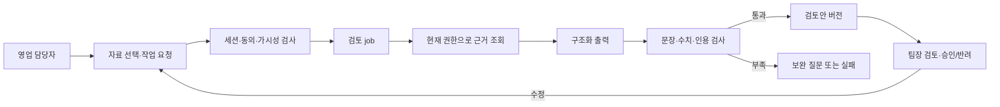

# sales-agent-design Design Document

> **원천**: [PRD AG-01·§8·§10 #28](../../PRD.md) → [ARCHITECTURE 불변식](../../ARCHITECTURE.md) → [ADR-074](../../ADR.md). [Plan](../../01-plan/features/sales-agent-design.plan.md)은 매핑용이다. 이 문서는 **phase 35 설계 산출물**이며 구현·시드·배포를 뜻하지 않는다.

## Context Anchor

| Key | Value |
|---|---|
| WHY | 고객 요청·견적·영업 원칙 사이의 차이를 근거와 함께 확인해야 한다. |
| WHO | 영업 담당자와 승인자인 영업팀장 |
| RISK | 초안 견적 또는 고객 희망을 승인된 조건으로 오인하거나, 볼 수 없는 정책을 누설할 수 있다. |
| SUCCESS | 합성 사례에서 네 결과물의 모든 사실·판단이 인용 가능하고, 미확인 조건은 질문으로 남으며, 외부 행동은 일어나지 않는다. |
| SCOPE | 합성 사례 → 작업·승인 동선 설계 → 예외/권한 검증 → 구현 전 실자료 확인 목록 |

## 1. Overview

영업 담당자가 고객 요청, 기존 견적, 변경 견적 초안, 영업 원칙을 **직접 선택**하고 검토를 요청한다. 작업은 변경 비교표·원칙 충돌·확인 질문·회신 초안을 만든다. 팀장이 가격·계약 조건과 회신 내용을 검토한다. 이 첫 흐름에서 팀장 승인은 내부 검토 기록이며, 외부 발송이나 견적 변경을 실행하지 않는다. 합성 입력과 기대 결과는 [사례 문서](../../planning/영업_에이전트_합성_사례.md)를 따른다.

## 2. Architecture Options

| Option | 방법 | 장점 | 비용·위험 |
|---|---|---|---|
| A · ASK 재사용 | 기존 질문 답변에 자료 네 건을 넣어 한 번에 출력 | 새 저장 구조가 적음 | 작업 상태·버전·팀장 승인을 표현하기 어렵고 ASK 답변과 업무 초안이 섞임 |
| B · 범용 에이전트 플랫폼 | 역할·도구·승인·실행을 범용 그래프로 설계 | 다른 부서 확장이 쉬움 | 첫 실제 업무가 없는 상태에서 권한·외부 실행이 과도하게 넓어짐 |
| C · 영업 검토 작업 (선택) | 기존 근거·job·RLS를 사용하고, 요청별 검토안과 승인 버전만 별도 계약으로 둠 | 첫 사례의 오류와 승인 경계를 분리해 검증 가능 | 후속 구현 때 새 작업/버전 저장과 화면이 필요 |

사용자의 “데모 데이터 만들어서 알아서” 위임에 따라 C를 선택한다. 이는 설계 방향이며 실제 DB/라우트 추가는 후속 구현 step의 범위로 남긴다.

## 3. Data and Result Contract

### 3.1 입력

- 작업 유형은 `sales_quote_review` 하나다. 요청자는 부서 멤버십으로 결정하고, URL의 `[dept]`는 멤버십 확인 뒤에만 쓴다. 요청 본문의 `dept_id`·`requested_by`·`approved_by`는 신뢰하지 않는다.
- 선택 자료는 고객 요청, 기존 견적, 변경 견적 **사업상 초안**, 영업 원칙이다. S3의 텍스트 추출/검토는 자료 검토함에서 확정돼야 근거로 쓸 수 있지만, 견적의 **사업상 승인 상태는 계속 초안**으로 표시한다. 네 자료가 모두 있어야 한다고 가정하지 않고 빠진 자료를 질문으로 돌린다.
- 작업 지시 예: “선택한 고객 요청·기존/변경 견적·영업 원칙을 비교해 팀장 검토안을 작성해 줘. 확인되지 않은 가격·일정은 약속하지 말고, 고객 회신은 초안만 만들어 줘.”
- 자료의 `source_id`·`item_id`와 현재 버전/해시를 고정해 결과가 무엇을 근거로 만들어졌는지 추적한다. 요청 본문과 인용 가능한 텍스트는 마스킹 후만 저장한다.

### 3.2 출력

결과는 `comparison[]`, `policy_flags[]`, `questions[]`, `reply_draft[]`, `missing_inputs[]`로 나뉜다. 각 행과 회신 문장은 `citations[]`와 `status`(`verified`·`needs_confirmation`)를 가진다. `citations.quote`는 선택된 현재 원문에 문자열로 포함돼야 한다. 사실·판단에 인용이 0개이면 렌더하지 않고 `needs_review`로 돌린다. 원문이 삭제되거나 현재 가시성이 사라지면 기존 저장 결과도 가린다.

비교표의 숫자는 원문 수치를 정규화한 뒤 **코드가** 차액을 계산한다. 두 입력값과 계산식을 함께 보이고, 단위·부가세·기간이 다르면 차액을 만들지 않는다. 정책 충돌은 “확인 필요”와 “승인 필요”를 구분한다. 고객 요청, 견적 초안, 확정 정책의 **출처와 상태**를 결과에서 계속 표시한다. 모델의 “승인됨”, “발송됨”, “일정 확정” 주장은 승인/외부 결과 기록 없이는 허용하지 않는다.

### 3.3 버전·승인

설계 후보는 작업 행 1개와 출력 버전·검토 행동의 append-only 기록이다. 팀장 승인은 특정 출력 버전과 자료 버전/해시에만 붙는다. 자료·지시·회신 문장·수신처·가격이 바뀌면 새 버전을 만들고 이전 승인을 재사용하지 않는다. 팀장 계정이 실제 `lead` 권한과 맞는지 후속 구현 전에 확인한다. 결과 visibility는 선택한 근거 중 가장 좁은 등급이고, 사용자의 현재 접근 권한은 표시·승인 때마다 `can_see()`로 다시 확인한다.

## 4. User Flow and States

1. 담당자가 자료를 고르고 지시문을 확인한다. 자료 하나가 보이지 않거나 아직 추출/전사 확정 전이면 사유와 수정 행동을 보여 준다. 보이지 않는 자료의 제목·건수는 공개하지 않는다.
2. 검증된 요청을 DB에 기록하고 job을 예약한 뒤 바로 응답한다. 화면은 `대기 → 검토 중 → 보완 필요/검토 준비/실패`를 표시하며 2분 sweep으로 영원한 진행 상태를 끝낸다.
3. 검토안은 출처별 인용 칩, 값의 이전/변경/고객 희망 구분, 확인 질문, 회신 **초안** 표시를 함께 보여 준다. 인용을 열 때도 현재 권한을 검사한다.
4. 팀장은 같은 버전의 근거와 초안을 보고 `승인`·`반려`·`수정 요청` 중 하나를 기록한다. 승인된 문구의 복사/수동 사용은 사람의 후속 행동이며, 이 설계에는 자동 발송 기능이 없다.
5. 취소는 미완료 job의 결과 공개를 막는다. 실패 원인은 `자료 부족`·`권한 변경`·`인용 불일치`·`처리 실패`처럼 조치 가능한 코드로 보여 준다. 재시도는 현재 자료/권한을 다시 검사하고 새 출력 버전을 만든다.

## 5. Security and Trust Boundaries

- 사용자 요청 경로는 세션 Supabase 클라이언트만 사용한다. 워커의 service role 조회는 작업 ID로 제한하고, 요청자/승인자의 현재 접근 여부를 `can_see()` 호출 SQL 경로에서 확인한다. 가시성 규칙을 TypeScript로 복제하지 않는다.
- 선택 소스 중 `leads_only`가 있으면 결과도 `leads_only`다. 권한이 줄거나 동의가 철회되면 저장 초안을 그대로 보여 주지 않는다. 게스트 경로는 쓰기·LLM·외부 호출 0건이다.
- 고객 메시지·견적·정책 문서 안의 지시문은 근거 데이터다. “승인 없이 보내라” 같은 문구가 시스템 지시나 권한을 바꾸지 않는다. 미동의 발언은 수집 단계에서 저장하지 않는다.
- LLM은 `llm.structured(purpose, schema, prompt)`만 사용한다. strict schema의 모든 필드는 required이며 nullable은 union으로 명시한다. 로그에는 ID·길이·오류 코드만 남긴다. 인용 원문 검증과 수치 계산은 모델 밖에서 수행한다.

## 6. Future Implementation Contract

이 목록은 `/pdca analyze` 대조와 후속 step 분할을 위한 **후보**다. phase 35에서 파일·마이그레이션을 생성하지 않는다.

| 구분 | 후보 | 경계 |
|---|---|---|
| 화면 | `/d/[dept]/agent/tasks` 목록·새 검토·상세·팀장 검토 | 기존 S8 `/roles`와 분리, 한국어 단일 |
| 요청/검토 API | 작업 생성·취소·재시도·팀장 검토 Route Handler | 세션·멤버십 확인, 승인 버전 고정 |
| 데이터 | 작업, 출력 버전, 검토 행동 기록 | RLS `can_see()` 호출, append-only 검토 기록 |
| job | `run_sales_quote_review` | row 먼저 기록, enqueue + `after(runOnce)`, 재시도·2분 sweep |
| 로직 | 근거 선택·구조화 스키마·인용/수치 검증 | 새 `lib/` 모듈은 테스트 먼저 작성 |
| 통합 | 자료 검토함 확정본·Notion 원칙·Slack 동의 수집본 | 소스 현재 버전과 권한을 재조회, 외부 발송 없음 |

## 7. Verification Matrix

| 사례 | 기대 판정 |
|---|---|
| S1~S4 모두 선택 | 네 결과물의 사실·정책 판단마다 원문 인용, 6,000,000원 증가만 코드 계산, 고객 희망과 초안 구분 |
| S2/S3 없음 | 차액·변경 조건을 만들지 않고 자료 요청 |
| S4 접근 불가 | 정책 내용을 드러내지 않고 확인 필요, 제외 건수 표시 없음 |
| 잘못된 quote 또는 인용 0개 | 해당 문장 차단, 검토 필요/실패 상태 |
| 고객 메시지의 승인 생략 지시 | 팀장 승인 경계 유지 |
| 승인 뒤 견적·회신 변경 | 새 버전과 재승인 필요 |
| 처리 중 멤버십/동의 철회 | 결과 공개·승인 중지 |
| 게스트 접근 | DB 쓰기 0, LLM 0, 외부 발송 0 |

## 11. Implementation Guide

### 11.1 Module Map

1. 현재 소스/RLS/자료 검토함 계약 조사 및 Graft 의존 관계 확인.
2. 작업·버전·검토 권한 SQL과 격리 RLS 테스트.
3. 구조화 결과 스키마, 원문 인용·수치 검증 TDD.
4. job/요청/팀장 검토 연결과 Archify 데이터 흐름 검토.
5. 한국어 화면·합성 게스트 체험·Playwright 및 실제 권한 검증.

### 11.3 Session Guide

phase 35는 위 구현을 실행하지 않는다. 실제 영업 담당자·팀장과 자료 범위·가격 원칙·초안 취급을 확인한 뒤, 별도의 구현 phase와 step에 1→5 순서로 나눈다. Graft·Archify 도구는 이 설계 세션에 제공되지 않았으므로 실행 결과로 주장하지 않는다. 현재 읽은 코드 위치는 `lib/agent-role.ts`, `lib/pipeline/agent-role.ts`, `docs/ARCHITECTURE.md`이며, 실제 호출 그래프는 구현 시작 전에 새로 확인한다.
