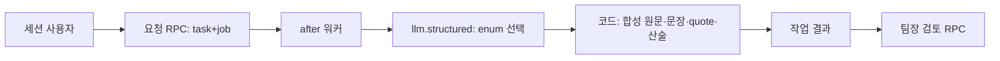

# sales-agent-review Design Document

> 원천: [PRD AG-02·§8](../../PRD.md) → [ARCHITECTURE](../../ARCHITECTURE.md) → [ADR-075](../../ADR.md), [plan](../../01-plan/features/sales-agent-review.plan.md). 구현 대조 목록은 §11이다.

## Context Anchor

| Key | Value |
|---|---|
| WHY | 합성 검토 동선을 제품에서 검증해야 한다. |
| WHO | 인증·동의한 비데모 부서 구성원과 팀장 |
| RISK | 요청 경로 service role, 인용 없는 문장, 팀장 승인 의미 오인 |
| SUCCESS | 작업 생성→job→인용 결과→팀장 기록 완주, RLS·게스트·실패 경계 통과 |
| SCOPE | 고정 S1~S4, 세 가지 초점, 내부 검토만, 운영 미반영 |

## 1. Overview

고정 합성 사례의 버전 1만 처리한다. 실제 소스나 사람 발언은 조회하지 않는다. 자료와 결과 전체에 합성 표시를 고정한다.

## 2. Architecture Options

| Option | 방법 | 판정 |
|---|---|---|
| A | 기존 `agent_role_results` 재사용 | 기준표 점수 계약과 결과 형태가 달라 제외 |
| B | 범용 업무 에이전트 프레임워크 | 합성 사례 하나에 과도해 제외 |
| C | 별도 작업·검토 기록, SQL RPC + 기존 job/LLM | 선택. 요청 경로 service role 없이 비동기와 RLS 유지 |

## 3. Data Model

- `sales_review_tasks`: UUID, `dept_id`, `requested_by`, `case_version=1`, `focus`, `status(queued/processing/ready/failed)`, `status_reason`, `result jsonb`, `created_at`, `updated_at`. 직접 INSERT/UPDATE/DELETE는 authenticated에 허용하지 않는다. SELECT는 `can_see(auth.uid(),dept_id,'dept')` 및 현재 동의.
- `sales_review_actions`: UUID, `task_id unique`, `dept_id`, `reviewer_id`, `action(approve/reject)`, `created_at`. append-only. SELECT는 같은 부서 `can_see()`와 현재 동의, INSERT는 RPC만. 기존 검토 행동 수정·삭제 불가.
- `request_sales_review(p_dept,p_focus,p_request_id)`는 `auth.uid()`와 멤버 동의·비데모·한도를 확인하고 task와 `jobs(kind='run_sales_review', payload={taskId})`를 한 트랜잭션에서 만든다. `p_request_id`는 멱등 키다. `p_dept`는 URL에서 전달되지만 SQL 멤버십 검증 전에는 권한이 아니다.
- `review_sales_task(p_task,p_action)`은 lead·현재 동의·ready 상태·미검토를 확인하고 행동 1개를 INSERT한다. 이 기록은 합성 내부 확인이다. 자가 승인을 허용한다.

## 4. API and Job

- `GET/POST /api/d/[dept]/sales-review`: 세션 멤버십, 목록·생성. POST는 focus만 strict parse, 세션 RPC, `kickWorker()`.
- `POST /api/d/[dept]/sales-review/[taskId]/review`: 팀장 세션, action enum, 검토 RPC.
- GET은 RLS SELECT로 작업과 검토 행동을 조회한다. 원문 합성 자료는 코드 상수에서 내려주고, 결과는 Zod 파싱 후 보여 준다. 서버는 요청 본문 역할·부서·사용자 필드를 신뢰하지 않는다.
- 워커 `run_sales_review`는 queued→processing 조건 갱신 후 `llm.structured('sales_quote_review', schema, prompt)`로 `priority`, 질문 ID 목록, 회신 유형만 받는다. 코드가 S1~S4와 고정 문장·정확한 quote·6,000,000원 계산으로 네 결과물을 만든다. 구조화 거절/실패는 status=failed로 정리하고, 2분 sweep도 실패시킨다. 작업 상태 조건으로 늦은 결과 덮어쓰기를 막는다.

## 5. Security and Citations

- 합성 사례의 원문을 그대로 인용하되, 각 표시 항목에는 해당 source ID와 quote를 붙인다. quote의 실제 포함 여부를 코드가 검사한다. 모델 자유 문장·모델 계산값은 저장/표시하지 않는다.
- `missing_inputs`는 고정 사례에 없으며 실패 안내는 사실 주장과 구별된 고정 UI 문구다.
- 화면과 API, SQL 모두 현재 멤버십·동의를 확인한다. RLS 판정은 `can_see()`를 호출한다. `is_demo_department()`가 작업 생성과 승인 모두 거절한다.
- 게스트 페이지는 생성 UI를 제공하지 않는다. 실제 고객 자료·외부 발송·견적 변경 코드는 만들지 않는다.

## 6. UI

`/d/[dept]/sales-review`: 합성 S1~S4 요약, 초점 선택, 새 검토 버튼, 작업 목록, 비교/원칙/질문/회신 초안, 문장별 인용, 상태·실패 안내, 팀장 내부 확인/돌려보내기. “가상 사례 · 고객에게 발송되지 않음”을 상단과 검토 행동 옆에 표시한다. 생성 중에는 4초 폴링, 실패/완료 시 중단한다. 기존 WorkspaceShell에 비데모 내부 메뉴 링크를 넣고 데모 조직의 직접 페이지 접근은 막는다.

## 7. Verification Matrix

| 사례 | 기대 |
|---|---|
| 비데모 consented member 요청 | task+job 1건, 모델 선택 후 네 결과물 |
| lead 승인/반려 | 단회 append-only 행동, 타 부서/일반 member 거절 |
| 미동의·demo·타 부서·10건 초과 | 요청/검토 거절, 쓰기 0 |
| 모델 응답 오류·2분 초과 | 보이는 failed, 무한 진행 없음 |
| 모든 결과 문장 | S1~S4의 실제 quote 또는 코드 고정 상태 문구 |
| 게스트 | 쓰기·LLM 0 |

## 11. Implementation Guide

### 11.1 Module Map

| 순서 | 목록 |
|---|---|
| 1 | `supabase/migrations/0066_sales_review.sql`, 격리 SQL/RLS 테스트 |
| 2 | `lib/contracts.ts`, 신규 `lib/sales-review.ts` 테스트→구현, `lib/llm.ts` 목적 |
| 3 | `lib/pipeline/sales-review.ts`, `lib/jobs.ts`, `lib/worker.ts` |
| 4 | `app/api/d/[dept]/sales-review/**`, `app/(auth)/d/[dept]/sales-review/page.tsx`, `components/sales-review.tsx`, 내비게이션 |
| 5 | Vitest·SQL·Playwright·lint·build·PDCA analyze/report |

### 11.3 Session Guide

`phases/36-sales-agent-review/step0.md`는 1~4를 구현하고 5를 검증한다. Graft·Archify 호출 도구가 없으므로 이 Mermaid와 수동 파일 관계를 기록하고 도구 결과로 주장하지 않는다.
