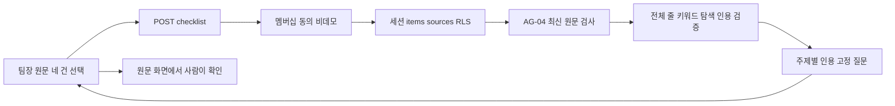

# sales-review-condition-checklist Design

원천: [PRD AG-06·§8](../../PRD.md) → [ARCHITECTURE](../../ARCHITECTURE.md) → [ADR-079](../../ADR.md), [plan](../../01-plan/features/sales-review-condition-checklist.plan.md). §11은 analyze 대조 목록이다.

## Context Anchor

| WHY | WHO | RISK | SUCCESS | SCOPE |
|---|---|---|---|---|
| 원문 조건 찾기 | 동의한 비데모 팀장 | 의미 판정 오해·인용 손실 | 현재 권한·전체 줄·실패 후 숨김 검증 | AG-06 읽기 전용 |

## 1. Overview

PRD AG-06·ADR-079의 고정 단어와 질문 계약을 구현한다. 원문을 코드가 탐색하며 새 사실을 생성하지 않는다.

## 2. Architecture Options

| 안 | 방식 | 복잡도·위험 | 선택 |
|---|---|---|---|
| A | 브라우저에서 미리보기만 탐색 | 낮음·320자 밖 누락/권한 재검사 없음 | 제외 |
| B | 새 task·job·모델·저장 | 높음·원문 폐기/권한/의미 평가 계약 필요 | 후속 |
| C | 별도 순수 모듈·현재 세션 POST | 낮음·읽기 전용 전체 원문 검사 | 선택 |

Graft·Archify가 없으면 실제 파일 의존 목록·위 Mermaid와 도구 누락을 기록한다.

## 3. Data Model

DB 변경 없음. `SalesReviewConditionChecklist = {sources, topics:[{id,label,question:string|null,evidence:[{role,source_id,quote,href}],matches:Record<Role,number>,truncated:boolean}]}`. 네 topic 순서는 price/schedule/contract/approval, role 순서는 request/old_quote/new_quote/policy. 빈 주제 question=null, evidence=[], counts=0. 모든 role은 기존 selection의 실제 item ID에 매핑한다.

## 4. API Specification

`POST /api/d/[dept]/sales-review/checklist`: AG-04 strict 네 UUID 본문. `requireMembership`→lead·consentedAt→세션 `is_demo_department=false`→`items`/`sources!inner` 최신 조회→`buildSalesReviewSourcePreview` 검사→`buildSalesReviewConditionChecklist`. 선택 중복은 400. 응답은 위 형식·`Cache-Control: private, no-store`. 요청자·부서는 세션에서 정한다.

각 원문을 CRLF/LF/CR로 줄 분리, 앞뒤 공백만 제거, 비어 있지 않은 줄을 순서대로 처리한다. ADR-079의 한도 하나라도 넘으면 전체 422. 한국어 includes, 영문 case-insensitive 단어 경계. 같은 줄은 각 주제에서 한 번만, 반복된 원문 줄은 횟수대로 센다. 주제·role별 처음 3개, 전체 일치 수와 truncated. 줄의 quote 포함·item ID·직접 링크 검증. 인용 있는 주제의 질문은 가격 조건 확인/일정 약속 확인/계약 조건 확인/승인 절차 확인을 묻는 코드 상수다.

## 5. UI/UX Design

기존 원문 나란히 보기 뒤 `조건 확인 질문 보기` 버튼. 선택 잠금·요청 중 상태·오류 표시를 유지한다. 새 체크리스트 요청 시작·다른 조회 시작·선택 변경 시 이전 체크리스트를 지운다. 실패하면 기존 원문/비교/체크리스트를 모두 지운다. 화면에는 네 주제, 고정 질문(인용 있을 때), 역할 이름·정확 인용·링크·역할별 전체 수·3건 제한을 표시한다. 빈 주제는 단어 미탐색 안내이며 사실상 누락 선언이 아니다. 탐색 방식은 고정 안내로 표시한다.

UI 대조 목록: 버튼, 로딩, 잠금, 네 주제, 질문, 인용, 역할 이름, 링크, 전체 수, 제한 안내, 빈 주제 안내, 선택 변경/실패 후 이전 결과 제거.

## 6. Error Handling

비로그인·비멤버는 기존 `requireMembership`의 Next 리다이렉트 계약을 따른다. 멤버십 확인 DB 예외도 기존 계약을 유지한다. 멤버십 통과 후 route가 반환하는 JSON은 원문을 포함하지 않는 고정 오류와 no-store를 사용한다: 400 형식/중복, 403 member/미동의/demo 또는 demo RPC 실패, 404 현재 숨김/타 부서/삭제/비활성/비원칙, 422 한도 초과, 500 DB/인용 오류. SDK 호출 자체의 예외는 프레임워크 오류이며 UI 파싱 실패도 기존 결과를 제거한다.

## 7. Security Considerations

RLS `can_see()`를 재사용한다. 순수 모듈은 RLS 결과를 입력받고 현재 상태만 검증한다. 가시성 로직 복제·service role·원문 로그·LLM·DB 쓰기 없음. 게스트 직접 POST도 demo 검사에서 거절된다.

## 8. Test Plan

- 단위: 네 원문 역할·키워드·영문 경계·부정어/예외·반복·주제 중첩·빈 주제·정확 인용·표시 제한·모든 한도·현재 상태.
- API: 정상, member/미동의/demo, malformed/중복, 숨김/삭제/비활성/원칙 해제, 한도, DB 오류·no-store.
- E2E: 로컬 합성 원문 시드→팀장 로그인→네 건 선택→질문·인용·링크→선택 변경 숨김→비활성/권한 회수 재요청 거절. jobs/llm_calls/tasks/actions 증가 0, 합성/원문/게스트 회귀.
- 실제 고객 문서의 업무 적합성은 미검증으로 남긴다.

## 9. Clean Architecture

표현은 `components/sales-review-sources.tsx`, 세션 배선은 route, 탐색 로직은 순수 lib. 기존 SQL·jobs·LLM 모듈에 의존하지 않는다.

## 10. Coding Convention Reference

AGENTS의 TDD·한국어 UI·절대 import·Next.js 설치 문서의 비동기 params를 따른다. 새 환경변수 없음.

## 11. Implementation Guide

| # | 비교 목록 |
|---|---|
| 1 | `tests/sales-review-condition-checklist.test.ts` red → `lib/sales-review-condition-checklist.ts` green |
| 2 | `app/api/d/[dept]/sales-review/checklist/route.ts`와 route 테스트 |
| 3 | 기존 `components/sales-review-sources.tsx`의 주제별 결과·질문·인용·상태 |
| 4 | 로컬 인증 E2E·기존 원문/비교/합성·게스트·전체 단위·lint/build |
| 5 | 실행 기록·analyze 90% 이상·report·phase 상태 |

### 11.3 Session Guide

모듈 1 순수 탐색·단위, 모듈 2 세션 API·화면, 모듈 3 실행 검증·보고. 이 세션에서 순차 수행한다.
