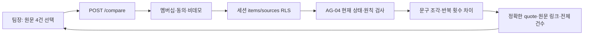

# sales-review-literal-comparison Design

원천: [PRD AG-05·§8·§11](../../PRD.md) → [ARCHITECTURE](../../ARCHITECTURE.md) → [ADR-078](../../ADR.md), [plan](../../01-plan/features/sales-review-literal-comparison.plan.md). 비교 대상은 §11이다.

## Context Anchor

| WHY | WHO | RISK | SUCCESS | SCOPE |
|---|---|---|---|---|
| 선택한 실제 견적의 다른 문구를 수동으로 찾아야 한다 | 동의한 비데모 팀장 | 인용 불일치·권한 변경·부분 비교 오해 | 현재 RLS 재검사, 원문 부분 문자열, 한도 명시 | 읽기 전용 문구 차이 |

## 1. 구조와 실행 흐름

### 1.1 계약

`POST /api/d/[dept]/sales-review/compare`는 AG-04의 strict 네 UUID JSON을 받는다. 세션 `requireMembership()`에서 lead·동의를 확인하고 세션 RPC `is_demo_department`가 false인지 확인한다. 세션 클라이언트로 `items`와 `sources!inner`를 읽어 네 행 모두 같은 부서·미삭제·활성·서로 다른 ID이며 원칙 행의 소스가 `is_principles=true`인지 `buildSalesReviewSourcePreview()`로 다시 검사한다. 가시성은 RLS의 `can_see()` 결과만 사용한다. 응답 헤더는 `private, no-store`다.

기존/변경 견적 `content`를 CRLF/LF 줄로 나누고 앞뒤 공백만 제거한다. 긴 줄은 320자 이하의 연속 조각으로 나눈다. 빈 조각은 버린다. 각 원문은 100,000자·2,000조각 이하만 처리한다. 크거나 조각이 많은 경우 422로 끝내며 부분 결과는 만들지 않는다. 동일한 조각 문자열의 등장 횟수를 multiset으로 비교하고 양쪽에 남은 조각을 원문 순서로 각각 최대 8건 반환한다. 전체 건수와 `truncated`를 따로 반환한다. 모든 quote는 해당 원문에 문자열로 포함되는지 마지막에 검증한다.

응답은 `sources`(AG-04 네 원문의 최신 짧은 인용·링크)와 `difference` `{old_only, new_only, old_only_total, new_only_total, truncated}`다. 각 차이 항목은 `{source_id, quote, href}`이며 `source_id`는 선택한 실제 item UUID다. 0건이면 화면은 "문자 그대로 다른 문구를 찾지 못했습니다"라고 표시한다. 이는 사업상 동일하다는 뜻이 아니다. 고객 요청·원칙의 맥락 외에 금액 계산·LLM·저장·승인·발송은 없다.

### 1.2 실패·권한

400: 형식·중복 ID. 403: 비lead·미동의·demo. 404: 현재 RLS에서 숨김·타 부서·삭제·소스 비활성·원칙 오지정. 422: 비교 한도 초과. 500: DB 실패. 원문 본문은 로그에 남기지 않는다.

## 2. 설계 선택

새 task/job에 실자료 복사본을 저장하는 방식은 원문 폐기와 권한 재검증 계약이 필요하다. 현재 단계는 짧은 세션 요청에서 문자 비교만 수행하고 저장하지 않는다. 의미 추출이나 생성형 초안은 실제 문서 평가가 없으므로 분리한다. 구조 변경은 위 Mermaid로 검토하고 Graft·Archify 도구가 없으면 검증 기록에 누락을 명시한다.

## 11. Implementation Guide

| 순서 | 비교 목록 |
|---|---|
| 1 | `tests/sales-review-literal-comparison.test.ts` red → `lib/sales-review-literal-comparison.ts` green |
| 2 | `app/api/d/[dept]/sales-review/compare/route.ts` 현재 세션 조회·권한·한도와 route 테스트 |
| 3 | `components/sales-review-sources.tsx`의 문구 차이 요청·결과·원문 링크 |
| 4 | 격리 인증 브라우저와 기존 합성·게스트, 전체 단위·lint/build, PDCA analyze/report |
