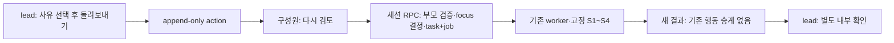

# sales-review-revision Design Document

> 원천: [PRD AG-03·§8](../../PRD.md) → [ARCHITECTURE](../../ARCHITECTURE.md) → [ADR-076](../../ADR.md), [plan](../../01-plan/features/sales-review-revision.plan.md). 구현 대조 목록은 §11이다.

## Context Anchor

| Key | Value |
|---|---|
| WHY | 돌려보낸 결과와 다음 검토의 관계가 보이지 않는다. |
| WHO | 동의한 비데모 부서 구성원과 lead |
| RISK | 예전 내부 확인의 승계 오인, 타 부서 부모 지정, 재요청 중복 |
| SUCCESS | reject→연결 재검토→새 결과→새 내부 확인 완주, SQL 거절·멱등 검증 |
| SCOPE | 고정 S1~S4, 사유 price/schedule, 새 작업 링크, 로컬 검증 |

## 1. Overview

기존 합성 검토의 사용자 요청→worker→근거 결과를 그대로 사용한다. 사람이 돌려보낸 이유를 두 가지 고정 코드로 기록하고, 그 부모에서 다시 검토할 때 SQL이 초점과 소속을 정한다.

## 2. Architecture Options

| Option | 방법 | 판정 |
|---|---|---|
| A | 클라이언트에서 이전 작업 ID를 표시하고 일반 새 요청 호출 | 재검토 관계를 DB가 보장하지 않아 제외 |
| B | 별도 승인 엔진·버전 테이블 | 합성 한 사례에 과도해 제외 |
| C | 기존 작업에 부모 FK, 행동에 사유, 전용 세션 RPC | 선택. append-only와 task+job 원자성을 유지 |

## 3. Data and SQL

- migration `0067_sales_review_revision.sql`: `sales_review_tasks.revision_of uuid null`, 같은 부서의 task만 참조하는 복합 FK와 자기 참조 금지. `sales_review_actions.reason_code text null`은 `price|schedule`만 허용한다. 과거 reject의 null 사유는 읽기만 허용한다.
- 기존 2인자 `review_sales_task` 호출 권한을 회수하고 3인자 `review_sales_task(p_task,p_action,p_reason)`을 생성한다. `approve`면 null, `reject`면 price/schedule을 강제한다. 기존 lead·동의·ready·단회 검사는 그대로다.
- `request_sales_review_revision(p_dept,p_parent,p_request_id)`은 부모 task와 reject action을 읽어 사유를 얻는다. `auth.uid()`·현재 동의·`can_see()`·비데모·부서 일치, 하루 10건, 기존 `(dept_id,requested_by,client_request_id)` 멱등을 검사한다. 새 task의 `focus=reason_code`, `revision_of=p_parent`로 task+job을 한 트랜잭션에 넣는다. 같은 멱등 키가 다른 부모/초점에 쓰이면 거절한다. 부모 승인·미검토·과거 null 사유는 재검토할 수 없다.
- RLS 읽기 정책은 현재 `can_see()`와 동의를 유지한다. 직접 쓰기 권한을 열지 않는다. 새 함수는 `SECURITY DEFINER`와 고정 `search_path`, public/anon/service_role revoke 후 authenticated execute만 허용한다.

## 4. API and UI

- 기존 GET은 task의 `revision_of`와 action의 `reason_code`를 반환한다. 결과의 코드 고정 인용 재검증을 유지한다.
- 기존 review POST는 strict `{action,reason_code}`를 받고 3인자 SQL RPC를 호출한다. `reason_code`는 approve에서 null, reject에서 price/schedule이다.
- `POST /api/d/[dept]/sales-review/[taskId]/revision`은 strict `{request_id}`만 받는다. 세션 멤버십 검증 후 전용 RPC를 호출하고 `kickWorker()` 한다. 본문 부서·사용자·초점은 받지 않는다.
- UI는 reject 사유 선택, 돌려보낸 작업의 사유와 `이 자료를 그대로 다시 검토` 버튼, 새 작업의 이전 작업 링크를 표시한다. 새 작업 선택을 ID로 고정한다. 결과의 인용·금액은 기존 검증을 사용한다. 부모 action은 새 작업 화면에 승계하지 않는다.

## 5. Verification Matrix

| 사례 | 기대 |
|---|---|
| lead reject price/schedule | 사유 포함 행동 1건, 수정/삭제·두 번째 행동 거절 |
| member/타 부서/미동의/demo의 reject | 거절, 쓰기 0 |
| 같은 부서 구성원의 reject 부모 재검토 | 새 task+job 1건, focus=사유, revision_of=부모 |
| 승인·미검토·사유 없는 부모/타 부서 | 재검토 거절, 부모·기존 행동 불변 |
| 같은 멱등 키 반복/충돌 | 동일 작업 반환/다른 부모 거절 |
| 새 결과/팀장 확인 | 같은 S1~S4 인용·차액, 새 action 필요, 이전 action 승계 없음 |
| 게스트 | 쓰기·LLM 0 |

## 11. Implementation Guide

| 순서 | 목록 |
|---|---|
| 1 | `supabase/migrations/0067_sales_review_revision.sql`, 격리 SQL 하니스 |
| 2 | `lib/contracts.ts` reason enum, 기존 review API·GET, 새 revision route |
| 3 | `components/sales-review.tsx`의 reject/재검토 UI·이전 작업 연결 |
| 4 | 로컬 DB/E2E·전체 회귀·lint/build·PDCA analyze/report |

`phases/37-sales-review-revision/step0.md`가 이 순서를 실행한다. Graft·Archify 도구가 없으면 수동 의존 목록과 위 Mermaid를 검증 기록에 남기되 도구 결과로 주장하지 않는다.
