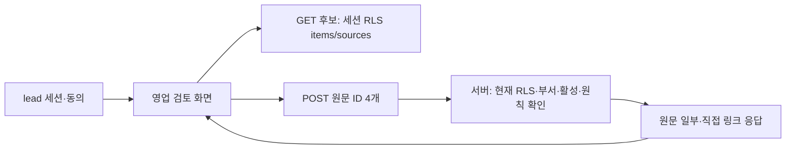

# sales-review-source-connection Design

원천: [PRD AG-04·§8](../../PRD.md) → [ARCHITECTURE](../../ARCHITECTURE.md) → [ADR-077](../../ADR.md), [plan](../../01-plan/features/sales-review-source-connection.plan.md). 비교 대상은 §11이다.

## Context Anchor

| WHY | WHO | RISK | SUCCESS | SCOPE |
|---|---|---|---|---|
| 합성 S1~S4 밖의 실제 부서 원문을 영업 화면에서 고를 수 없다 | 동의한 비데모 부서 lead | 타 부서/권한 회수/삭제 원문 노출, 원칙 오지정 | 현재 권한의 4건 선택→원문 대조·링크, 회수 후 거절 | 읽기 전용 원문 연결 |

## 1. 구조와 실행 흐름

GET은 현재 부서의 미삭제 원문과 활성 소스 중 최근 100건에 원칙 소스 최근 50건을 중복 제거해 반환한다. POST는 strict `{request_item_id,old_quote_item_id,new_quote_item_id,policy_item_id}`를 받는다. `requireMembership()`의 lead·동의 확인과 `is_demo_department` 거절 뒤 세션 클라이언트로 4건을 다시 조회한다. 관계 `sources!inner`의 활성 상태와 현재 RLS를 모두 통과해야 한다. 역할 ID는 서로 달라야 하고 원칙의 소스만 `is_principles=true`를 강제한다. 이 서버 검증은 `can_see()`를 복제하지 않고 RLS 결과에만 의존한다.

응답은 각 역할의 ID·소스 제목·종류·마스킹된 원문의 앞부분·`/d/[dept]/evidence/[id]` 링크다. 원문 미리보기는 본문 포함 부분 문자열만 표시하고 새 사실 문장을 만들지 않는다. `Cache-Control: private, no-store`. 선택은 브라우저 메모리에만 있으며 새 호출은 새 DB 상태를 읽는다. 기존 합성 task/job과 테이블은 수정하지 않는다.

## 2. 실패·권한

- 400: 형식·중복 ID. 403: lead/동의/demo 조건. 404: 네 원문 중 하나라도 현재 RLS·부서·활성·미삭제·원칙 조건에서 탈락. 500: DB 조회 실패.
- 원문 본문·질문 문자열을 로그로 내보내지 않는다. service role, LLM 호출, DB 쓰기는 없다.
- GET 후보는 선택 전 화면 표시용이며 POST가 다시 검사한다.

## 11. Implementation Guide

| 순서 | 비교 목록 |
|---|---|
| 1 | `tests/sales-review-sources.test.ts` red → `lib/sales-review-sources.ts` green |
| 2 | `app/api/d/[dept]/sales-review/sources/route.ts` GET/POST와 권한 테스트 |
| 3 | `components/sales-review.tsx`의 실제 원문 선택·미리보기·링크 |
| 4 | lint/build·단위·브라우저·게스트 검증, PDCA analyze/report |

Graft·Archify 호출 도구가 이 세션에 없다면 파일 관계와 위 Mermaid를 별도로 기록하고 도구 산출물로 표시하지 않는다.
