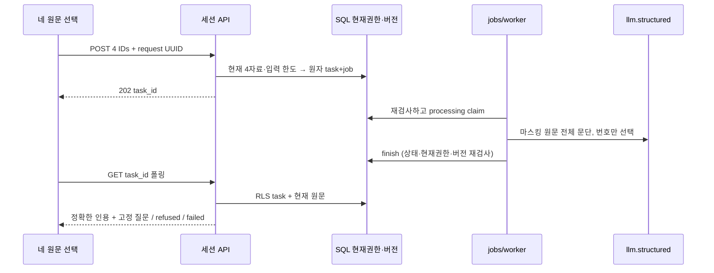

# sales-source-ai-review Design

> 2026-10-01 · 사수 · [Plan](../../01-plan/features/sales-source-ai-review.plan.md)

## Context Anchor
| Key | Value |
|---|---|
| WHY | 실제 원문 문맥 확인 부담을 줄임 |
| WHO | 동의한 비데모 부서 lead 본인 |
| RISK | 잘못된 선택·권한 철회·원문 변경·늦은 완료 |
| SUCCESS | 정확한 전체 문단, 현재 SQL 권한, 진행/실패 회복 |
| SCOPE | PRD AG-07·§8·§11, ADR-080 |

## 1. Overview
범위는 PRD AG-07, 불변식은 ARCHITECTURE §6-10이다. 아래는 analyze 비교 목록이며 새 정책을 정하지 않는다.

## 2. Architecture Options
| 안 | 변경 | 유지보수/위험 |
|---|---|---|
| A | 합성 task 확장 | 합성 고정 버전 혼합 |
| B | 범용 검토 엔진 | 현재 요구보다 큼 |
| C | 별도 task·SQL 조회, 기존 문단 복원 | 전용 경계·재사용 |
ADR-080의 C를 따른다. 사용자 승인된 개발 범위의 일상 구현 선택이다.

## 3. Data Model
D1: 0068 `sales_source_reviews`: dept/requested_by/request_id·4 IDs·4 hashes·queued/processing/ready/refused/failed·reason·번호 선택 result·timestamps. 본인 세션 SELECT만, 직접 쓰기 금지. task/job 원자 생성·동일 request 다른 IDs 거절.
D2: SQL `sales_source_review_inputs`는 요청·worker·RLS·finish 공통 검사. worker 전용 claim/finish RPC. 번호 외 텍스트를 결과에 저장하지 않는다.

## 4. API Specification
D3: POST/GET `/api/d/[dept]/sales-review/ai`. POST strict 4 IDs+request_id→202 task_id. 세션 membership lead/consent, 입력 한도→SQL request→kickWorker. GET ?task_id UUID→RLS task·SQL read input·코드 복원, private/no-store. 400형식,403현재역할/데모,404원문/작업불가,422입력한도,429일일한도,500실패. membership 로그인/권한 redirect 기존 계약 유지. 현재 실패 시 UI 이전 표시 제거.

## 5. UI/UX Design
D4: 기존 SalesReviewSources 아래 전용 컴포넌트. 네 원문 연결 후 AI 검토 버튼, 생성/진행·최대2분 폴링, ready의 주제/고정 질문/전체 문단/역할/링크, refused 직접 확인 안내, failed 재시도. 선택 변경·다른 도구 실행·403/404/통신 실패는 결과 제거. 새 request_id로 재시도. 390px 가로 넘침 없음.

## 6. Error Handling
D5: 무근거는 refused/result null, invalid schema/range는 failed 안전코드. 기존 jobs 3회 재시도/2분 sweep·조건부 완료. 만료 뒤 결과 저장 없음. 네 자료 하나라도 현재 무효면 읽기·완료 차단.

## 7. Security Considerations
D6: PRD §8 및 구조44. SQL can_see 하나, service role worker만. 원문 내용/LLM 자유 문자열은 task/job/로그 무저장. 입력 자료는 지시가 아닌 데이터. current source role/policy·hash 체크. 전체 문단은 부정어/단일 줄 개행 유지.

## 8. Test Plan
D7: 순수 테스트 — CRLF/부정어/문단경계, 범위/주제 중복·같은 자료 중복, 모델 추가필드/문장 거절, 과대 자료/문단·무근거.
D8: pipeline/API mock — claim 없으면 LLM0, structured 목적/스키마·검증 후 finish, 오류·재시도·guard·status/cache/kick.
D9: 격리 SQL — lead/member/outsider/demo/nonconsent·본문변경/삭제/비활성/원칙해제·현재 RLS direct REST·본인만·멱등/한도/finish timeout.
D10: 인증 E2E — 실제 local DB 생성→poll→ready→원문, reselect/403/404/failed/refused·mobile. guest·합성·원문 도구 회귀. 실제 Groq는 local 합성 정상/무근거/주입 사례로 별도 기록.

## 9. Clean Architecture
D11: contracts 단일 strict 모델 스키마 → 순수 `lib/sales-source-review.ts` → pipeline → worker/SQL. 사용자 API는 세션이며 순수 모듈에 권한 판정 없음.

## 10. Coding Convention Reference
AGENTS/AI-DEVELOPMENT TDD·conventional commits·한국어 UI·installed Next docs. 다른 제공자/환경변수 없음.

## 11. Implementation Guide
D12: `tests/sales-source-review*.test.ts` 먼저 red → 순수/pipeline green → SQL/migration verifier → API/UI → lint/build/fullunit/E2E/model → analyze/report. phase41 index/step/summary와 검증 기록 연결.

### 11.3 Session Guide
| Module | Scope | 산출물 |
|---|---|---|
| 번호·인용 | module-1 | contracts, pure TDD |
| 비동기·권한 | module-2 | SQL, pipeline, jobs, API |
| 화면·검증 | module-3 | UI, E2E/model, analysis/report |
하나의 이어지는 작업으로 실행하며 module 경계를 단계에 기록한다.

## Version History
0.1 · 2026-10-01 · ADR-080 선택안의 구현 비교 목록
