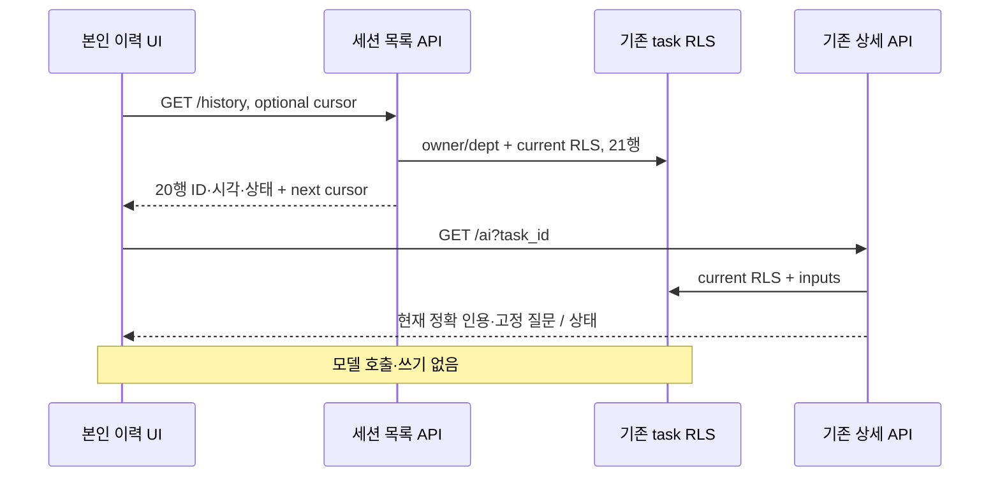

# sales-source-review-history Design

> 2026-10-01 · [Plan](../../01-plan/features/sales-source-review-history.plan.md) · 원천 PRD AG-08/ADR-081

## Context Anchor
| Key | Value |
|---|---|
| WHY | 화면을 떠난 뒤 기존 검토 찾기 |
| WHO | 동의한 비데모 lead 본인 |
| RISK | 오래된 근거·권한 회수·페이지 중복·응답 순서 |
| SUCCESS | 재접속 재열람·현재권한·열람 쓰기 0 |
| SCOPE | PRD AG-08·§8·§11, ADR-081 |

## 1. Overview
ARCHITECTURE §6-11의 읽기 경계. 아래 D1~D8은 analyze 비교 목록이다.

## 2. Architecture Options
| 안 | 변경 | 위험/유지보수 |
|---|---|---|
| A | 기존 상세에 목록 분기 | 계약 혼합 |
| B | 별도 스냅샷 테이블 | 원문 폐기 경계 중복 |
| C | 별도 목록 Route·기존 상세 읽기 모드 | RLS/인용 재사용 |
ADR-081 C안.

## 3. Data Model
D1: 기존 sales_source_reviews/0068 RLS 재사용. 새 schema/RPC/migration 없음.

## 4. API Specification
D2: GET /api/d/[dept]/sales-review/history. requireMembership lead/consent·is_demo_department false. session from/select id,created_at,status·dept/owner eq·order created_at/id desc·limit21. before_created_at ISO offset 시각/before_id UUID를 함께 strict 검증(중복/알 수 없는 params 거절). 커서는 created_at lt 또는 equal AND id lt. 반환 tasks 최대20,next_cursor null 또는 마지막행 두 필드. private/no-store. 400커서·403권한·500조회. 상세 AG-07 GET 그대로.

## 5. UI/UX Design
D3: 동의 lead 전용 원문 영역과 별개 본인 이력 영역. 자동 첫 목록·새로고침·더 보기·KST 시각·5상태·다시 열기·닫기·빈 목록·실패 재시도. 선택 작업은 key로 재마운트한 SalesSourceAiReview initialTaskId 읽기 모드, POST/새검토 버튼 없음. 열린 결과로 키보드 초점과 화면을 이동한다. 초기 detail 조회/진행은 최대2분·동일 원문 인용 출력.
D4: 목록 교체/포커스/선택 변경은 먼저 이전 목록/인용 제거. 더 보기는 상세 제거 후 기존 목록과 다음 페이지 append·ID중복 방어. 더 보기 실패는 기존 목록도 제거하여 현재 표시 없음. abort controller·30초 목록 watchdog·최신 요청만 적용. 상세의 기존2분 watchdog/poll/focus 재검사 재사용. 403/404 상세는 목록도 제거하고 갱신·안내. 세션 결과 localStorage 등 저장 없음.

## 6. Error Handling
D5: 실패·무근거는 기존 안내만 표시. 통신/timeout 후 spinner/lock 종료·이전 인용 없음·조회 재시도 가능. 새 검토는 원문 선택 흐름으로.

## 7. Security Considerations
D6: 본인·부서 필터는 SQL RLS와 함께 사용. 서비스 클라이언트·권한 재구현·총/제외 수·본문 목록 반환 없음. 이력 읽기가 task/job/LLM 호출 만들지 않음. 게스트에는 렌더/호출 없음.

## 8. Test Plan
D7: mock API guard·strict/paired cursor·same-time keyset·21→20/minimal/cache·empty/error. 실제 로컬 합성 task22개·타인/타부서 숨김·원문 변경·역할 철회·refresh 재열람·더 보기·5상태·링크·390px. mocked 목록500/지연/늦은 응답·상세 실패 및 2분 기존 회귀. 열람 전후 task/job/llm_calls counts 불변. 전체 단위/기존 SQL/영업/guest·lint/build.

## 9. Clean Architecture
목록 Route→세션 Supabase. 상세 UI→기존 API→기존 pure 문단 복원. 공통 출력/폴링을 기존 컴포넌트 읽기 모드로 재사용.

## 10. Coding Convention Reference
AGENTS·installed Next route guide·React skill·한국어 UI. 새 lib 없음.

## 11. Implementation Guide
D8: API test→Route→UI/read-only mode→local/E2E/regression→analysis/report/step summary.

### 11.3 Session Guide
| Module | Scope | 파일 |
|---|---|---|
| 목록 | module-1 | Route·route tests |
| 재열람 | module-2 | history UI·기존 AI UI·sales-review |
| 검증 | module-3 | E2E·실행 기록·analysis/report |

## Version History
0.1 · 2026-10-01 · AG-08 비교 목록
