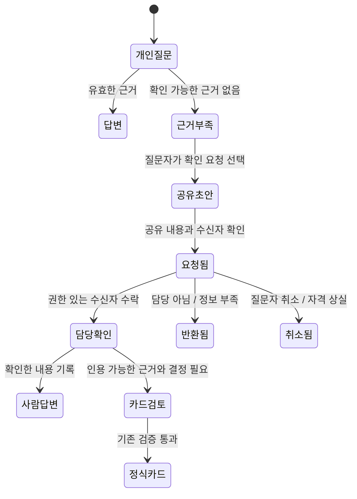

# 개선 설계 제안 10건

이 문서는 구현 명세로 승격하기 전의 검토안이다. D01의 기존 동작 수정 외에 새로운 데이터/권한/공유 계약이 필요한 항목은 PRD §3·§8 → ADR → phase step 순서로 확정한다. 실제 업무 에이전트의 역할은 [공동설계](../부서_에이전트_공동설계.md)를 따른다. 다른 세션의 phase23/25/26 파일을 이 작업에서 수정하지 않았다.

## 공통 계약

1. **행동을 맡겼다고 열람 범위를 넓히지 않는다.** 모든 본문·인용·검색 가시성은 SQL `can_see()`의 단일 판정을 유지한다. 새 기능에 소유자/검토자 한정 자료가 필요하면 기존 dept/leads_only만으로 해결되는 것처럼 구현하지 않는다. `can_see()`를 중심으로 자원 단위 접근을 설계하고 기존 서명 호환·RLS·`search_as`·직접 RPC·워커 재검증을 함께 바꿔야 한다. 앱에 별도 판정 복제 금지.
2. **읽기와 작업 허용은 다르다.** SQL의 작업 허용 함수는 `can_see()`로 열람을 확인한 다음 결정/검토/대행 범위와 유효 기간을 확인한다. org admin은 부서 본문 권한을 얻지 않는다. 사용자 경로에는 세션 클라이언트, worker 내부에서만 허용된 service role을 사용한다.
3. **기록과 실행을 분리한다.** 결정은 append-only, 잘못된 결정은 `supersedes_id`로 정정한다. 외부 발송·입금·배포·계정 생성은 이 설계에 자동 실행 권한이 없다.
4. **비동기 작업의 경계를 지킨다.** 요청 검증 → row/멱등 키 → enqueue → 응답. 저장/작업/전달 상태를 나눈다. 수신자·동의·가시성은 수락 시와 job·전달 직전 다시 확인한다. 실패는 error_code와 재시도 가능한 행동으로 끝낸다.
5. **텍스트와 근거를 보호한다.** 질문/원문은 로그에 쓰지 않고 마스킹한다. 인용 없는 AI 결론을 렌더/DM하지 않는다. 사람의 질문·결정은 ‘사람이 작성’으로 구별한다. 권한 밖 건수·존재·제목은 보여주지 않는다.
6. **게스트는 읽기/브라우저 합성 체험만.** 새 기능도 orgs.is_demo 기준 쓰기·LLM·외부 호출 0을 유지한다. 기능이 꺼진 경우 사용자에게 없는 기능처럼 권유하지 않는다.

## D01 사람이 확정하는 결정 내용

**연결:** G01·G19 / SA·FN·PM·DS L2~4 / J02·J08. **최소 구현 후보**, 기존 `outcome` 계약을 올바르게 쓰는 수정이다.

현재 웹은 추천을 prop으로 받아 그대로 제출한다. 수정 후 화면은 AI 추천(읽기 전용) → **최종 결정 내용**(사람 편집) → 결정 사유 → 확정 순서로 만든다. 추천 복사 버튼은 가능하지만 입력란을 암묵적으로 확정하지 않는다. 사람이 쓴 최종 결과를 직전 확인 영역에 보여준다. ‘승인’처럼 회사 전결 완료를 암시하는 공통 버튼 대신 ‘결정 기록’이 적절한지 실제 업무에서 확인한다.

```text
AI 추천                  고객 A의 12% 할인 요청을 승인한다.
최종 결정 내용 [편집]     고객 A에 한해 5% 할인한다. 납기 변경은 승인하지 않는다.
결정 사유     [편집]     가격 정책의 5% 한도와 제공 조건을 확인했다.
기록할 사람              현재 로그인 사용자 / 현재 부서
[결정 기록] [보류] [반려]
```

- **변경 접점:** `components/card-actions.tsx`, 카드 page prop 의미/라벨, 서버 decide의 입력 계약, Slack modal과 원장 회귀. 원장에 새 AI 요약 필드를 추가할 필요는 없다.
- **데이터:** 기존 `decisions.outcome/rationale`에 사람이 제출한 값을 저장한다. 추천 필드는 원 카드에 남겨 비교 가능. 표준 길이/마스킹 규칙을 기존 결정/정정 계약과 통일하고 클라이언트만 제한하지 않는다. 현재 서버는 nonempty를 검사하므로 추가 상한은 별도 계약 확인 후 적용한다.
- **충돌/실패:** 응답 유실 후 재시도·두 명 동시 클릭은 기존 request unique/RPC 결과를 사용. 다른 결정이 선점됐으면 실제 확정 결과를 재조회하여 보여주고 내 미저장 입력을 구별한다. 성공 메시지로 내 내용이 저장된 듯 보이면 안 된다. 403/409 후 입력 유지, 과거 결정 수정은 정정으로 이동.
- **직접 기록:** ‘직접 기록’ 상태를 유지하고 기록자/결정자·외부 공식 결재 참조의 의미를 설명한다. 현재 회사 전결표를 검증하지 않는다는 계약이 필요한 업무는 도입 화면에서 명확히 한다.
- **수용 기준:** T01 수정5%가 전송→저장→원장/인용에 동일; T02 빈 결과/사유·지연중 중복 클릭 처리; T03 같은 카드 동시 결정 원장1건; T04 Slack/Web 결과 입력 동등; T05 member 비담당/타부서/권한 상실 제출 차단; T06 정정은 새 결정이며 과거 행 유지.
- **검증/롤백:** 기존 컴포넌트 관찰을 ‘새 결과가 제출됨’ 기대의 회귀로 바꾸고 API/SQL/두 채널 E2E 추가. UI 롤백 때 입력을 다시 숨겨 오기록을 재도입하면 안 되므로 해당 결정 동작을 일시 중지하는 편이 낫다.

## D02 답변에서 사람에게 확인 요청

**연결:** G02·G17·G23 / 모든 L1~2 / J03·J06. 기존 U7의 기대와 근거 없는 카드 금지 원칙을 함께 충족해야 한다.

거절 화면 문구는 ‘현재 확인할 수 있는 근거로 답변하기 어렵습니다’로 유지하고, 가능한 경우 **질문 보완**과 **담당자에게 확인 요청**을 제공한다. 담당자 공유는 자동이 아니며, 질문자가 공유할 문장·받는 사람·공개 범위를 확인한 뒤 제출한다. 개인 질문 이력 전체/이전 대화/숨은 검색 결과는 복사하지 않는다.



- **종류 구별:** `clarification_request`(제안 이름)는 사람이 보낸 질문이다. ‘AI가 권고하는 근거 없는 카드’가 아니다. 처음에는 LLM을 호출하지 않고 질문자가 확인한 문장만 전달한다. 기존 카드에 근거가 없으면 needs_review/DM 금지를 그대로 적용한다.
- **최소 두 경로:** 접근 가능한 기존 item이 있으면 지금의 promote_item을 재사용. item 없는 질문은 별도 요청 객체와 접근 계약이 준비돼야 한다. 두 번째 경로를 첫 번째 API에 가짜 item/인용을 넣어 구현하지 않는다. 제공할 수 없는 단계에서는 존재하지 않는 승격 버튼을 안내하지 않는다.
- **제안 데이터:** id, dept_id, requester_id, target_id, original_question_id(질문자 소유), 공유용 masked_text, status, request_key, created_at/resolved_at, response_ref. 개인 질문과 별도 객체이며 공유 승인 시각을 남긴다. `dept_id/requester_id`는 세션으로 결정한다.
- **접근 결정 필요:** 질문자와 수락한 담당자만 본문을 읽는 범위가 바람직하다. 현 `can_see(dept, dept/leads_only)`만으로 표현할 수 없으므로 **자원 접근 확장 설계가 선행**한다. 임시로 부서 전체 공개하거나 requester가 member라는 이유로 사후 조회가 막히는 구조를 채택하지 않는다. 최종 안이 없으면 이 기능을 배포하지 않는다.
- **실패:** 동일 질문의 활성 요청 중복은 unique(requester, question, active) 또는 request_key로 막고 수신자 변경은 새 이력. 담당자 없음→사용 가능한 부서 확인 담당 안내, 응답기한은 요청자가 명시한 경우만. 권한 상실/동의 변경 후에는 DM 금지. 전달 실패는 재생성 없이 저장된 요청 전달만 재시도.
- **수용 기준:** T07 거절부터 확인 요청까지 실제 완료; T08 거절 이유로 비공개 문서 존재/건수 노출0; T09 다른 사용자 질문ID·타부서 수신자·취소 후 전달 차단; T10 원래 질문은 개인으로 유지; T11 중복 제출1건·DM중복 없음; T12 인용 없는 요청을 AI 결론으로 렌더하지 않음.

## D03 결정 책임과 기간 한정 대행

**연결:** G03·G19·G24 / L2~5·X01/X04/X08 / J08~J10. 직급 계층 전체를 구현하기 전에 **한 부서의 실제 결정 종류 하나**로 책임 계약을 검증한다.

화면에 작성자·확인할 사람·최종 결정자·후속 실행자를 필요한 경우 구분한다. AI가 제안한 이름은 후보로만 표시하고, 책임자 설정 또는 적법한 담당자의 확인 없이 회사 전결이 생긴 것으로 표현하지 않는다. 새 계약이 채택되면 기존 ‘모든 lead는 처리 가능’과 달라지는 범위를 PRD에 명시한다.

- **1차 최소안:** 부서가 사람이 정한 결정 담당자/대행자, 카드별 책임 확인·변경 이력, ‘내 담당 아님’ 반환 사유. 불명확하면 임의 첫 lead에 최종 결정권을 부여하지 않고 검토 큐로 보낸다. 일반 항목의 인물명과 결정 책임을 혼동하지 않는다.
- **2차 확장 조건:** 할인/구매 등의 실제 규정이 확인되면 결정 유형·한도·필요 확인 역할을 구조화한다. 회사 규정의 자연어를 LLM이 해석해 자동 결재권을 부여하지 않는다. 금액·통화·예외 조건이 불명확하면 추가 확인으로 보낸다. 범용 다단 전자결재는 이번 최소안 밖이다.
- **제안 데이터:** `decision_responsibilities`(dept, kind, owner, verifier?, policy_ref, valid_from/to), `card_responsibility_events`(actor, from/to, reason, at), `delegations`(delegator, delegate, scope, start/end, accepted_at, revoked_at). 모두 의미 제안이며 그대로 SQL을 만들기 전 단일 실제 사례로 줄인다.
- **권한:** SQL 작업 허용은 can_see → 현재 멤버십 → 책임/유효기간 → 상태 확인 순서. 부서 직급 문자열은 사용하지 않는다. lead/read 권한과 승인 범위는 구별. 위임자는 자신에게 없는 결정 범위를 줄 수 없고, 대행자는 못 보는 leads_only 자료를 전달받지 않는다. 접근 승격은 별도 절차이며 위임으로 자동 수행하지 않는다.
- **경합/인계:** 대행 만료·취소·퇴사와 클릭 경합은 DB 트랜잭션 시각으로 판정. 이전 담당자의 미결만 새 담당이 수락, 완료 원장은 바꾸지 않음. 동시에 결정하면 기존 unique로1건. 수신자 제거 뒤 대기 job은 재검증해서 취소/검토 상태로 전환.
- **수용 기준:** T13 동명이인/이름 불일치/복수lead에서 검토 책임이 명확; T14 일반 카드 배정만으로 회사 승인이라고 표시하지 않음; T15 대행 범위 밖·시작 전·종료 후·철회 후 요청 차단; T16 승격 없는 대행자의 leads_only 읽기/DM0; T17 퇴사자에게 미결 알림0·인계 수락 기록.

## D04 자료 기여와 검토 분리

**연결:** G04·G11·G13·G22 / L2~4 / J04·J12. 작은 조직은 lead 검토 시간을 줄이고, 중견 조직은 전문가를 불필요하게 lead로 만들지 않는 것이 목적이다.

제안 흐름은 **기여 초안 → 지정 검토 → 확정 담당자의 공개 범위 확인 → 검색 가능 자료**다. 최초 버전은 기존 lead 작업에서 ‘기여 요청/확정 대기/수정 필요’ 상태를 명확히 하는 UX 보완부터 가능하다. member의 원본 업로드 권한은 별도 접근 설계·DB/Storage 회귀 후 연다.

- **상태/데이터:** 기존 review pipeline을 확장하며 새로운 파일 저장소/전사 엔진을 만들지 않는다. contributor_id, reviewer_id, revision, submitted_at, reviewed_at, published_revision, 검토 의견을 제안. 변경할 때 expected_revision을 보내 오래된 추출문 위 덮어쓰기 방지. 재추출은 검토 초안으로 두고 기존 확정본을 자동 교체하지 않는다.
- **접근 선행:** 소유자/검토자만 보는 초안은 현 두 가시성 범위로 표현 불가. D02와 함께 can_see 자원 확장을 검토하고 Storage 정책·서명URL/프록시·추출 worker도 같은 판정 사용. 단순히 UI upload 버튼을 member에게 열지 않는다. 확정 공개 범위는 contributor가 임의로 넓힐 수 없다.
- **행위 분리:** 기여자=자기 초안 업로드/수정, 검토자=지정 자료 검토, 확정자=부서의 공개/근거 사용 승인. read 범위와 입력 범위를 따로 검증. 적은 조직은 한 사람이 겸할 수 있으나 무엇을 겸했는지 이력으로 남긴다. 모든 자료에 이중 승인을 강제하는 제안은 아니다.
- **음성:** 기존 내부 구성원 동의·참여자 재검증 유지. 고객·지원자를 멤버로 위장하거나 synthetic로 표시하지 않는다. 외부 참가자 동의/목적/철회 계약은 후속 과제다. 현재 지원하지 않는 경우 녹음/자동 수집 대신 허용된 내부 요약 자료 경로를 안내한다.
- **수용 기준:** T18 member 기여자로 바꿔도 다른 자료/비공개 원본 접근0; T19 미확정/반려/이전 revision은 검색/역할 입력에 포함0; T20 동시 편집 충돌과 재추출 후 사용자 수정 보존; T21 동의 철회·탈퇴·원본 만료의 처리/재시도·확정 차단; T22 외부 참여자 불가 상태에서 업로드 우회0.
- **연계:** phase20~22·23의 원본 보존/재생/보안 통제와 합류한다. 현재 원본 보존 기능을 다시 설계하는 것으로 표현하지 않는다.

## D05 내가 확인할 일과 알림 운영

**연결:** G05·G25·G28 / L3~4·외근/교대 / J01·J09·J14.

대시보드 첫 영역에 ‘내 결정 대기’, ‘내 확인 요청’, ‘부서 검토 필요’를 구별해서 보여준다. 현재의 입력 분류 탭은 수집된 내용을 탐색하는 용도로 유지한다. 원장 완료 목록과 미결을 같은 상태로 섞지 않는다.

- **행 구성:** 안건·현재 책임자·결정이 필요한 이유·원문에 있는 기한·보류 사유·다음 행동. 근거를 펼치지 않아도 결정을 요구하는 내용을 이해할 수 있어야 한다. AI 추측 마감은 만들지 않고 마감 없음은 그대로 표시한다.
- **쿼리:** 현재 사용자와 can_see 범위 안에서만 미결을 조회. 감춰진 안건 수를 포함한 ‘전체 N건’ 표시 금지. 안정적인 created_at/id 커서, 마지막 페이지·상태 변경 반영. 담당 기준은 D03과 일치한다.
- **알림:** 기존 reminder/job을 재사용. 즉시 요청/사용자 설정 기한과 정기 묶음 알림을 구분하고 수신자가 빈도/시간대를 조정할 수 있는지 파일럿에서 결정한다. 무조건 매일 새 알림을 추가하지 않는다. opt-out이 사내 필수 책임을 지우는 효과는 없어야 한다.
- **중복:** 원본당 멱등과 현재 ADR-037의72h 의미상 병합을 재사용한다. 어떤 원본이 묶였는지 권한 안에서 설명하고 오병합 이견을 받는 보완을 검증한다. 공개 카드에 private 입력을 합치지 않는 기존 SQL 경계를 유지한다. 공개 입력을 이미 비공개인 카드에 합치는 기존 허용을 임의로 바꾸지 않는다. 묶음 알림은 각 수신자의 can_see를 다시 확인하고 비공개 내용을 공개 채널에 섞지 않는다.
- **수용 기준:** T23 여러lead/member 각각 자기 미결 식별; T24 권한 밖 수/제목/정렬 단서0; T25 재시도/같은 원본 중복/기한 변경의 중복 알림 통제; T26 키보드·390px·확대에서 핵심 처리와 실패 안내 완주; T27 동일 안건 후보를 반려해도 원본 기록 유지.

## D06 근거의 시점과 적용 범위

**연결:** G06·G08·G09·G12 / 모든 부서 / J05~J07·J12.

인용에 최소한 원문 작성/결정 시각, 가져온 시각, 적용 대상/유효 상태를 구별해 제시한다. 모르는 값은 ‘확인되지 않음’이다. ‘방금 수집함’이 ‘방금 개정된 정책’을 뜻하지 않는다.

- **1차 최소안:** 기존 API의 인용 시각을 ASK에서 표시, 원장 정정/원문 변경 상태를 일관된 용어로 표시, ‘현재 시행 정책’인지 단정할 자료가 없으면 답변 범위를 제한. 코드에 없는 미래 metadata가 있다고 UI에 배지부터 붙이지 않는다.
- **추가 데이터 제안:** 근거 종류(policy, decision, discussion), subject_ref, applies_to, effective_from/to, verified_by/at, source_revision, content_hash. 사람 또는 원문에 명시된 값만 확정. 모델 추출은 후보. 적용기간이 없는 모든 과거 결정을 임의로 만료시키지 않는다.
- **검색/생성:** 현재 정책 질문과 과거 이유 질문을 구별한다. 정책·논의·예외를 섞어 한 문장의 확정 지시로 만들지 않는다. 충돌 검토는 같은 대상/범위/시점인지 먼저 확인. 인용의 문자열 포함 외에 ‘이 결론을 이 인용이 뒷받침하는가’를 반례 세트로 평가한다. 답변 문장별 근거 연결 강화는 기존 정확률 계획과 합류.
- **Notion:** 수집 범위·공개 범위가 원본 ACL과 같지 않음을 연결 시 확인. root 이동/삭제/연결 철회/갱신 실패 때 기존 근거의 상태를 바꿔 처리한다. last_successful_sync와 last_attempt 구별. phase25와 같은 source revision 계약을 사용하고 별도 크롤러를 만들지 않는다.
- **비텍스트:** 추출문에 없던 이미지·차트·코드 동작을 평가했다고 쓰지 않는다. 읽지 못한 부분은 ‘검토 필요’로 안내. 부분 실패가 있다는 설명이 권한 밖 소스의 존재를 드러내면 안 된다.
- **수용 기준:** T28 최신 수집/오래된 정책·미래 발효·한 고객 예외·정정된 결정 구별; T29 서로 다른 고객/릴리스의 비슷한 숫자를 잘못된 충돌로 표시하지 않음; T30 원문 변경/삭제/연결 철회 후 저장 답변/카드/DM 재검증; T31 인용은 있지만 결론이 과도한 반례 거절/범위 축소; T32 이미지 중심 자료를 완전 검토로 표시하지 않음.

## D07 부서 간 통제된 전달

**연결:** G07·G14 / L3~5·겸직 / J01·J07·J10·J11. 웹 부서 전환은 작은 보완으로 먼저 할 수 있으나 부서 간 본문 공유는 별도 구조 변경이다.

- **부서 전환 최소안:** 서버 세션으로 사용자의 실제 소속을 조회, 각 부서 이름/역할 표시. 현재 부서를 모든 ASK/카드 헤더에서 확인 가능. 전환하면 이전 요청 취소/결과 무효화, 전 부서 질문 입력을 자동 전송하지 않음. 소속 삭제와 북마크 접근은 서버 재검증. org admin 부서 목록을 본문 접근 가능한 목록으로 쓰지 않는다.
- **공유물 제안:** 원부서의 승인자가 작성/검토한 `shared_brief`를 새 출판물로 만든다. 수신부서, 공유 목적, 필요한 선택, 공유 가능한 사실·근거만, 공개 승인자, 버전/만료/철회 상태를 명시. 다른 부서에 공유할 권한은 단순히 원문을 볼 권한과 다르므로 별도 승인 계약이 필요하다.
- **중요 경계:** 비공개 원문의 quote를 그대로 붙여 수신부서에 보여주는 것은 기존 카드 visibility 규칙을 우회한다. 원부서가 별도로 공개 승인한 **새 자료**만 수신부서의 근거가 될 수 있다. 원문 링크/제목/감춰진 ID/인용은 수신자가 못 보면 전달하지 않는다. 감사용 원본 연결은 권한 있는 측에만 보존한다. 이 공개 계약이 확정되지 않으면 공유 기능은 구현하지 않는다.
- **수신:** 도착은 동의/승인이 아니다. 수신부서의 권한 있는 담당자가 받아야 협의 중으로 전환. 각 부서는 자기 원장에 자기 결정을 append-only로 남기고 공유물로 연결한다. 상위관리자에게 원부서 전체 RLS bypass를 주지 않는다.
- **변경/철회:** 새 버전은 재수락 필요 여부를 표시. 원본 변화로 유효성 재검토가 필요하면 수신 측 새 생성/검색을 중지하고 확인 요청. 수신부서의 이미 확정된 결정 자체를 삭제/덮어쓰지 않는다. 사용한 근거의 상태와 재검토 필요만 별도 이력으로 남긴다. 보존·철회의 정확한 계약을 PRD와 맞춘다.
- **수용 기준:** T33 멤버십 목록 정확·전환 중 이전 응답 섞임0; T34 타부서/타조직 URL 직접 접근 차단; T35 승인되지 않은 원문/제목/감사 연결 노출0; T36 미수락 전달물을 합의 완료로 표시0; T37 공유 철회/버전 변경 시 검색·답변·알림 재검증.
- **범위 제어:** HR 개인 사건의 제한 공개, 전사 통합 검색, 복잡한 매트릭스 ACL은 이 최소 공유물로 해결됐다고 보지 않는다.

## D08 대상별 결정과 후속 실행

**연결:** G15·G16·G28 / 실무자·팀장 / J01·J07·J08.

같은 고객·프로젝트·릴리스에 대한 결정을 사람이 연결할 수 있게 한다. 결정 그 자체와 실제 후속 일을 나란히 보되 상태는 분리한다.

- **대상 제안:** dept 안의 `subjects`(종류, 표시명, 허용된 외부 참조), 결정/카드와 link. 같은 이름으로 자동 합치지 않음. 조직 밖 CRM 동기화 없이 먼저 사람이 선택한다. 외부 링크 URL은 안전한 프로토콜·표시명 처리, 공개 범위를 검증한다.
- **후속 제안:** `decision_followups`(decision_id, 담당자, 확인할 일, due_at?, status, completion_ref?, verified_at). ‘실행 확인 전/진행/확인됨/중단’은 원장 decision status와 별도. 자동 실행 명령 없음. 요청자/실행자/확인자 각각 정해지고 읽기는 연결된 결정의 can_see를 넘지 않는다.
- **정정:** 새 결정이 이전 결정을 대체하면 이전 실행을 자동으로 되돌리지 않는다. 열려 있는 followup을 재검토 필요로 두고 책임자가 새 조건을 확인한다. 실행 이미 완료면 재작업/되돌림 여부를 새 결정으로 남긴다.
- **검색:** 부서/상태/대상/기간 필터, 링크된 근거도 RLS. 대상 이름에 고객 기밀이 있다면 대상 목록이 정보 유출 통로가 되지 않도록 can_see와 연결한다.
- **수용 기준:** T38 이름 같은 두 고객/릴리스는 자동 병합0; T39 결정 완료 후 실행 미완료가 명확; T40 정정 뒤 기존 실행 기록 보존·미결 후속 재검토; T41 대상 목록/검색에서 권한 없는 결정의 존재 노출0.
- **범위 제어:** 업무관리도구 전체, SLA/재고/매출 대시보드, 자동 티켓 생성은 별도 가치 검증 뒤 검토한다.

## D09 평가 근거와 이견 처리

**연결:** G10·G17·G18·G20 / 전문 검토자·HR / J04·J13.

현재 이미 기준별 점수/인용·근거 없음·최종 판단 고지가 있고, ADR-038은 근거 없는 항목을 총점에서0점으로 계산한다. 보완은 계산을 몰래 바꾸는 것이 아니라 **점수와 근거 충족 범위를 함께 이해할 수 있는 표시**, 기준 버전·이견 처리다. 점수 계산 자체를 바꾸려면 PRD/ADR의 비교 계약을 먼저 정한다.

- **버전:** 역할 instruction/rubric/weight/version, 입력자료 확정 revision, 실행 모델/시각, 인용 검증 결과를 연결한다. 같은 이름의 역할이라도 기준이 바뀌면 새 버전. 과거 결과를 새 기준 점수처럼 덮어쓰지 않는다.
- **이견:** 사용자는 항목별 ‘근거가 다름/적용 대상 아님/추출 누락’을 선택하고 확인 가능한 의견을 남긴다. 피드백은 자기 가시성 안에 보관. 사람이 재검토한 결과는 새 run 또는 별도 검토 의견. 불만이 들어왔다고 정답으로 즉시 학습하지 않는다.
- **역할 한계:** 문서 내용 비교이지 코드 실행·실제 역량·채용/승진 결론이 아니다. ‘근거 없음(총점0점 반영)’과 ‘근거를 읽고 기준 미충족으로 평가한0점’을 구별하며 어느 쪽도 자동 결격으로 해석하지 않는다. 가중치·정렬이 결과를 어떻게 바꾸는지 검토자가 확인할 수 있어야 한다.
- **채용:** 실제 지원자 경로는 PRD1.14/ADR062/phase26을 따른다. 합성 미션을 실지원자 데이터로 몰래 대체하거나 demo 사용자에 실제 제출 권한을 주지 않는다. 후보별 링크·동의·기간·제출·철회/파기·면접관 접근 계약을 기존 계획에 연결한다. 법률 검토 전 개시 제한 등 기존 상위 조건을 이 문서로 바꾸지 않는다.
- **감시 방지:** 질문 횟수·결정 속도를 개인 능력 점수로 바꾸지 않음. 운영 측정에는 최소 메타데이터를 쓰고 자료 내용/질문자 성과표를 제공하지 않는다. 작은 집단의 집계도 개인을 드러낼 수 있어 집계 목적·기간·최소 크기를 별도 합의한다.
- **수용 기준:** T42 기준 변경 뒤 과거 결과 보존·비교 가능; T43 근거 없는 항목을 낮은 역량으로 단정0; T44 피드백에 타인 질문·비공개 인용 첨부 차단; T45 합성/실지원자 경로 혼입0; T46 개인 성과 감시 지표가 신규 로그/UI에 생성되지 않음.

## D10 처음 쓰기와 운영 책임

**연결:** G12·G13·G20·G21·G22·G23·G25·G26·G27 / 새 부서·admin/lead / J12·J14.

처음 쓰는 화면은 기능 전체를 채우게 하기보다 **한 업무를 실제로 완주할 준비**를 보여준다. 부서 목적 → 수집/동의 → 확정 원칙 문서 → 테스트 질문 → 결정 한 건 → 운영 담당자 순서다. 모든 단계는 사용자가 중단·재개할 수 있고 누가 해야 하는지 표시한다.

| 상태 | 사용자에게 보여줄 내용 | 다음 행동·책임 |
|---|---|---|
| 자료 없음 | 이 부서에 질문 근거가 아직 준비되지 않음 | lead가 공용 원칙 한 건부터 검토·확정 |
| 수집 준비 미완료 | 허용된 운영 화면에서 동의/연결 준비 상태 | 본인 동의 또는 관리자/lead의 설정. 미동의 강제·수집 우회 없음 |
| 연결되었으나 갱신 실패 | 마지막 성공 시각, 실패 범주, 재시도 상태 | 연결 admin은 credential/범위, lead는 자료/공개 계약 확인 |
| 처리 중·부분 실패 | 저장된 작업·확정되지 않은 부분·가능한 재시도 | 질문/자료를 새로 중복 생성하기 전 기존 작업 재조회 |
| 보존 만료·원본 없음 | 원본/추출문/확정본/인용 각각의 실제 상태 | 권한 있는 담당자가 보존 정책 확인. 모든 기록 삭제로 오인하지 않음 |
| 도움 필요 | 업무 문의와 연결 장애 문의를 구별 | 부서 담당자 또는 org admin. 실제 질문 원문을 자동 첨부하지 않음 |

- **기능 발견:** lead/member/admin마다 할 수 있는 동작을 안내하되 서버/RLS를 권한 근거로 유지한다. 기능이 꺼진 경우 준비 상태를 정확히 표시하고 허용되지 않은 버튼으로 유도하지 않는다. ‘사수에게 무엇을 맡길지’는 부서별 예시 질문/결정이되 실근거와 합성 예시를 표시한다.
- **보존 설명:** 자료별로 원본 삭제, 추출문 제외, 확정본, 원장 인용 보존, 백업 복구 정책을 따로 설명. 운영 원본 다운로드/보존 통제는 phase22/23의 실제 구현과 대조. 법정 보존·개인정보 삭제 의무의 판단을 UI가 임의로 대신하지 않는다.
- **진단 메타데이터:** source/job ID, 마지막 성공·오류 코드·재시도 횟수·담당만. admin에 질문/전사/비공개 본문을 열어 장애를 해결하지 않는다. 사용자 측 실수/권한 부족/외부 장애를 모두 ‘다시 해보세요’로 묶지 않는다.
- **작은 조직:** 한 사람이 여러 책임을 맡는 초기 템플릿. **중견 규모:** 설치 admin·자료 owner·결정 owner·문의 창구를 구분한 인계표. 동일 제품에서 권한 기준은 같다.
- **수용 기준:** T47 빈 부서와 합성 데모를 구별해 첫 질문/결정 완주; T48 실패 후 기존 작업 복구·중복 생성 없음; T49 권한/동의/연결 변화 안내에 비공개 근거 암시0; T50 삭제/만료 설명이 실제 저장·검색·인용 상태와 일치; T51 관리자 운영 정보만으로 진단 가능한 경로; T52 키보드/모바일에서 입력 유지·포커스/상태 변화 이해.

## 구현 인계와 검증 순서

1. D01만 먼저 기존 API/RPC 계약에 맞춰 구현한다. 브라우저→원장 실제 합성 DB 경로로 최종 입력 보존을 확인한다.
2. D02의 최소 인계와 D03의 책임 확인을 한 업무 사례로 명세화한다. `can_see` 자원 확장이 필요한 D02/D04는 설계 없이 버튼만 추가하지 않는다.
3. D05·D06·D10에서 기존 필드/화면으로 개선할 수 있는 범위를 먼저 적용한다. 수집/보존/녹음/채용과 겹치는 부분은 해당 개발 세션의 최신 결과에 통합한다.
4. D07~D09의 새 구조는 실제 사용자 검증이 필요하다. 제안 전체를 하나의 대형 phase로 시작하지 않는다. 단계마다 관련 `lib/` 새 로직 TDD, SQL/RLS 격리 테스트, 실제 브라우저 증거를 step 기록에 연결한다.
5. 운영 적용은 PRD의 검증·승인 절차를 따른다. 기능 플래그를 끄더라도 이미 만든 결정/감사 이력은 삭제하지 않고, 미결 job이 권한/동의를 다시 확인하도록 한다. 모든 롤백은 비공개 자료 접근을 넓히지 않아야 한다.
