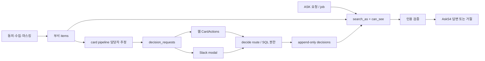

# 현재 제품: 확인한 것과 확인하지 않은 것

검토 기준: 2026-09-18 로컬 작업 트리. 동시 개발로 PRD가 1.14(지원자 개별 링크 설계, phase 26)까지 바뀐 것을 반영했다. 아래 ‘구현’은 로컬 코드 존재를 뜻하며 이번 작업에서 배포를 재확인한 뜻이 아니다.

증거 등급: **R** 이번 실행에서 재현, **C** 소스 확인, **D** 확정 문서, **P** 과거 운영 검증 기록, **H** 사용자 검증이 필요한 가설. 파일 링크는 저장소 기준 상대 경로다.

| ID | 사실·경계 | 증거 |
|---|---|---|
| E01 | 타깃은 5~50인 팀, 부서 격리와 결정 레이어. 구성원 인사평가는 제외. 채용 지원자 개별 링크는 설계 상태 | D [PRD §0·§3·§8](../../PRD.md), [ADR](../../ADR.md) |
| E02 | 멤버 역할은 lead/member. org admin은 본문 열람과 별개. 소속 부서 URL 검증 | C [membership.ts](../../../lib/supabase/membership.ts), D [관리자 설계](../메인웹사이트_관리자콘솔_설계.md) |
| E03 | 대시보드는 분류된 입력·카드 승격 중심. 원장은 상태·담당·날짜 필터. ‘내가 지금 결정할 목록’ 전용 집합 화면은 확인 범위에서 찾지 못함 | C [dashboard-s1](../../../components/dashboard-s1.tsx), [ledger-s3](../../../components/ledger-s3.tsx) |
| E04 | 카드의 `outcome`은 서버 페이지가 추천/제목으로 전달, 웹은 사유만 편집. Slack 모달은 결과 편집 가능 | R·C [card-actions](../../../components/card-actions.tsx), [card page](../../../app/(auth)/d/[dept]/cards/[id]/page.tsx), [Slack blocks](../../../lib/slack/blocks.ts), [OBS-02](../../verification/persona-review-2026-09-18/component-observations.json) |
| E05 | ASK 거절 화면에 카드 승격 안내는 있지만 연결 동작 없음. 기존 카드 생성 API는 원본 item ID를 요구 | R·C [ask-s4](../../../components/ask-s4.tsx), [cards route](../../../app/api/d/[dept]/cards/route.ts), [OBS-05](../../verification/persona-review-2026-09-18/component-observations.json) |
| E06 | 담당 지정은 이름 정확 일치, 불명확/비공개는 첫 lead. 결정은 lead 또는 담당자. 보류 재개는 lead | C [card pipeline](../../../lib/pipeline/card.ts), [decide route](../../../app/api/cards/[id]/decide/route.ts), [0017 SQL](../../../supabase/migrations/0017_card_decision_boundaries.sql), R OBS-03·04(UI 부분) |
| E07 | 원장 직접 기록과 `supersedes_id` 정정이 있음. 현재 결정과 후속 실행 완료는 별개 | C [ledger-s3](../../../components/ledger-s3.tsx), [decision-correction](../../../components/decision-correction.tsx), [0031 SQL](../../../supabase/migrations/0031_decision_followup.sql) |
| E08 | 자료 검토는 동의한 lead 중심. 문서20MB·음성50MB/30분 계약, 참여자 검증. 원본 접근 추가 통제는 작업 트리에 존재 | C [documents route](../../../app/api/d/[dept]/documents/route.ts), [0034 SQL](../../../supabase/migrations/0034_reviewed_materials.sql), [0037 SQL](../../../supabase/migrations/0037_review_access_controls.sql) |
| E09 | S8 문서 역할은 lead가 기준·가중치를 만들고 문서를 평가. 인용 없는 기준은 null/근거 없음 표시, 총점 계산에서는 전체 가중치 분모에 0점 반영. 이 계산은 ADR-038의 의도된 계약. 일반 업무 실행 에이전트는 아님 | C [agent-roles](../../../components/agent-roles.tsx), D [ADR-038](../../ADR.md), [공동설계](../부서_에이전트_공동설계.md) |
| E10 | 답변 인용 문자열 검증, 근거 부족 시 거절. 이 검증만으로 의미적 추론·현행 정책 적용 정확성을 보증하지 않음 | C [answer pipeline](../../../lib/pipeline/answer.ts), D [ARCHITECTURE](../../ARCHITECTURE.md). 의미 정확성은 H |
| E11 | ASK 인용 UI에 author/source/quote/link가 있으나 시각 표시 없음. 원장 인용에는 시각 필드 존재 | C [ask-s4](../../../components/ask-s4.tsx), [ledger-s3](../../../components/ledger-s3.tsx) |
| E12 | 일반 웹 부서 사이드바에 전환 링크가 없고 데모에만 있음. 로그인 기본 부서는 UUID 정렬 첫 소속. Slack DM은 부서명 선택 지원 | C [workspace-shell](../../../components/workspace-shell.tsx), [callback](../../../app/auth/callback/route.ts), D PRD §6-5 |
| E13 | Notion 지정 페이지 스냅샷/갱신은 기존 범위. phase25 index에서 step0~2 완료, step3~8 대기·운영 미배포 기록을 확인. root 전체 수집은 미완성. Notion 원본 개별 ACL을 그대로 동기화하는 제품이 아님 | D [노션 설계](../노션_전체수집_설계.md), [phase25](../../../phases/25-notion-collection/README.md), [상태 기록](../../../phases/25-notion-collection/index.json). 다른 세션 기록이며 전체 검증을 이번에 재실행한 뜻 아님 |
| E14 | Slack ASK·인용·정정·후속·Notion 갱신·OAuth의 과거 운영 확인 기록 존재. 이번에 다시 실행한 결과는 아님 | P [2026-09-16 연속성 검증](../../verification/continuity-production-2026-09-16.md) |
| E15 | 검토 자료·음성·보존 phase20~22의 운영 확인 기록 존재 | P [2026-09-17 자료 검토 검증](../../verification/reviewed-materials-production-2026-09-17.md) |
| E16 | 데모 부서 목록에는 영업·개발·기획·디자인·HR·FE·BE가 있으며 채용 mission은 기획·HR·FE·BE·디자인 다섯 종류. 합성 체험은 실사용 결과가 아님 | C [demo-access](../../../lib/demo-access.ts), [missions](../../../fixtures/hiring/missions.ts), [phase24](../../../phases/24-department-hiring-demo/README.md) |
| E17 | 웹 직접 회의 녹음은 phase23 별도 진행. 합성 음원/코드 검증과 실제 장치·외부 회의 수집을 구별해야 함 | D [녹음 설계](../웹회의_녹음_설계.md), [phase23](../../../phases/23-browser-meeting-recording/README.md) |
| E18 | 게스트는 합성 org에서 읽기/브라우저 체험, 쓰기·LLM·실데이터 없음. 운영 데이터가 많은 화면처럼 보여도 실제 사용자 권한 검증을 대체하지 못함 | D PRD·ARCHITECTURE, C demo-access |
| E19 | 의미상 중복 병합이 이미 있음: 최근72h 후보·임베딩0.55 이상·최대3개 확인, 분류 모델의 같은 미결 결정 확인 후 기존 카드에 근거 추가. private 입력을 공개 카드에 합치지 않는 SQL 경계 존재. 새 중복 제거 엔진이 필요한 상태로 보지 않음 | C [card pipeline](../../../lib/pipeline/card.ts), [0018 SQL](../../../supabase/migrations/0018_card_merge.sql), [0030 SQL](../../../supabase/migrations/0030_source_lifecycle.sql), D [ADR-037](../../ADR.md) |

## 이번 실행

`node docs/verification/persona-review-2026-09-18/probe-components.mjs`로 실제 `CardActions`·`AskS4`를 독립 Vite 서버/새 Playwright 컨텍스트에서 실행했다. 결과 **6개 관찰**, 그중 **2개 문제 재현**, 브라우저 오류 0. `/api`는 전부 intercepted synthetic response이며 저장·메일·Slack·LLM 호출은 없다. 라우터는 stub, CSS는 검토용 단순 스타일이므로 운영 UI의 시각 품질·전체 인증·RLS 검증이 아니다.

- OBS-01: 빈 결정 사유 차단. API 요청 0.
- OBS-02: 사유 ‘5%만 승인’과 전송 결과 ‘12% 승인’ 불일치. 편집 가능한 입력은 1개.
- OBS-03: `canAct=false`일 때 처리 버튼 없음. 서버 보안 검증을 했다는 뜻은 아님.
- OBS-04: 일반 담당자의 보류 재개 동작 없음.
- OBS-05: ASK 거절 안내 뒤 가능한 결과 행동은 ‘이어서 질문하기’ 하나.
- OBS-06: 이어 묻기는 부모 질문을 연결하고 입력을 비움.

[JSON 결과](../../verification/persona-review-2026-09-18/component-observations.json) · [결정 화면](../../verification/persona-review-2026-09-18/card-outcome-desktop.png) · [거절 화면](../../verification/persona-review-2026-09-18/ask-refusal-desktop.png). 모바일390px도 캡처했으나 간소화한 CSS이므로 운영 모바일 적합성 판정은 하지 않았다.

로컬 공유 개발 서버 `localhost:3011`의 `/demo`는 40초 navigation timeout이 발생해 해당 경로의 신규 검증 증거로 쓰지 않았다. 공유 브라우저 프로필도 사용 중이어서 별도 브라우저를 이용했다. 다른 세션의 서버/프로필을 종료·재시작하지 않았다.

## 코드 관계와 도구 누락

위 그림은 파일 검색과 읽기로 작성한 관계도다. 이번 세션의 가용 도구 목록에서 Graft·Archify를 찾지 못해 두 도구의 실행 결과는 없다. Archify로 생성/검사했다고 표시하지 않는다. 실제 구현이 구조를 바꾸는 단계에서는 [AI 개발 절차](../../AI-DEVELOPMENT.md)에 따라 그래프/실행 흐름 검토를 추가하고, 누락 도구가 phase 완료 조건이면 완료로 처리하지 않는다.

## 현재 지원하지 않는다고 단정하면 안 되는 항목

알림, 직접 결정 기록, 결정 정정, 질문 이력, Slack DM ASK, 문서/음성 자료 검토, 보존 설정, 의미상 동일 안건 병합은 이미 코드/명세에 있다. 이 검토의 요구는 주로 **발견 가능성·업무 책임·예외 처리·권한의 세분화**다. ‘알림을 만들자’, ‘문서 업로드를 새로 만들자’, ‘중복 병합을 처음 만들자’처럼 기존 기능을 재구현하지 않는다. 검색에서 찾지 못한 기능은 확인 범위를 적었으며 제품 전체의 부재를 증명한 것으로 다루지 않는다.
