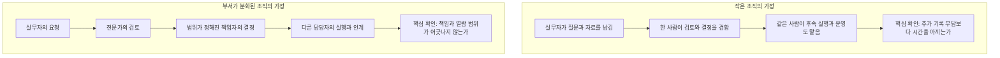

# 두 규모와 직급을 비교하는 기준

## 비교 집단은 연구 가정이다

| 항목 | S: 작은 조직 | M: 부서가 분화된 조직 |
|---|---|---|
| 전체 인원 | 5~50명 가정 | 100~500명 가정 |
| 사수 설치 단위 | 겸직이 많은 한 팀 또는 소수 부서 | 조직 안 5~50인 부서 단위 파일럿 |
| 대표 사례 | 18명 B2B 서비스 팀. 대표가 영업·재무 결정, 개발/기획 리드가 실무 겸임 | 240명 서비스 조직. 기획·개발·디자인·매출·지원 부서와 여러 책임 단계 |
| 실제 표본 여부 | 없음. 합성 사례 | 없음. 합성 사례 |
| 권한 운영 부담 | 한 명이 설치·동의 안내·문서 검토·결정·정정까지 맡기 쉬움 | 담당자가 여러 명이라 경계·대행·이동·감사 책임의 합의가 필요 |
| 주요 구매 동기 가설 | 반복 질문·빠진 결정·퇴사 시 맥락 손실 감소 | 부서 내 정책 일관성·인계·부서 간 재확인 지연 감소 |
| 도입 방해 가설 | 수집 설정 시간이 얻는 시간보다 커짐, 기록이 없는 상태 | 접근 계약·구매 절차·보안 검토·노션 권한과 사수 공개 범위 차이 |
| 성공 조건 | 짧은 설정 뒤 실제 자주 묻는 질문과 미결 안건을 다룸 | 접근 가능한 한 부서에서 책임과 기록의 정확성을 증명 |

50~100명 사이와 500명 이상은 별도 실증 전 일반화하지 않는다. 5명 조직에 10개 부서나 5단계 결재를 만들자는 뜻이 아니다. 같은 사람이 여러 페르소나 역할을 연속해서 수행할 수 있다. 제조·공공·의료 조직의 전문 업무는 이번 코드·데모 근거가 부족해 일반화하지 않았다. 운영군에 구매·납기 사례를 포함했지만 ERP·공장 시스템 지원을 뜻하지 않는다.

현실의 조직이 반드시 이 순서나 인원으로 일한다는 뜻은 아니다. 같은 판단을 두 규모에서 검토할 때 먼저 확인할 부담의 차이를 표현한 그림이다.

## 직급은 책임 단계를 이해하기 위한 표현이다

| 단계 | 흔한 명칭 예시 | 이 검토의 책임 | 작은 조직에서 | 중견 규모에서 | 사수의 현재 권한과 관계 |
|---|---|---|---|---|---|
| L1 | 인턴·신입·사원 | 기준을 배우고 정해진 범위에서 수행 | 입사 초기라도 여러 일을 맡음 | 제한된 업무와 많은 내부 용어 | 보통 member. 직급이 아니라 실제 멤버십 확인 |
| L2 | 대리·주임·독립 실무자 | 한 업무를 끝까지 담당, 예외 요청 | 요청자와 실행자가 같음 | 특정 고객·기능·채널을 독립 담당 | member로 자기 결정 직접 기록 가능. 카드 담당이면 처리 가능 |
| L3 | 선임·과장·파트장·전문가 | 동료 검토·영역 판단·일부 위임 | 사실상 lead 역할도 겸함 | 인사관리 없는 전문가 또는 작은 파트 책임자 | member/lead 중 하나를 골라야 함. 검토 권한과 비공개 권한의 분리 부족 |
| L4 | 팀장·부서장 | 부서 우선순위·예외·인력·최종 책임 | 실무·관리·자료 정리를 겸함 | 부서 결정과 상위 의사결정 연결 | lead에 가장 가까우나 회사의 결재 권한과 동치는 아님 |
| L5 | 본부장·임원·대표 | 여러 부서 상충·예산·조직 방향 | 같은 사람이 L2~L4도 수행 | 부서별 보고와 위험·의존성을 보고 싶음 | 임원이라는 자동 권한 없음. 부서 멤버십과 org admin은 별개 |

‘과장=lead’, ‘대표=모든 문서 열람’ 같은 규칙은 사용하지 않는다. L3 전문가는 L4보다 특정 기술 결정을 잘할 수 있지만, HR 비공개 열람 권한을 얻을 이유는 없다. 직급별 문체 변경보다 **누가 요청하고, 누가 검토하고, 누가 결정하며, 누가 실행하는지**를 드러내는 것이 우선이다.

## 현재 권한의 실제 의미

| 행동 | member | lead | org admin만 보유 | 유의점 |
|---|---|---|---|
| 부서 공개 기록·웹 ASK | 소속 부서 범위 | 소속 부서 범위 | 본문 권한 없음 | RLS·`can_see()`가 판정 |
| `leads_only` 열람 | 불가 | 같은 부서 가능 | 자동 허용 아님 | 비공개 범위가 모든 lead보다 좁아야 하는 HR 사례는 부적합 |
| 열린 카드 처리 | 자신에게 배정되면 가능 | 같은 부서 카드 가능 | 불가 | 보기 권한도 필요. 카드 지정이 회사 결재 위임과 같지는 않음 |
| 보류 카드 재개 | 불가 | 가능 | 불가 | 주니어·실무자가 정보 보완 후 재개하려면 lead 의존 |
| 직접 결정 기록 | 현재 계약 안에서 가능 | 가능 | 불가 | 기록 사실과 실제 회사 승인 여부를 혼동하지 않아야 함 |
| 자료 업로드·추출문 검토·확정 | 현재 lead 중심 | 동의·소속 조건 충족 시 | 자동 허용 아님 | 모두 lead로 올리는 편법 금지 |
| 조직 관리·수집 운영 메타데이터 | 별도 권한 필요 | 별도 권한 필요 | 가능 | 질문 원문·전사·카드 본문을 보는 권한과 다름 |
| 채널 `@사수` | member 수준 답변 | 채널에서는 member 수준 | 동일 원칙 | DM·웹은 질문자 권한. lead가 채널에서 물어도 비공개 답변을 게시하지 않음 |

현재 권한을 실행할 때는 [증거 E02~E08](evidence.md)와 최신 SQL을 기준으로 한다. 이 표는 UI 안내를 위한 요약이며 애플리케이션에 별도 권한 판정 함수를 만들라는 지시가 아니다.

## 규모별 장단점과 순효과

| 관점 | 작은 조직에서 얻을 수 있는 것 | 작은 조직의 손실·조건 | 중견 규모에서 얻을 수 있는 것 | 중견 규모의 손실·조건 |
|---|---|---|---|---|
| 반복 질문 | 담당자가 없어도 근거에 접근 | 문서가 없으면 거절만 늘고 질문이 다시 사람에게 돌아옴 | 표준 질문의 일관된 답변·입사/이동 인계 | 다른 부서 정책은 보이지 않아 분절 경험 가능 |
| 결정 요청 | 대표·리드가 놓친 안건을 발견 | 모든 알림이 한 명에게 집중 | 영역별 미결·상충을 발견 | 이름 기반 담당 추정이 책임 규정과 불일치 |
| 원장 | 구두 결정의 이유가 남음 | 기록/정정 부담이 체감 이익을 넘을 수 있음 | 과거 판단의 추적·정정·인계 | 현재 유효한 예외인지, 다른 프로젝트인지 구별 필요 |
| 자료 검토 | 원문을 고쳐 확정하므로 추출 오류 통제 | lead 한 사람이 병목 | 전문 검토자를 둘 수 있음 | 현행 lead 권한 묶음이 과도함 |
| 신뢰·동의 | 구성원끼리 수집 목적을 설명하기 쉬울 가능성 | 대표가 평가에 쓸까 봐 발언을 줄일 수 있음 | 명시적 부서 격리·운영 메타데이터 분리 | 인사·보상·조사 자료는 두 가시성 단계로 부족 |
| 비용 | 적은 기준 문서로 시작 가능 | 설정·분류 오탐·원문 정리 시간을 포함해야 함 | 반복 업무량이 커지면 이익 가능 | 도입 교육·접근 승인·소스 갱신·감사 운영 비용 증가 |

순효과는 `질문/검색/재설명에서 절약한 사람 시간 - 설정/검토/오탐 처리/정정/운영에 든 사람 시간`으로 측정한다. 현재 절약 시간, 채택률, 매출 개선율은 측정하지 않았다. ‘인원이 크니 ROI가 크다’고 가정하지 않는다.

## 적용 순서 제안

1. **공통 선행:** G01 최종 결과, G02 근거 부족 인계, G03 담당/결정 책임의 오해부터 해소한다. 승인 기록의 신뢰가 있어야 다른 편익을 평가할 수 있다.
2. **S 파일럿:** 주간에 실제 반복되는 질문 한 종류와 결정 한 종류, lead 1~2명의 검토 업무량을 측정한다. 기능 메뉴를 모두 켜는 것을 도입 완료로 보지 않는다.
3. **M 파일럿:** 민감 인사 사례를 제외하고 한 부서에서 시작한다. 전문가가 자료를 기여하되 권한을 넓히지 않는 과정, 두 lead의 책임 분리, 대행·퇴사 시 처리 중 요청을 검증한다.
4. **M 확장 조건:** 부서별 기록 품질과 운영 부담을 확인한 다음 공용 정책 전달·다부서 협의를 다룬다. 전사 검색이나 다단 결재 시스템을 선행 구축하지 않는다.

## 경계 페르소나

| ID | 사용자·상황 | 필요한 경험 | 피해야 할 해석 | 연결 |
|---|---|---|---|---|
| X01 | 대표이자 영업 담당자이자 org admin | 현재 어느 부서/책임으로 행동하는지 명확 | 관리자니까 모든 기록을 읽을 수 있음 | G03 G14 |
| X02 | 두 부서 겸직 전문가 | 권한 있는 부서 전환, 질문 범위 표시 | 두 부서 내용을 자동 합쳐 답변 | G14 G07 |
| X03 | 미동의·동의 철회 구성원 | 수집 제외와 이용 가능한 범위를 명확히 안내 | 이름만 가리고 발언 저장, 팀 압박으로 자동 동의 | G13 |
| X04 | 휴가 대행자·퇴사자 인계 담당 | 시작·종료 시각이 있는 책임 인계 | 휴가 동안만 필요했던 열람 권한을 영구 유지 | G03 G24 |
| X05 | IT 조직 관리자·보안 담당자 | 연결·보존·접근 메타데이터와 장애 해결 | 문제 해결 목적으로 직원 질문 원문까지 조회 | G20 G27 |
| X06 | 외부 고객·협력사·지원자 | 별도 목적·참여 절차를 충족한 제한 입력 | 조직 멤버로 위장 등록해 수집 동의 우회 | G11 G18 |
| X07 | 키보드·모바일·보조기술 사용자 | 핵심 업무 완주, 상태·포커스·오류 안내 | 음성 입력 가능=접근성 검증 완료 | G25 |
| X08 | 원장에 등장하지만 계정이 종료된 전 담당자 | 과거 기록의 출처는 보존, 현재 책임자 분리 | 퇴사한 사람에게 계속 DM/승인 요청 | G24 |

실제 조직 면담에서는 직함보다 위 표의 겸직·이동·대행 상황을 먼저 확인한다.
