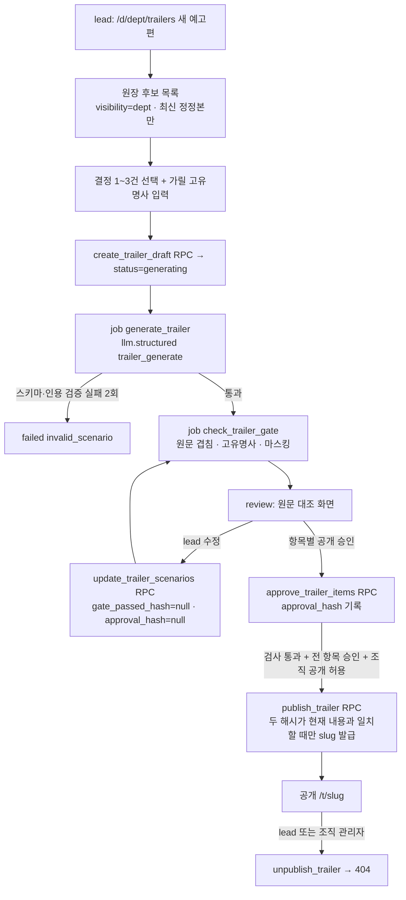

# 메인 웹사이트 · 조직 관리자 콘솔 설계 (작업 문서)

- 문서 버전: 0.3 (Phase 2 초안 → Phase 3 렌즈 5개 → Phase 4 삭감 → Phase 5 외부 리뷰 반영, §R) · 작성일: 2026-09-15
- 지위: **PRD §3-2가 참조하는 상세 설계.** 범위·완료 조건·컷 라인의 권위는 [PRD](../PRD.md) §3-2·§8-2·§11, 불변식은 [ARCHITECTURE](../ARCHITECTURE.md) §6-2, 결정 이유는 [ADR](../ADR.md) ADR-042~046에 있다. 이 문서와 상위 문서가 충돌하면 상위 문서가 이긴다. Codex step 파일은 이 문서의 절 번호를 계약으로 인용한다.
- 화면 시안: https://claude.ai/code/artifact/a1bb2164-6ad5-4659-bfd5-2cdeb68839c3
- 사용자 결정 (2026-09-15): ① 메인 웹사이트와 관리자 페이지가 필요하다 ② 관리자 페이지 사용자는 **고객사 조직 관리자**다 ③ 산출물은 문서 + 화면 시안이다 ④ 이번 주 범위는 "채용 예고편까지 전부 구현"이다.
- Phase 1(근거 수집)은 건너뛴다. 메인 웹사이트의 메시지와 경쟁 구도는 기획서 v3 §04·§09와 제출 체크리스트에 이미 있다. 관리자 콘솔은 기존 PRD의 관리자 페르소나(U9·U10)를 확장하는 내부 화면이라 시장 근거가 필요 없다.

---

## 0. 현재 상태 (2026-09-15 조사)

| 영역 | 지금 | 설계에 주는 영향 |
|---|---|---|
| `/` | `app/page.tsx` 10줄 자리표시. h1 "사수" + `/demo` 링크 하나. metadata 없음 | 전면 신규 |
| 전역 CSS | `app/globals.css`의 `main`·`h1`·`a` 요소 규칙이 레이어 밖에 있어 Tailwind v4 유틸리티를 이긴다. `/demo/.../ask`의 h1이 거대한 초록 가운데 정렬로 렌더되는 스크린샷이 있다. 팀이 `text-3xl!` 같은 `!`로 우회 중 | 새 화면을 만들기 전에 기반을 고쳐야 한다(§A-5) |
| 토큰 | CSS 변수 6개(`--accent` 등), `@theme` 등록 없음. 다크는 `prefers-color-scheme`만 | `@theme inline`으로 유틸리티 등록 |
| SEO·공유 | `metadataBase`·openGraph·아이콘·robots·sitemap 모두 없음. `public/` 폴더 없음 | 투표 기간 SNS 공유 미리보기가 비어 나온다 |
| 게스트 CTA | PRD S6이 요구한 끝 CTA(파일럿 문의·투표) 미구현. 묻기 화면의 "우리 팀에 설치하기 →"는 초대 전용 `/login`으로 간다 | 메인의 문의 앵커로 연결 |
| 공개 URL 환경 변수 | `NEXT_PUBLIC_APP_URL`(슬랙 링크)과 `APP_URL`(동의 라우트)이 섞여 있다 | `lib/site.ts` 한곳에서 해석 |
| 채용 예고편 | 다른 세션이 phase `7-recruitment-trailer` step 0 진행 중. `/trailers`는 `SASU_TRAILER_PREVIEW_ENABLED=true`일 때만 열리고, 브라우저 메모리 전용 합성 체험이다(ADR-040). step 0 금지사항: "홈·게스트·제출물을 수정하지 않는다" | 메인은 예고편 섹션을 **같은 환경 변수로 조건부 노출**. 전역 CSS 수정은 step 0 완료 뒤 `/trailers`를 회귀 대상에 포함 |
| 조직 관리자 | 조직 단위 역할 없음. 역할은 부서별 `members.role`(lead/member)뿐 | 신규 역할·판정 함수 필요(§B) |

---

## A. 메인 웹사이트

### A-1. 먼저 정한 다섯 가지

| 항목 | 결정 |
|---|---|
| **문제** | 서비스 링크로 들어온 사람이 보는 첫 화면이 "사수" 한 단어다. 무엇을 하는 제품인지, 왜 다른지, 어디를 눌러야 하는지 알 수 없다. SNS로 공유해도 미리보기가 비어 있다 |
| **타깃** | ① 심사위원(예선 80%) — 무엇이 다르고 실제로 동작하는지 ② 투표자(20%) — SNS 링크로 모바일에서 들어와 30초 안에 이해 ③ 잠재 고객(팀장) — 우리 팀에 쓸 수 있는지, 어디로 문의하는지 ④ 파일럿 사용자 — 로그인 |
| **가치** | 10초 안에 "부서별 결정 사수"를 이해하고, 클릭 한 번으로 로그인 없는 게스트 데모에 들어간다 |
| **화면** | `/` 메인 1장(앵커 섹션) · `/privacy` 개인정보 처리 안내 · 공통 헤더/푸터 · 공유 이미지·아이콘 |
| **핵심 흐름** | ① 링크 진입 → ② 히어로에서 한 문장 이해 → ③ 작동 방식·차이·신뢰 훑기(선택) → ④ "데모 보기" → `/demo` → ⑤ 데모 끝 CTA에서 파일럿 문의 또는 투표 |

### A-2. 정보 구조 — 섹션 순서

| # | 섹션 | 내용 | 근거 |
|---|---|---|---|
| 1 | **헤더** (고정) | 워드마크 "사수" · 앵커(작동 방식 · 차이 · 신뢰) · "로그인" 텍스트 링크 · **"데모 보기"** 버튼. 모바일은 워드마크 + "데모 보기"만 (JS 메뉴 없음) | 어느 스크롤 위치에서도 데모까지 1클릭 |
| 2 | **히어로** | 눈썹 "부서별 결정 사수 AI" · h1 **"회의록은 남들도 만듭니다. 사수는 결정을 만듭니다."** · 부제 "슬랙과 회의에 묻힌 '지금 결정해야 할 것'을 담당자에게 카드로 보내고, 내려진 결정은 근거와 함께 부서 원장에 남깁니다." · CTA "로그인 없이 데모 보기"(주) / "파일럿 문의"(보조, 설정 시) · 아래 한 줄 "가상 회사 '온새미로'의 합성 데이터로 둘러봅니다 · 가입 없음" · 오른쪽(모바일은 아래)에 **실제 게스트 모드 결정 카드 캡처** | 제출서 제목·썸네일 훅과 같은 문장 (submission-checklist §2·§3) |
| 3 | **문제** h2 "결정은 내렸는데, 아무도 모릅니다" | 카드 3장: 팀장(회의에 갇혀 전달할 시간이 없다) · 팀원(물어볼 곳이 없어 일이 막힌다) · 부서(결정이 어느 시스템에도 남지 않는다). "심판" 같은 책임 추궁 프레임은 쓰지 않는다 | PRD §0·§2-1 |
| 4 | **작동 방식** 5단계 | ① 동의를 먼저 받고 채널 연결 ② 입력 자동 분류 ③ 담당자에게 결정 카드 ④ 원장 기록·과거 결정 충돌 표시 ⑤ 권한 안에서 인용해 답변. 단계마다 짧은 설명, 섹션 머리에 "데모에서 직접 보기 →"(`/demo`) 하나 (단계별 캡처는 P4에서 뺌) | PRD §0 핵심 흐름 5단계 |
| 5 | **차이** "여기까지는 남들도 합니다" | 두 열: 회의록 도구·사내 검색·범용 AI가 하는 것(기록·요약·검색) / 사수가 서는 층(결정 요청 카드·결정 원장·부서 격리·권한별 답변). **경쟁사 이름과 우월성 주장은 쓰지 않는다** | ADR-033(비교 실험 전 우월성 주장 금지) |
| 6 | **같은 질문, 다른 답** | 2분할 캡처: 팀장/팀원 계정의 답 차이 + 영업/개발 사수의 답 차이 | 데모 장면 4·4' |
| 7 | **신뢰 설계** "동의와 권한이 먼저입니다" (PRD §7 — "감시"라는 단어는 부정문으로도 쓰지 않는다). 관리자 한 줄은 "조직 관리자 권한만으로는 질문·답변·카드의 내용을 볼 수 없습니다"로 쓴다(절대 문장 금지, ADR-044) | 타일 6개: 동의가 수집보다 먼저 · 미동의 구성원 발언은 저장하지 않음 · 인용 없는 문장은 보여주지 않음 · 권한은 데이터베이스(RLS)가 집행 · 저장 전 개인정보 마스킹 · 모델 제공사 무보존(ZDR) 설정 | PRD §8-3, §10 #14(9/14 확인) |
| 8 | **채용 예고편** (조건부) | `lib/site.ts`의 `trailerDemoHref()`가 링크를 줄 때만 렌더(L1-10). "입사 전에는 예고편, 입사 후에는 사수" + "합성 사례 · 베타" 라벨 + "예고편 체험하기 →". 문구는 "AI는 지원자를 거르지 않습니다. 담당자가 참고할 근거만 정리합니다 — 지금은 합성 지원자로 시연합니다"까지만. 링크가 없으면 섹션 자체가 없다 | ADR-040·045. 만들지 않은 것을 만든 것처럼 보이지 않게 |
| 9 | **마지막 CTA** | "우리 부서의 결정, 지금 어디에 남고 있나요?" · "데모 보기" · "파일럿 문의" · "투표하기"(설정 시) · "3분 데모 영상"(설정 시) | PRD S6 CTA, 체크리스트 §1 가산 자료 |
| 10 | **푸터** | 사수 · 원티드 AI Championship 2026 출품작 · 개인정보 처리 안내 · 문의(설정 시) · "데모의 회사·인물·대화는 모두 합성입니다" | 대회 유의사항(개인정보·비밀정보) |

**카피 금지선** (submission-checklist §11 계승): "감시·대체·평가" 서사 · "적합도 예측"·"AI가 거른다" · 경쟁사 실명 비교 · 출처 없는 수치 · "학습 미사용" 단정(확인된 것은 ZDR 설정뿐).

### A-3. 화면 정의

| 화면 | 라우트 | 핵심 요소 | 렌더 |
|---|---|---|---|
| S9 메인 | `/` | §A-2 섹션 1~10 | 정적 (DB·LLM·쓰기 0) |
| S10 개인정보 처리 안내 | `/privacy` | 처리 목적·항목·보관·위탁(Groq·Voyage·Supabase·Vercel·Slack)·정보주체 권리·문의. `docs/pilot-consent.md` 기반 초안이며 "법률 검토 전 초안" 표시 | 정적 |
| 공통 | `app/(site)/layout.tsx` | `SiteHeader` · `SiteFooter` | 서버 컴포넌트 |
| 게스트 보강 | `/demo` 하단, `/demo/d/[dept]/ask` | 끝 CTA 블록(파일럿 문의·투표·메인으로). "우리 팀에 설치하기 →"를 `/#pilot`로 변경 | ISR 60초 유지 |

### A-4. 링크·환경 변수

- 외부 링크는 **서버 전용 환경 변수**로 받는다. 값이 비어 있거나 형식이 틀리면 버튼을 렌더하지 않는다. 노션 사용 가이드는 예외적으로 사용자가 제공하고 공개 열람을 검증한 주소를 기본값으로 제공하며, `SASU_GUIDE_URL`로 바꿀 수 있다. 명시적 빈 값은 기본값 대신 노출을 끈다.

| 변수 | 용도 | 허용 형식 |
|---|---|---|
| `SASU_PILOT_CONTACT_URL` | 파일럿 문의 (외부 폼 또는 메일) | `https:` 또는 `mailto:` |
| `SASU_DEMO_VIDEO_URL` | 3분 데모 영상 | `https:` |
| `SASU_VOTE_URL` | 대회 투표 페이지 (9/21 공개 후 설정) | `https:` |
| `SASU_GUIDE_URL` | 노션 공개 사용 가이드. 상단·모바일 메뉴·본문 안내·푸터, 새 탭(고지 포함) | `https:` |
| `SASU_TRAILER_PREVIEW_ENABLED` | 예고편 섹션 노출 (ADR-040과 같은 변수) | `true`일 때만 |

- 해석은 `lib/site.ts` 하나에서 한다(순수 함수라 TDD 대상). `metadataBase`도 여기서 `NEXT_PUBLIC_APP_URL` → `VERCEL_PROJECT_PRODUCTION_URL` 순으로 정한다.
- 가이드 주소는 노션에서 웹 공개한 페이지로 설정하고, 로그아웃 상태에서 실제 열람을 확인한다. 정적 사이트이므로 환경 변수 설정·변경 후 재빌드/재배포한다. 노션 API 연결·사내 원칙 문서 공유 권한은 변경하지 않는다.
- **문의 폼을 우리 서버에 만들지 않는다.** 개인정보를 받는 순간 보관·파기·스팸 방어가 생긴다. 외부 폼 또는 메일 링크로 충분하다.
- 사용자 이메일을 코드에 하드코딩하지 않는다. 문의처는 환경 변수로만 넣는다.

### A-5. 기반 정리 — 새 화면보다 먼저

1. `app/globals.css`의 요소 규칙(`main`·`h1`·`a`)을 `@layer base`로 옮긴다. `main`의 가운데 정렬 grid는 요소 규칙에서 빼고 `.center-shell` 클래스로 바꿔, 필요한 자리표시 화면(`not-found`·`no-membership` 등)에만 붙인다.
2. 토큰을 `@theme inline`으로 등록한다(`--color-accent: var(--accent)` 등). 기존 `text-[var(--accent)]` 표기는 그대로 동작한다.
3. 회귀 확인: 전후로 `/login`·`/consent`·`/no-membership`·`/demo`·`/demo/d/*`(대시보드·카드·원장·묻기·역할)·`/d/*`·`/trailers`(활성 시)를 1440/390px로 캡처해 비교한다. `!` 우회 클래스(`text-3xl!`)는 이번에 지우지 않는다.
4. 공유: `app/opengraph-image.png`(1200×630, 기존 썸네일에서 파생) · `app/icon.svg` · `app/apple-icon.png` · `app/robots.ts`(`/d/`·`/admin`·`/api/`·`/trailers` 차단) · `app/sitemap.ts`(`/`·`/demo`·`/privacy`).
5. 이미지: 게스트 모드 실제 캡처만 쓴다(합성 데이터). `public/marketing/`에 webp로 두고 `next/image`로 불러온다.

### A-6. 기술 결정

| 결정 | 고른 것 | 왜 | 안 고른 것 |
|---|---|---|---|
| 위치 | 같은 Next.js 앱의 `app/(site)` | ADR-007 런타임 1개. 배포·도메인·인증이 하나 | 별도 마케팅 사이트(Framer·별도 Vercel 프로젝트) — 관리 대상이 둘이 된다 |
| 렌더 | 정적 서버 컴포넌트 | 심사·투표 트래픽에 캐시가 그대로 먹고 DB 장애와 무관 | 동적 렌더, 클라이언트 애니메이션 라이브러리 |
| 의존성 | 추가 없음 (아이콘은 인라인 SVG) | 프리징 직전 번들·보안 표면 증가 방지 | lucide·framer-motion·shadcn |
| 제품 화면 | 게스트 모드 실제 캡처 이미지 | "모조 UI 아님" 원칙(ADR-019)과 같다. 캡처는 실제 실행 결과 | HTML로 다시 그린 가짜 카드 |
| 문의 | 외부 폼/메일 링크 | 개인정보 수집 0 | 자체 문의 폼 + DB |
| 분석 | 이번 주 없음 | 서드파티 스크립트·쿠키 고지 부담 | Vercel Web Analytics (나중 후보) |

### A-7. 완료 판정 (초안)

| 기능 | "됐다"의 기준 |
|---|---|
| 메인 | 1440/390px에서 가로 넘침 0 · h1 텍스트 일치 · "데모 보기" 클릭 → `/demo` 도착 · 콘솔 에러 0 · 네트워크 쓰기 요청 0 |
| 공유 | `/` HTML에 `og:title`·`og:description`·`og:image`(절대 URL) 존재 · 이미지 200 응답 |
| 링크 | 환경 변수 미설정 시 해당 버튼 없음 · 잘못된 형식(`javascript:` 등) 거부 (`lib/site.ts` 단위 테스트) |
| 예고편 섹션 | 변수 꺼짐 → 섹션·링크 0 · 켜짐 → `/trailers` 링크 1 |
| 기반 정리 | §A-5 회귀 캡처 전후 비교 기록 · 기존 E2E(`guest`·`team-coverage`·`vertical-slice`·`ask-permission`·`agent-roles`) 통과 |
| 로봇 | `/robots.txt`에 `/d/`·`/admin`·`/api/` Disallow |

---

## B. 조직 관리자 콘솔

### B-1. 먼저 정한 다섯 가지

| 항목 | 결정 |
|---|---|
| **문제** | 회사가 사수를 여러 부서에 들이면 "어느 부서가 무엇을 수집하는지, 누가 동의했는지, 권한 밖 정보가 새지 않았는지"를 조직 단위로 볼 곳이 없다. 멤버 추가·부서장 지정은 서비스 키를 쓰는 시드 스크립트로만 가능하다 |
| **타깃** | 고객사 **조직 관리자**(대표·운영·보안 담당). 부서 lead와 다른 사람일 수 있다 |
| **가치** | 부서 도입·멤버·동의·수집 채널을 한 화면에서 관리한다. **조직 관리자 권한만으로는 부서 내용을 볼 수 없다** — 권한 설계 자체가 신뢰의 근거가 된다 |
| **화면** | `/admin` 개요(공개 중인 예고편 섹션 포함) · `/admin/members` 멤버·초대 · `/admin/sources` 수집 채널 · `/admin/audit` 권한 경계·관리 기록 · `/invite/[token]` 초대 수락 · `/demo/admin` 게스트 읽기 전용. 사용량 화면·예고편 별도 화면은 나중(P4) |
| **핵심 흐름** | ① 운영자가 스크립트로 첫 조직 관리자 지정 → ② 관리자가 빈 부서를 만들고 첫 부서장 초대 → ③ 초대받은 사람이 같은 이메일로 로그인해 수락 → 동의 → 부서장이 부서 세팅에서 멤버 초대 → ④ 관리자는 개요에서 동의율·연결 채널·공개 예고편 확인 → ⑤ 문제가 보이면 부서장 해제·멤버 제외·예고편 철회(권한을 내리는 작업만) |

### B-2. 사용자 스토리

| # | 스토리 |
|---|---|
| A1 | 조직 관리자로서 부서별 도입 현황(부서장·멤버 수·동의율·연결 채널·최근 30일 결정·질문 수)을 한 화면에서 보고 싶다 |
| A2 | 새 부서를 만들고 첫 부서장을 초대하고 싶다 |
| A3 | 문제가 있는 멤버를 부서에서 제외하거나 부서장 권한을 해제하고 싶다 (권한을 올리는 초대·지정은 부서장 몫) |
| A3-L | (부서장) 우리 부서에 멤버를 초대하고 부서장을 추가로 지정하고 싶다 |
| A4 | 감시 도구로 오해받지 않도록 조직 전체의 수집 채널과 동의 상태를 공개된 형태로 확인하고 싶다 (U9 확장) |
| A5 | 권한 밖 정보가 나가지 않았는지 확인하고 싶다. 단, 질문 원문과 질문자별 기록은 보지 않는다 (U10을 메타데이터로 축소) |
| A6 | 부서별 AI 호출량을 보고 싶다 — **나중**(P4). 이번에는 개요의 "이번 달 AI 호출 수" 한 줄 |
| A7 | 공개된 채용 예고편을 한곳에서 보고 문제가 있으면 즉시 철회하고 싶다 (§C, 개요 섹션) |

### B-3. 권한 원칙 — 관리자는 운영을 보고, 내용은 보지 않는다

| 조직 관리자가 볼 수 있는 것 | 볼 수 없는 것 |
|---|---|
| 부서 목록, 부서장 이름, 멤버 이름·이메일·역할·동의 상태·슬랙 연결 여부 | 슬랙·회의·문서 본문(`items.content`) |
| 소스 메타데이터(종류·이름·가시성·활성·항목 수·마지막 동기화 오류 유무) | 카드·원장·답변의 내용 |
| **일별·부서별 답변 집계**(답변·거절·실패 수, 인용 가시성별 합계) | **질문 원문, 질문자 신원, 질문자별 집계, 답변 한 건 단위의 시각·인용 내역** |
| 이번 달 AI 호출 수 | 프롬프트·응답 |
| 관리 작업 기록(누가 부서 생성·첫 부서장 초대·제외·강등·철회했나) | — |

- **조직 관리자 권한만으로는 부서 내용을 볼 수 없다.** 관리자가 어느 부서의 멤버이기도 하면, 그 부서는 멤버 권한으로만 본다. **`can_see()`는 바꾸지 않는다.** (외부 리뷰 R-2: "관리자는 내용을 보지 않는다"는 절대 문장은 자기 승격 경로가 있는 한 거짓이다. 표현을 이 문장으로 낮추고, 승격 경로 자체를 아래 권한 분리로 줄인다.)
- **권한을 올리는 작업은 이미 내용을 볼 수 있는 부서장만 한다. 관리자는 권한을 내리는 작업과 빈 부서의 시작만 한다.**

| 작업 | 조직 관리자 | 부서장(S5) |
|---|---|---|
| 부서 만들기 | ✓ | — |
| **멤버가 0명인 부서**의 첫 부서장 초대 (자기 이메일 금지) | ✓ | — |
| 기존 부서에 멤버 초대 | ✗ | ✓ (멤버 역할로만) |
| 멤버 → 부서장 승격 | ✗ | ✓ |
| 부서장 → 멤버 강등 (다른 부서장이 남을 때) | ✓ | ✓ |
| 부서에서 제외 (마지막 부서장 제외) | ✓ | ✓ |
| 조직의 공개 예고편 허용 켜기·끄기, 예고편 철회 | ✓ | 철회만 |

- 남는 위험: 관리자가 **보조 이메일**로 새 빈 부서의 첫 부서장이 될 수 있다. 그 부서는 비어 있고, 이후 합류하는 멤버에게 그 부서장이 표시되며, 동의는 그 뒤에 받는다. 기존 부서의 내용에는 닿지 않는다. 이 한계는 동의문·발표에서 숨기지 않는다.
- 관리 판정은 SQL 함수 **`is_org_admin(p_user, p_org)` 하나**에 둔다(`can_see()`와 같은 원칙). 모든 관리 RPC가 이 함수를 호출한다.
- 관리 데이터는 **SECURITY DEFINER RPC가 메타데이터만 골라** 반환한다. 관리 테이블에 authenticated 직접 정책을 두지 않는다. 세션 클라이언트로 호출하므로 service role은 쓰지 않는다(불변식 2).
- **함수 실행 권한 (외부 리뷰 R-1)**: 신규 함수는 전부 `revoke all on function … from public, anon, authenticated, service_role` 뒤에 필요한 역할만 `grant execute`한다(0017의 기존 방식). 여러 게이트가 공유하는 내부 함수(`_admin_*(p_org)`)는 PostgREST에 노출되지 않는 **`private` 스키마**에 두고 API 역할 실행 권한을 주지 않는다. 데모 래퍼는 조직 인자를 받지 않고 SQL이 `is_demo` 조직을 고른다.
- 조직 id는 요청 본문·URL이 아니라 `auth.uid()`에서 SQL이 정한다(불변식 3의 확장). URL에 `[org]`를 두지 않는다.
- 첫 조직 관리자 지정은 운영 스크립트(`scripts/grant-org-admin.ts`, service role)로만 한다. 관리자가 다른 관리자를 만드는 UI는 없다.

### B-4. 선행 보안 수정 (관리자 기능보다 먼저)

조사에서 발견한 경계 문제다. 조직 단위 권한이 생기는 순간 위험이 커지므로 같은 phase의 첫 step에서 고친다.

**외부 리뷰(Codex, 2026-09-15)가 아래 두 건을 마이그레이션 근거로 "참"이라고 확인했다.** Supabase 기본 `authenticated` 테이블 권한이 전제다. 둘 다 **지금 운영 중인 서비스의 구멍**이라, 신규 기능과 무관하게 가장 먼저 고친다(§D phase `8-security-hotfix`). 운영 DB 적용은 사용자 승인 후.

| 발견 | 위험 | 수정 |
|---|---|---|
| `departments_member_access`가 `FOR ALL`이고 USING·WITH CHECK 모두 부서 `id`만 `can_see()`에 넘긴다. `departments` 쓰기 회수가 없다 (0002:62, 0013) | **멤버가 자기 부서의 `org_id`를 데모 조직으로 바꾸면, anon 데모 정책(0002:295) 때문에 실제 부서 데이터가 익명 조회 대상이 된다.** 조직 관리자가 생기면 다른 조직으로 넘기는 경로도 된다 | SELECT 전용 정책으로 교체. authenticated·anon의 `departments` INSERT·UPDATE·DELETE 회수. 부서 생성은 관리 RPC만. 앱에서 세션 클라이언트로 `departments`를 쓰는 곳이 있는지 먼저 확인 |
| `items_source_access`가 `FOR ALL`이고 INSERT 회수가 없다 (0002:106, 0015는 UPDATE·DELETE만 회수) | member는 `dept` 소스에, lead는 `leads_only` 소스에도 **마스킹하지 않은 본문을 PostgREST로 직접 넣을 수 있다** (불변식 9 위반) | authenticated의 `items` INSERT 회수. 문서·전사 업로드는 CLAUDE.md가 허용하는 "수집 어댑터 insert"이므로, 라우트가 세션으로 lead를 검증하고 `lib/mask.ts`로 마스킹한 뒤 **service role로 insert**한다. SQL에 마스킹 정규식을 복제하지 않는다 |
| 하니스(PGlite)는 Supabase 기본 GRANT를 재현하지 않아 위 두 건을 못 잡는다 | 같은 종류의 구멍이 또 생겨도 테스트가 통과한다 | `scripts/verify-security-sql.mjs`에 Supabase 기본 GRANT(`grant all on all tables in schema public to anon, authenticated`)를 먼저 적용하는 단계 추가 → 모든 테이블에 대해 "authenticated 직접 INSERT/UPDATE/DELETE가 의도한 곳에서만 되는가" 표 테스트 |

### B-5. 데이터

```sql
-- 조직 관리자 (운영 스크립트로만 생성)
create table org_admins (org_id uuid references orgs not null, user_id uuid references auth.users on delete cascade not null,
                         granted_by text not null,                -- 'script:<operator>'
                         granted_at timestamptz default now(), primary key (org_id, user_id));

-- (org_id, dept_id) 일치를 FK로 강제하기 위한 키
alter table departments add constraint departments_id_org_unique unique (id, org_id);

-- 멤버 초대 (토큰 원문은 저장하지 않는다)
create table member_invites (id uuid primary key default gen_random_uuid(), org_id uuid references orgs not null,
                         dept_id uuid not null,
                         foreign key (dept_id, org_id) references departments (id, org_id),   -- 다른 조직 부서 초대 불가
                         invited_by_role text not null check (invited_by_role in ('org_admin','lead')),
                         email_normalized text not null,          -- lower(trim(email))
                         role text not null check (role in ('lead','member')),
                         token_hash text not null unique,         -- sha256(token) hex
                         expires_at timestamptz not null,         -- 생성 + 7일
                         created_by uuid references auth.users on delete set null, created_at timestamptz default now(),
                         accepted_at timestamptz, accepted_by uuid references auth.users on delete set null,
                         revoked_at timestamptz);
create unique index one_pending_invite on member_invites (dept_id, email_normalized)
  where accepted_at is null and revoked_at is null;

-- 관리 작업 기록 (append-only, 식별자만 저장)
create table admin_events (id bigint generated always as identity primary key, org_id uuid references orgs not null,
                         actor_id uuid references auth.users on delete set null,
                         action text not null check (action in ('department_create','first_lead_invite','invite_revoke',
                           'invite_accept','lead_demote','member_remove','trailer_publishing_toggle','trailer_unpublish')),
                         target jsonb not null,                   -- {dept_id, user_id, invite_id, trailer_id} — 이메일·이름 없음
                         created_at timestamptz default now());
```

- 세 테이블 모두 RLS를 켜고 authenticated·anon 정책을 두지 않는다. 읽기·쓰기는 RPC만.
- `admin_events`는 UPDATE·DELETE 권한을 전부 회수한다.

### B-6. RPC 계약

모두 `security definer`, `set search_path = public, pg_temp`. 첫 줄에서 `v_org := admin_org_id()`를 구하고 null이면 `forbidden`을 올린다.

| RPC | 호출자 | 반환·효과 |
|---|---|---|
| `admin_org_id()` | authenticated | `auth.uid()`가 관리하는 조직 id. MVP는 1개만 지원(여러 개면 가장 먼저 지정된 것) |
| `admin_overview()` | 관리자 | 조직명 · 공개 예고편 허용 여부 · 부서별 {id, 이름, 부서장 이름들, 멤버 수, 동의 수, 활성 소스 수, 30일 결정 수, 30일 답변 수} · 이번 달 AI 호출 수 · 공개 중인 예고편 {id, 부서, 제목, 발행일, 공개 경로}. **"경계 위반 N건" 같은 판정 값은 반환하지 않는다** (R-5) |
| `admin_members()` | 관리자 | {user_id, 표시명, 이메일, 부서, 역할, 동의 시각, 동의 버전, 슬랙 연결 여부} |
| `admin_invites()` | 관리자 | 대기 중 초대 {id, 부서, 이메일, 역할, 만료} |
| `admin_sources()` | 관리자 | {부서, 종류, 이름, 가시성, 원칙 문서 여부, 활성, 항목 수, 마지막 동기화, 오류 유무} |
| `admin_answer_stats(p_from, p_to ≤ 31일)` | 관리자 | **일별·부서별 집계만** {날짜, 부서, 답변 수, 거절 수, 실패 수, 인용 합계(dept/leads_only/결정)}. 답변 한 건 단위 행·분 단위 시각은 반환하지 않는다 — 부서장이 한 명인 부서에서 "부서장 전용 인용이 붙은 답변의 시각"이 곧 질문자를 드러내기 때문이다(시안 검토 지적). 질문 원문·질문자·판정 없음 |
| `admin_events_list(p_limit≤100)` | 관리자 | 관리 작업 기록 (행위자 표시명 + 액션 + 대상 이름) |
| `admin_create_department(p_name)` | 관리자 | 부서 생성(org는 SQL이 결정, 이름 1~40자, 조직 안 중복 금지) + 기록 |
| `admin_unpublish_trailer(p_trailer)` | 관리자 | 같은 조직 예고편만 철회 + 기록 (§C) |
| `admin_invite_first_lead(p_dept, p_email)` | 관리자 | **멤버 0명인 부서만**, 자기 이메일(`auth.jwt()`) 금지. 토큰 원문을 이 응답에서 한 번만 반환. 조직당 대기 초대 100개 상한 |
| `lead_invite_member(p_dept, p_email)` | 부서장 (`can_see(uid, dept, 'leads_only')`) | 기존 부서에 **멤버 역할로만** 초대. 이미 멤버면 `already_member` |
| `lead_promote_member(p_user, p_dept)` | 부서장 | 멤버 → 부서장 |
| `revoke_invite(p_invite)` | 초대를 만든 쪽(관리자·해당 부서장) | 철회 + 토큰 무효화 + 기록 |
| `demote_lead(p_user, p_dept)` | 관리자·부서장 | 부서장 → 멤버. 다른 부서장이 없으면 `last_lead` 거부 |
| `remove_member(p_user, p_dept)` | 관리자·부서장 | 멤버십만 삭제. 과거 기록은 기존 정책대로 유지. 마지막 부서장이면 거부 |
| `admin_set_trailer_publishing(p_enabled)` | 관리자 | 조직의 공개 예고편 허용(`orgs.trailer_publish_enabled`) 켜기·끄기. 끄면 공개 중인 예고편 전부 철회 |
| `invite_preview(p_token)` | anon·authenticated | {조직명, 부서명, 역할, 가린 이메일(`ab***@x.com`), 상태 valid/expired/revoked/accepted} |
| `accept_invite(p_token, p_display_name)` | authenticated | 토큰 해시·만료·철회·사용 여부 확인 → **`auth.jwt()` 이메일과 초대 이메일 일치** → 표시 이름(1~40자) 검증 → 멤버 생성(동의 전 상태) → 기록 → dept_id 반환 (R-6: `members.display_name`은 필수 컬럼) |
| `demo_admin_overview()` 외 `demo_admin_*` | anon | 조직 인자 없음. SQL이 `is_demo` 조직을 고른다. 이메일·초대·관리 기록은 반환하지 않는다 |

- 관리자용과 데모용은 내부 함수 `_admin_*(p_org)` 하나를 공유하고, 게이트 함수만 다르다. 로직이 두 곳에 생기지 않게 한다.
- **권한 경계 판정은 이번에 제공하지 않는다 (R-5).** 초안은 "질문자의 현재 역할 = member인데 `leads_only` 인용이 있으면 위반"을 세려 했다. 그런데 `answers`에 전달 경로(채널/DM/웹)와 질문 당시 역할이 없어서, 채널 답변과 역할이 바뀐 경우를 판정할 수 없다. 계산할 수 없는 값을 "위반 0건"으로 보여주면 안전 판정처럼 읽힌다. `answers.delivery_scope`·`asker_role_snapshot`을 저장 시점에 기록한 뒤에 판정을 붙인다(나중 — 슬랙 수집 핵심 경로 수정이 필요).

### B-7. 화면

| 화면 | 라우트 | 핵심 요소 |
|---|---|---|
| S11 개요 | `/admin` | 조직명 · "조직 관리자" 표시 · KPI 4개(부서 · 멤버·동의 · 연결 소스 · 공개 중인 예고편) · 부서 표(부서장·멤버·동의·소스·30일 결정·30일 질문, 멤버 0명 부서는 "부서장 없음" 배지 + [첫 부서장 초대]) · [부서 만들기] · 공개 예고편 허용 스위치 + 공개 중인 예고편 목록·[철회] · 이번 달 AI 호출 수 · "조직 관리자 권한만으로는 부서 내용을 볼 수 없습니다" 안내 · 부서 0개일 때 빈 상태 |
| S12 멤버 | `/admin/members` | 탭 [멤버 / 대기 중 초대] · 멤버 표(이름·이메일·부서·역할·동의·슬랙) · 행 동작은 [부서장 해제](다른 부서장이 있을 때) · [제외] 확인 대화상자 · "기존 부서의 멤버 초대와 부서장 지정은 부서장이 부서 세팅에서 합니다" 안내. **초대 버튼 없음** |
| S13 수집 채널 | `/admin/sources` | 조직 전체 소스 표 + 부서 필터. "채널 추가·제거는 부서장이 부서 세팅에서" 안내 (읽기 전용) |
| S14 기록 | `/admin/audit` | 탭 [답변 집계 / 관리 기록] · "보이는 것 / 보이지 않는 것 / 준비 중" 설명 카드 · 일별·부서별 답변 집계 표(기간 선택 최대 31일) · 관리 작업 기록 표 |
| S16 초대 수락 | `/invite/[token]` | 부서·역할 · 가린 이메일 · 로그인 전: [이 이메일로 로그인] → `/login?next=/invite/[token]` · 로그인 후: 표시 이름 입력(이메일 앞부분으로 미리 채움) + [초대 수락] → `/consent?next=/d/[dept]` · 이메일 불일치·만료·철회·사용됨 안내 |
| S5 보강 (부서장) | `/d/[dept]/settings` | 멤버 목록에 [멤버 초대](멤버 역할 고정, 링크 복사 대화상자) · 행마다 [부서장으로 지정] · [제외] · 대기 중 초대·철회 · "초대한 사람·일시" 표시 |
| S6 보강 | `/demo/admin` | 같은 컴포넌트 `readOnly` · 상단 "게스트 모드 · 읽기 전용" · 쓰기 버튼 없음 · 이메일·초대·관리 기록 없음 |

- 인증 콜백은 정리된 `next`를 먼저 따르고, 부서 멤버십이 없는 조직 관리자는 `/admin`으로 보낸다.
- 페이지 가드(`requireOrgAdmin()`, `lib/supabase/org-admin.ts`)는 UX용이다. 실제 권한은 RPC가 집행한다.

### B-8. 동의문 — 수집 동의는 그대로, 관리자 열람 범위는 고지로 추가

- 초안은 동의문 v2와 웹 재동의 게이트를 두면서 슬랙 수집은 v1으로 계속하게 했다. 외부 리뷰(R-7)가 지적한 대로 이건 서로 모순이다. "재동의가 필요하다"면 모든 수집 경계(웹 가드·`ingest_slack_atomic`·`consent_via_slack`)에서 버전을 강제해야 한다.
- 결정: **수집·이용 범위는 바뀌지 않으므로 수집 동의 버전은 올리지 않는다.** 관리자가 보는 것은 대화 내용이 아니라 계정·동의 상태·집계 메타데이터다. 이 사실은 **고지**로 추가한다.
  - 동의 화면(S0)·슬랙 동의 DM·`docs/pilot-consent.md`에 고지 조항 추가: "조직 관리자는 멤버 목록(이름·이메일·부서·역할)과 동의 상태, 부서별 질문 수와 인용 통계를 볼 수 있습니다. 질문·답변·카드·원장의 내용과 질문자별 기록은 볼 수 없습니다. 조직 관리자가 새 부서의 첫 부서장을 지정할 수 있으며, 부서장은 부서 설정에서 확인할 수 있습니다."
  - 기존 멤버에게는 부서장의 기존 [동의 요청 DM] 기능으로 바뀐 고지를 보낸다. 수집은 막지 않는다.
- `(확인 필요: 법률 자문 — 관리자 열람 범위 추가가 고지로 충분한지, 별도 동의가 필요한지)`. 동의가 필요하다는 결론이 나오면 그때 모든 수집 경계에서 버전을 강제하는 마이그레이션을 따로 만든다.

---

## C. 채용 예고편 — 발행과 합성 지원자 채점

### C-0. 사용자 결정과 기존 슬라이스

- 2026-09-15 사용자 결정: 이번 주에 **실데이터 발행 + 합성 지원자 채점까지** 구현하고 제출에 포함한다.
- 다른 세션의 phase 7(ADR-040)이 합성 체험(`/trailers`, 브라우저 메모리 전용, 환경 변수로 기본 비활성)을 만들고 있다. 이 설계는 그 위에 쌓는다: 계약 `TrailerScenario`·`TrailerSubmission`(lib/contracts.ts), 검증 `lib/trailer.ts`, 플레이 컴포넌트 `components/recruitment-trailer.tsx`를 재사용한다. **phase 7 step 0이 커밋되기 전에는 이 파일들을 건드리지 않는다.** 커밋 후 phase 11 step 2에서만 컴포넌트 props(`scenarios`·`applyUrl`·`notice`)를 확장한다.
- ADR-040의 "9/20 게스트·제출물 제외"는 이 결정으로 대체해야 한다(새 ADR). "실제 지원자 채점은 법률 자문 전 비활성"은 유지한다.

### C-1. 범위

| 구분 | 이번 주에 만든다 | 만들지 않는다 |
|---|---|---|
| 발행 (C1) | lead가 원장 결정 1~3건 선택 → AI 가상화 생성(job) → 결정적 발행 검사(job) → lead 원문 대조·수정·체크 → 발행(공개 링크) → 철회. 조직 관리자 철회 | 변형본 로테이션, 자유 질문 NPC, 공개 체험 분석 이벤트 |
| 채점 (C2) | 합성 지원자 제출물 → 기준표 채점 job → 기준별 점수·이유·지원자 본인 인용 · 면접 확인 질문 → 점수표(읽기 전용) | **실제 지원자 초대·동의·제출·채점**(조직 플래그 기본 off), 일괄 처리, 지원자 상태 관리 |
| 게스트·제출 | `/demo/d/[dept]/trailers` 읽기 전용(원장 → 검사 → 발행 → 합성 지원자 점수표) · 공개 체험 `/t/[demo-slug]` · 메인 예고편 섹션 | 게스트의 생성·발행·채점 실행(LLM 0·쓰기 0 유지) |

### C-2. 데이터

```sql
create table trailers (id uuid primary key default gen_random_uuid(), org_id uuid references orgs not null,
                  dept_id uuid references departments not null,
                  status text not null default 'generating'
                    check (status in ('generating','checking','review','published','unpublished','failed')),
                  status_reason text,
                  source_decision_ids uuid[] not null,     -- 1~3개, 공개 payload에 절대 포함하지 않음
                  banned_terms text[] not null default '{}',   -- lead 입력 고유명사 (최대 50)
                  scenarios jsonb,                         -- TrailerScenario[] (가상화본)
                  schema_version int not null default 1,   -- TrailerScenario 계약 버전. 다르면 fail-closed (L5-2)
                  rubric jsonb not null,                   -- AgentRoleCriterion[] 형식, 1~6개
                  gate_report jsonb,                       -- {passed, violations:[{path, rule}]} — 원문 조각 없음
                  gate_passed_hash text,                   -- 검사 **통과** 당시 scenarios의 sha256. 실패면 기록하지 않음. 수정되면 null
                  approved_item_ids text[] not null default '{}',  -- lead가 항목별로 공개 승인한 id (제목·요약·각 사실·대화·선택지·엔딩)
                  approval_hash text,                      -- 승인 당시 scenarios의 sha256. 수정되면 null (R-4)
                  slug text unique,                        -- 발행 시 무작위 22자
                  apply_url text,                          -- https만
                  created_by uuid references auth.users on delete set null,
                  approved_by uuid references auth.users on delete set null, approved_at timestamptz,
                  published_at timestamptz, unpublished_at timestamptz, unpublished_by uuid references auth.users on delete set null,
                  created_at timestamptz default now(), updated_at timestamptz default now());

alter table trailers add constraint trailers_dept_org_fk foreign key (dept_id, org_id) references departments (id, org_id);

alter table orgs add column trailer_publish_enabled boolean not null default false;      -- 조직 관리자가 켠다. 꺼져 있으면 발행 불가 (R-4)
alter table orgs add column trailer_assessment_enabled boolean not null default false;   -- 운영 스크립트만. 데모 조직만 true

-- 생성 하루 상한: 동시 요청에도 원자적으로 센다 (R-8, 0021의 count(*) 패턴은 경쟁 조건에 약하다)
create table trailer_generation_counters (dept_id uuid references departments not null, kst_date date not null,
                  count int not null default 0, primary key (dept_id, kst_date));
-- create_trailer_draft 안에서: insert … on conflict do update set count = count + 1 returning count → 20 초과면 예외(트랜잭션 롤백)

create table trailer_attempts (id uuid primary key default gen_random_uuid(), trailer_id uuid references trailers not null,
                  dept_id uuid references departments not null,
                  kind text not null check (kind in ('synthetic','candidate')),   -- candidate는 플래그 off면 RPC가 거부
                  label text not null,                     -- "합성 지원자 A"
                  submissions jsonb not null,              -- 시나리오별 {choice_id, reason, fact_ids, events[]}
                  status text not null default 'scoring' check (status in ('scoring','scored','failed')),
                  status_reason text, result jsonb,        -- 기준별 {key, score|null, rationale|null, evidence[]}, interview_questions[]
                  weighted_score numeric,                  -- 코드가 계산 (weightedScore 재사용)
                  created_at timestamptz default now(), updated_at timestamptz default now());
```

- RLS: `trailers`·`trailer_attempts` SELECT는 `can_see(auth.uid(), dept_id, 'leads_only')`(부서장만). authenticated 쓰기 권한은 전부 회수하고 RPC만 쓴다. anon은 데모 부서 행만 읽기(0024 패턴).
- `events[]`는 `{seq, kind: open_fact|ask_dialogue|choose|submit, ref}`만 담는다. 이동·시간·좌표는 없다.

### C-3. 발행 흐름



- **생성 입력**: 선택한 결정의 `outcome`·`rationale`, 연결된 카드 `title`, 같은 부서 `dept` 가시성 원칙 문서 chunk. 슬랙·회의 원문, 카드 `background`, 인용 quote는 넣지 않는다(컨셉 §4-1).
- **생성 출력**: `{scenarios: TrailerScenario[]}` strict json_schema. 저장 전에 phase 7의 `validateScenario`로 사실집 인용을 검증한다.
- **발행 검사**(`lib/trailer-gate.ts`, 순수 함수 TDD):
  1. 겹침: 시나리오 모든 텍스트 필드와 입력 원문 사이에 공백 정규화 후 **연속 20자 이상 같은 구간**이 있으면 위반
  2. 고유명사: 부서 멤버 표시명 · 조직명 · 부서명 · 소스 제목(슬랙 채널명) · lead 입력 목록이 들어 있으면 위반
  3. 마스킹: `MASK_PATTERNS`에 걸리면 위반
  - 결과는 `{path, rule}`만 저장한다. 원문 조각은 저장하지 않는다. 대조 화면이 원문을 lead 세션으로 따로 읽는다.
- **검사를 우회할 수 없게**: 검사는 워커(service role)가 돌린다. 기록 RPC `record_trailer_gate`는 **service_role에만 실행 권한**을 주고 본문에서도 `auth.role() = 'service_role'`을 확인한다. `gate_passed_hash`는 **통과했을 때만** 쓴다(R-1). `publish_trailer`는 SQL에서 현재 `scenarios`의 해시가 `gate_passed_hash`·`approval_hash` 둘 다와 같을 때만 발행한다. lead가 PostgREST로 어떤 RPC를 직접 불러도 검사와 승인을 건너뛸 수 없다.
- **검사는 필요조건일 뿐 충분조건이 아니다 (R-4).** 부서 가시성 `dept`는 "부서 안에 공개"이지 인터넷 공개 승인이 아니다. 20자 겹침·고유명사·정규식 검사는 바꿔 쓰기, 19자 단위 분할, 전략적 수치 노출을 막지 못한다. 그래서 발행에는 세 가지가 모두 필요하다: ① 자동 검사 통과 ② **부서장이 제목·요약·사실·대화·선택지·엔딩을 항목마다 공개 승인**(하나라도 미승인이면 발행 불가) ③ **조직 관리자가 켠 조직 단위 공개 예고편 허용**(`orgs.trailer_publish_enabled`). 검토 화면에는 "수치·전략이 가상화됐는지는 자동 검사가 판단하지 못합니다"를 고정 문구로 둔다.
- **공개 조회**: `public_trailer(p_slug)` anon RPC가 `published`일 때만 `{scenarios, apply_url}`을 반환한다. 부서·조직·원장 id는 반환하지 않는다. 페이지는 `noindex`, 분석·쓰기·LLM 0. 철회 라우트는 `revalidateTag`로 캐시를 바로 지운다.
- **표시**: 공개 페이지 첫 화면에 "이 체험의 회사·인물·수치는 가상화되었습니다"를 고정한다. `apply_url`이 있으면 기록실 끝에 "이 회사 공고 보기" 링크.

### C-4. 합성 지원자 채점

- 합성 지원자 3명(서로 다른 판단 방식)의 제출물은 `fixtures/trailer/synthetic-attempts.ts`에 둔다. 운영자 스크립트가 데모 조직 예고편에 attempt를 만들고 job `score_trailer_attempt`를 넣는다. 실제 LLM 채점 파이프라인을 돌린 결과를 게스트가 읽는다.
- 채점 프롬프트: 기준표 + 가상화 사실집 + 제출물(선택·이유·사실 id·이벤트) + `AGENT_ROLE_SYSTEM_GUARD`(직무 무관 특성 금지·합불 금지)를 재사용한다.
- 검증: 근거는 ① 이유 서술 안의 문자열(포함 검증) ② 이벤트 seq(존재 검증) ③ 선택한 사실 id(존재 검증) ④ **확인하지 않은 대화·사실 id**(시나리오에는 있고 제출 이벤트에는 없음을 검증 — "재무 담당에게 묻지 않고 결정" 같은 면접 질문의 근거)만 인정한다. 실패한 기준은 "근거 없음(0점 반영)". 총점은 `weightedScore()`. 면접 확인 질문은 근거 참조가 검증된 것만 남긴다. ④는 면접 질문의 근거로만 쓴다. 점수의 근거는 ①~③뿐이고, 근거가 없는 기준은 ADR-038과 같이 0점으로 반영된다.
- `kind='candidate'` 생성 RPC는 `orgs.trailer_assessment_enabled`가 false면 거부한다. 실제 지원자 초대·동의 화면은 만들지 않는다.
- 점수표 화면 고정 문구: "합성 지원자 · 참고용 · 최종 판단은 담당자". 합격·불합격·추천 표현 없음(`tests/seed-demo.test.ts`의 금지어 검사 확장). "합격·불합격·추천은 표시하지 않습니다" 같은 **고정 안내 상수는 금지어 검사의 예외 목록**에 명시한다(모델 출력에는 예외 없음).
- **순위처럼 보이지 않게**: 기본 정렬은 제출 순(합성 지원자 A·B·C)이다. 점수순 정렬은 담당자가 명시적으로 고를 때만 하고, 첫 행을 강조하거나 자동으로 펼치지 않는다.

### C-5. 화면

| 화면 | 라우트 | 핵심 요소 |
|---|---|---|
| S17 예고편 목록 | `/d/[dept]/trailers` (lead) | 상태 칩(생성 중·검사 중·검토·발행·철회·실패) · [새 예고편] |
| S18 만들기 | `/d/[dept]/trailers/new` | 원장 후보 표(결정·결정일·카드 제목) 1~3 선택 · 가릴 고유명사 입력 · 공고 URL(선택) · 기준표는 기본 4개 고정(원칙 확인·이해관계자 확인·트레이드오프·결정 명확성, 편집은 나중) |
| S19 검토·발행 | `/d/[dept]/trailers/[id]` | 좌 원문(원장·원칙) / 우 가상화본(편집 가능) · 위반 표시 · [다시 검사] · **항목마다 공개 승인 체크**(승인 수/전체) · "자동 검사는 수치·전략의 가상화 여부를 판단하지 못합니다" 고정 문구 · 조직 공개 허용이 꺼져 있으면 발행 버튼 대신 안내 · [발행] · 발행 후 링크 복사 · [철회] · [삭제](미발행·철회만) · 합성 지원자 점수표 탭(플래그 on일 때) |
| S20 공개 체험 | `/t/[slug]` | phase 7 컴포넌트 재사용 · 가상화 고지 · 공고 링크 또는 "사수 알아보기" |
| 관리자 | `/admin` 개요 섹션 | 조직 전체 발행 목록 · [철회] |
| S6 보강 | `/demo/d/[dept]/trailers` | 위 S19를 읽기 전용으로 · 체험 링크 · 점수표 |

---

## D. 일정·phase·컷 라인

> **9/15 보정 (ADR-049):** 날짜 기반 기능 프리징과 컷 판정 시각은 폐지했다. 아래 일정표는 계획 기록이고, 컷 순서는 검증 실패·장애 때 끄는 우선순위로만 쓴다.

| 날짜 | phase (Codex step) | 비고 |
|---|---|---|
| 9/15 (화) | 설계 확정(이 문서 → PRD·ARCHITECTURE·ADR) · 화면 시안 · 외부 리뷰 반영 | phase 7(합성 체험)은 다른 세션에서 진행 |
| 9/16 (수) 오전 | **8-security-hotfix** step0: `departments` SELECT 전용·쓰기 회수 · `items` 직접 INSERT 회수 + 문서·전사 업로드를 서버 어댑터 insert로 이동 · 하니스에 Supabase 기본 GRANT 재현 + 전 테이블 쓰기 경계 표 테스트 · 기존 E2E 전부 | **운영 DB 적용은 사용자 승인 후.** 신규 기능과 무관하게 먼저 |
| 9/16 (수) | **9-site** step0 기반 정리(CSS 레이어·토큰·메타·아이콘·robots) · step1 메인·개인정보 안내·게스트 CTA·`/no-membership` 보강 | 마이그레이션 없음 → 8·10과 병행 가능 |
| 9/16~17 | **10-org-admin** step0 관리 테이블·`private` 내부 함수·RPC 권한·하니스(다른 조직·직접 호출·권한 상승 거부) · step1 관리자 화면·초대 수락·콜백·S5 부서장 초대 · step2 게스트 관리자·고지 문구·E2E | |
| 9/17~18 | **11-trailer-publish** step0 테이블·RPC 권한·검사 lib(TDD)·생성 카운터 · step1 생성·검사 job · step2 검토(항목별 승인)·발행·공개 페이지(**phase 7 step 0 커밋 후** 컴포넌트 props 확장) · step3 조직 공개 허용·관리자 철회·데모 예고편 생성·시드·E2E | |
| 9/18~19 | **12-trailer-assessment** step0 attempt 테이블·플래그·RPC · step1 채점 job·근거 검증·A/B 평가 · step2 합성 지원자 시드·점수표·E2E | |
| 9/19 (토) | 12:00 **기능 프리징** · 오후 스크린샷·영상·제출서·부하 테스트·**제출** | D10(9/17) 프리징을 9/19 12:00으로 옮긴다 (ADR 필요) |
| 9/20 (일) | 버퍼·최종 제출 확인 | |

**운영 반영 원칙 (R-3)** — 라우트 플래그만 끄면 이미 적용된 테이블·RPC의 공격면은 남는다. 그래서 **각 phase의 마이그레이션은 그 phase의 보안 하니스·E2E가 통과한 뒤에만 운영 DB에 적용**한다. 컷된 phase는 운영 DB에 아예 들어가지 않는다. 마이그레이션 번호는 8 → 10 → 11 → 12 순서로 직렬이다. **(9/15 보정, ADR-047)** 운영 DB가 하나뿐이라 DB가 필요한 E2E는 적용 직후 기능 플래그 off 상태에서 QA 조직으로 돌리고, 컷하면 롤백 SQL로 제거한다.

**실현 가능성 근거와 한계** — 외부 리뷰는 "4일에 화면 13개·마이그레이션 4개·job 3종은 불가능하니 지금 컷하라"고 판정했다(R-3). 반대 근거는 이 저장소의 실행 기록이다: phase 3(D6~D10, step 15개)과 phase 4(부서 역할, step 7개)가 각각 하루에 끝났다(git log 9/13·9/14). 사용자는 두 번(9/15) 전체 범위를 선택했다. 그래서 범위는 유지하되, 컷 판정 시각을 앞당기고 운영 반영을 검증 뒤로 미룬다. 판정은 감이 아니라 각 시각에 해당 phase의 §11 검증이 통과했는지로 한다.

**컷 라인 — 일정이 밀리면 이 순서로 버린다**

| 순위 | 버리는 것 | 대체 | 판정 |
|---|---|---|---|
| 1 | 합성 지원자 점수표의 면접 확인 질문 | 기준별 점수·근거만 | 9/19 09:00 |
| 2 | 관리·부서장 쓰기(부서 생성·첫 부서장 초대·S5 초대·승격·해제·제외) | 읽기 전용 콘솔 + 스크립트로 멤버 추가 | 9/17 18:00 |
| 3 | 합성 지원자 채점(phase 12 전체) | 발행까지만 시연. phase 12 마이그레이션 미적용 | 9/19 09:00 |
| 4 | 실데이터 발행(phase 11 전체) | phase 7 합성 체험 `/trailers`를 메인·게스트에 "합성 사례" 라벨로 연결. phase 11·12 마이그레이션 미적용 | 9/18 18:00 |
| 5 | 관리자 콘솔 전체(phase 10) | 라우트 없음, 제출서에서 제외. phase 10 마이그레이션 미적용 | 9/18 12:00 |
| — | **절대 안 버림** | **보안 핫픽스(phase 8)** · 기존 5개(카드·원장·권한 차등·인용·게스트) · 메인 최소판(히어로·CTA·푸터) · 서비스 링크 안정성 | |

모든 신규 화면은 기능별 서버 환경 변수 또는 조직 플래그로 숨길 수 있게 만든다. 컷은 코드 삭제가 아니라 **플래그 끄기 + 해당 phase 마이그레이션 미적용**이다.

---

## L1. 렌즈 1 — 유저 플로우

### 전체 여정

```mermaid
flowchart TD
  subgraph V[방문자 · 심사위원 · 투표자]
    V0[SNS·제출 링크] --> V1[/ 메인 히어로/]
    V1 -->|데모 보기| V2[/demo 부서 선택]
    V1 -->|예고편 체험| T1[/t/demo-slug 공개 체험/]
    V1 -->|로그인| LG[/login]
    V2 --> V3[부서 대시보드·카드·원장·묻기·역할]
    V2 -->|조직 단위로 보기| VA[/demo/admin 읽기 전용/]
    V2 -->|예고편 만들기 과정| VT[/demo/d/dept/trailers 읽기 전용/]
    VT --> T1
    V3 --> VC[데모 공통 하단 CTA]
    VA --> VC
    T1 --> TE[기록실 끝: 공고 보기 또는 사수 알아보기]
    VC -->|파일럿 문의| EXT[외부 폼·메일]
    VC -->|투표| VOTE[대회 투표 페이지]
    LG -->|멤버십 없음| NM[/no-membership: 데모 보기 · 파일럿 문의/]
  end

  subgraph A[조직 관리자]
    A0[운영 스크립트로 관리자 지정] --> A1[/login → 콜백]
    A1 -->|부서 멤버십 없음| A2[/admin 개요]
    A1 -->|부서 멤버십 있음| A3[/d/dept] -->|헤더 '조직 관리'| A2
    A2 -->|부서 0개| A4[빈 상태: 첫 부서 만들기]
    A4 --> A5[부서 생성] --> A6[첫 부서장 초대 → 링크 복사<br/>멤버 0명 부서만 · 자기 이메일 금지]
    A2 --> A7[/admin/members 제외 · 부서장 해제]
    A6 -.링크 전달.-> I1
    A2 --> A8[/admin/audit 답변 기록 · 관리 기록]
    A2 --> A9[공개 중인 예고편 → 철회]
  end

  subgraph I[초대받은 사람]
    I1[/invite/token] -->|로그인 안 됨| I2[/login?next=/invite/token] --> I1
    I1 -->|다른 계정| I3[로그아웃 안내] --> I2
    I1 -->|만료·철회·사용됨| I4[관리자에게 새 초대 요청 안내]
    I1 -->|이메일 일치| I5[표시 이름 입력 + 초대 수락] --> I6[/consent?next=/d/dept] --> I7[/d/dept 빈 대시보드 → 세팅 안내]
    I7 -->|부서장| I8[S5에서 멤버 초대 · 부서장 지정]
  end

  subgraph L[부서장 — 예고편]
    L1[/d/dept/trailers] -->|원장 후보 0| L0[빈 상태: 원장으로 이동]
    L1 --> L2[새 예고편: 결정 1~3 + 가릴 고유명사] --> L3[생성 중 · 떠나도 됨]
    L3 -->|실패| L4[원인 + 다시 생성]
    L3 --> L5[검사 중] --> L6[검토: 원문 대조 · 위반 표시]
    L6 -->|수정| L5
    L6 -->|위반 많음| L2
    L6 -->|통과 + 확인 체크| L7[발행 확인 대화상자] --> L8[공개 링크 복사]
    L8 -->|철회| L9[철회됨] -->|수정 후 재검사·재발행| L5
    L6 -->|버리기| LD[초안 삭제]
  end
```

### 고칠 것 (렌즈 1)

1. **데모 깊은 화면에서 CTA가 안 보인다.** `/demo` 첫 화면 하단에만 CTA를 두면 카드·원장·묻기에 머문 심사위원은 못 본다 → `app/demo/d/[dept]/layout.tsx`에 공통 하단 CTA 띠를 둔다.
2. **메인의 "로그인"이 막다른 길이다.** 초대 없는 방문자가 매직링크로 로그인하면 `/no-membership`에서 멈춘다 → 그 화면에 "데모 보기"·"파일럿 문의"를 둔다.
3. **심사위원이 관리자·예고편 데모를 찾을 경로가 없다** → `/demo` 부서 선택 아래에 "조직 단위로 보기"(`/demo/admin`)와 "채용 예고편 만드는 과정"(`/demo/d/[dept]/trailers`) 카드 2개를 둔다.
4. **조직 관리자가 `/admin`을 발견할 방법이 없다.** 부서 멤버이기도 한 관리자는 콜백이 부서로 보낸다 → 부서 헤더에 관리자에게만 "조직 관리" 링크(표시는 UX, 권한은 RPC).
5. **새 부서는 부서장이 없어 아무도 들어갈 수 없다** → 개요 부서 표에 "부서장 없음" 배지와 [부서장 초대] 버튼.
6. **다른 계정으로 로그인된 채 초대 링크를 연 경우 되돌아갈 길이 없다** → 불일치 안내 + 로그아웃 버튼(로그아웃 경로가 없으면 `POST /auth/signout` 추가).
7. **로그인 `next`가 매직링크를 거치며 사라질 수 있다** → 로그인 폼이 `emailRedirectTo`에 정리된 `next`를 싣고 콜백이 `sanitizeInternalPath`로 따른다(구현 확인 필요).
8. **공개 체험의 끝이 막혀 있다** → 기록실 끝에 `apply_url`이 있으면 "이 회사 공고 보기", 없으면 "사수 알아보기"(`/`).
9. **예고편 생성은 오래 걸릴 수 있다** → row 먼저 만들고 목록에서 상태 칩으로 보여준다. 떠나도 되고, 2분 스윕 대신 10분 기준 `failed(timeout)` + 다시 생성.
10. **메인 예고편 섹션의 링크 대상이 컷 상황에 따라 바뀐다** → `lib/site.ts`의 `trailerDemoHref()` 하나가 결정: `SASU_TRAILER_DEMO_PATH`(발행된 데모 slug) → 없으면 `SASU_TRAILER_PREVIEW_ENABLED`일 때 `/trailers` → 둘 다 없으면 섹션 숨김.

## L2. 렌즈 2 — 아키텍처

### 데이터 흐름

| 흐름 | 생성 | 저장 | 조회 |
|---|---|---|---|
| 메인 | 빌드 시 서버 컴포넌트가 환경 변수 해석 | 없음 | 정적 HTML (환경 변수 변경은 재배포로 반영) |
| 관리 읽기 | — | 기존 테이블 + `org_admins`·`member_invites`·`admin_events` | 서버 컴포넌트 → 세션 클라이언트 → `admin_*` RPC → Zod 파싱 → 렌더 |
| 관리 쓰기 | Route Handler(Zod) | RPC가 한 트랜잭션에서 변경 + `admin_events` | `router.refresh()` |
| 예고편 생성 | `POST /api/d/[dept]/trailers` → `create_trailer_draft` RPC → `enqueue(generate_trailer)` → `after(kickWorker)` | 워커(service role)가 결정·카드 제목·원칙 chunk 로드 → 결정 1건당 `llm.structured("trailer_generate")` 1회 → `validateScenario` → `scenarios` 저장 → `enqueue(check_trailer_gate)` | 목록 폴링 |
| 발행 검사 | 워커가 `lib/trailer-gate.ts` 실행 | `record_trailer_gate(p_trailer, p_report, p_passed, p_seen_updated_at)` RPC가 **SQL 안에서** `sha256(scenarios::text)`를 계산해 `gate_passed_hash` 저장. 워커가 읽은 뒤 수정됐으면(`updated_at` 불일치) 기록을 버리고 재검사 job | 검토 화면 |
| 발행 | `publish_trailer` RPC | 해시 일치 확인 → slug 발급 | `/t/[slug]` → `public_trailer` anon RPC → Zod + `validateScenario` → phase 7 컴포넌트 |
| 채점 | 운영 스크립트가 합성 attempt 생성 → `enqueue(score_trailer_attempt)` | 워커가 `llm.structured("trailer_score")` → 근거 검증 → `weightedScore()` | 읽기 전용 점수표 |

### 고칠 것 (렌즈 2)

1. **해시를 TypeScript와 SQL에서 따로 계산하면 어긋난다** → 해시는 SQL(`pgcrypto digest`)에서만 계산한다. `jsonb::text`는 키 순서·공백이 정규화되므로 결정적이다.
2. **검사 중에 lead가 수정하면 옛 검사 결과가 새 내용에 붙는다** → `record_trailer_gate`가 `updated_at`을 비교해 불일치면 기록하지 않고 재검사 job을 넣는다.
3. **결정 3건을 한 LLM 호출로 만들면 함수 300초 상한과 부분 실패에 약하다** → 결정 1건당 1회 호출, 전부 성공해야 `checking`으로 간다. 원칙 chunk는 12,000자 상한.
4. **phase 7 컴포넌트는 합성 fixture 전용 props일 수 있다** → phase 11 step 2는 phase 7 step 0 커밋 후 시작하고, `scenarios`·`applyUrl`·`notice` props 확장은 그 step에서 한다. phase 7 진행 중에는 같은 파일을 고치지 않는다.
5. **새 job 종류 3개가 워커 등록·실패 매핑에서 빠지면 영원한 스피너가 된다** → `lib/worker.ts` 등록 + `FAILURE_OWNER_MAPPINGS`에 `trailers.status`·`trailer_attempts.status` 매핑 + 10분 스윕.
6. **마이그레이션 번호 충돌** → 0025(보안 핫픽스, phase 8) → 0026(조직 관리, phase 10) → 0027(예고편 발행, phase 11) → 0028(합성 채점, phase 12) 직렬. 한 번에 한 phase만 마이그레이션을 만든다. phase 9(메인)는 마이그레이션이 없어 병행 가능. (동의 버전 마이그레이션은 §B-8 결정으로 없음)
7. **Supabase 장애와 "없는 링크"를 구분하지 않으면 공개 체험이 장애 때 404로 보인다** → `public_trailer` 호출 오류는 오류 화면, `null`만 404.
8. **LLM 용도가 `lib/llm.ts`에 없으면 호출이 거부된다** → `trailer_generate`·`trailer_score`를 용도 목록과 모델 매핑(120b)에 추가한다.
9. **10배 규모에서 깨지는 곳(대비하지 않음)**: `admin_overview`의 부서별 `count(*)`(items 수백만 행이면 느려짐 → 집계 테이블), 조직당 관리자 1조직 가정(`admin_org_id`), 공개 체험 캐시 무효화(철회 즉시성).

## L3. 렌즈 3 — 엣지 케이스·에러

| 상황 | 처리 | 사용자가 보는 것 |
|---|---|---|
| 초대 만들기 연타 | 부분 유니크 인덱스 `one_pending_invite` | "이미 대기 중인 초대가 있습니다" + [기존 초대 철회 후 새 링크] |
| 링크를 복사하기 전에 대화상자를 닫음 | 토큰은 다시 볼 수 없다 | 대기 초대 행의 [새 링크 만들기](철회 + 재생성) |
| 두 탭에서 동시에 초대 수락 | `for update`로 초대 행 잠금, 같은 사용자면 멱등 | 두 번째 탭도 부서로 이동 |
| 이미 그 부서 멤버가 수락 | 중복 생성 없이 수락 처리 | 부서로 이동 |
| 관리자 두 명이 동시에 부서장 둘을 강등 | 해당 부서 멤버 행 `for update` 후 마지막 부서장 검사 | 늦은 쪽에 "마지막 부서장은 강등할 수 없습니다" |
| 부서 이름 중복 | `unique (org_id, lower(name))` | "같은 이름의 부서가 있습니다" |
| 관리 중에 관리자 권한이 회수됨 | RPC `forbidden` | "조직 관리자 권한이 없습니다" 화면 |
| 관리자 열람 범위 고지 추가 | 수집 동의 버전은 그대로, 고지 문구만 추가(§B-8). 수집·웹 접근을 막지 않는다 | 동의 화면·동의 DM에 새 고지 조항, 부서장이 [동의 요청 DM]으로 안내 |
| 원칙 문서가 너무 김 | chunk 순서대로 12,000자까지 | — |
| LLM이 사실집에 없는 fact를 인용 | `validateScenario` 실패 → 오류를 붙여 1회 재생성 → 실패 | "가상화 초안을 만들지 못했습니다(invalid_scenario)" + [다시 생성] |
| LLM이 원문을 거의 그대로 복사 | 검사가 겹침 위반으로 표시 | 위반 필드 강조. 위반 20개 초과면 "다시 생성을 권합니다" |
| lead 수정본이 스키마·인용 검증 실패 | Route Handler 422 + 필드 경로 | 해당 입력란 아래 오류 |
| 발행 버튼 연타 | 이미 `published`면 같은 slug 반환 | 링크 표시 |
| 철회 후 재발행 | **새 slug** 발급(옛 링크는 계속 404) | "새 링크로 발행되었습니다" |
| 공고 URL이 `https:`가 아님 | 저장 거부 | "https로 시작하는 주소만 넣을 수 있습니다" |
| 생성 하루 상한 초과 | 부서당 하루 20회 | "오늘 생성 한도를 넘었습니다" |
| 채점 결과에 합불·추천 표현 | 해당 기준 폐기(근거 없음) + 금지어 사후 검사 | 점수표에 "근거 없음" |
| 채점 스크립트 재실행 | attempt id 고정(결정적 UUID) | 중복 없음 |
| 공개 체험 조회 중 DB 장애 | 오류 화면(404 아님) | "잠시 후 다시 시도해주세요" |

**고칠 것 (렌즈 3)** — 위 표 전체를 §B-6·§C-3·§C-4 구현 계약에 포함한다. 특히 ① 토큰 재발급 경로 ② 재발행 시 새 slug ③ 생성 하루 상한 ④ DB 장애와 404 구분 ⑤ 채점 금지어 사후 검사는 초안에 없던 것이다.

## L4. 렌즈 4 — 보안·권한

### 역할표

| 역할 | 볼 수 있는 것 | 할 수 있는 것 | 못 하는 것 |
|---|---|---|---|
| **anon** | 메인·개인정보 안내 · `is_demo` 조직의 데모 화면 · 발행된 `/t/[slug]` · 토큰을 가진 초대의 미리보기 | 없음 (읽기 전용) | 모든 쓰기, 비공개 예고편, 실제 조직 관리 데이터 |
| **로그인·멤버십 없음** | 위 + `/no-membership` · 자기 이메일과 일치하는 초대 수락 | 초대 수락 | 부서·관리 화면 |
| **member** | 기존과 같음 | 기존과 같음 | 예고편 목록·검토·점수표, 관리 화면 |
| **lead** | 기존 + 자기 부서 예고편·원문 대조·합성 점수표 · 부서 초대 목록 | 기존 + 부서 멤버 초대(멤버 역할)·승격·해제·제외 · 예고편 생성·수정·항목 승인·발행(조직 허용 시)·철회·삭제(미발행) | 다른 부서 예고편, 관리 화면, 조직 공개 허용·채점 플래그 변경 |
| **조직 관리자** | §B-3의 메타데이터 · 조직 전체 발행 예고편 목록 | 부서 생성 · 빈 부서의 첫 부서장 초대(자기 이메일 금지) · 부서장 해제 · 멤버 제외 · 조직 공개 예고편 허용 · 예고편 철회 | **부서 콘텐츠 열람**, 기존 부서에 초대·승격, 다른 조직, 관리자 추가, 채점 플래그 변경 |
| **service role (워커·스크립트)** | 전부 | 생성·검사·채점 결과 기록, 관리자 지정, 데모 시드 | 사용자 요청 경로에서 사용 |

### 고칠 것 (렌즈 4)

1. **`is_org_admin()`을 authenticated에 열면 "이 사용자가 저 조직의 관리자인가"를 떠볼 수 있다** → 실행 권한을 회수하고 definer RPC 내부에서만 호출한다.
2. **관리자가 자기 이메일을 부서장으로 초대하면 부서 콘텐츠를 볼 수 있다.** → (외부 리뷰 R-2 반영으로 교체) 권한을 올리는 작업을 부서장에게만 주고, 관리자는 멤버 0명인 부서의 첫 부서장만 초대하며 자기 이메일은 금지한다(§B-3 표). 보조 이메일로 빈 새 부서의 부서장이 되는 경로만 남고, 기존 부서 내용에는 닿지 않는다. 표현도 "관리자 권한만으로는 내용을 볼 수 없다"로 낮췄다.
3. **관리 RPC가 `p_dept`·`p_user`·`p_trailer`를 받는 곳마다 조직 일치 검사가 빠질 수 있다** → 모든 RPC가 대상 행의 `org_id = admin_org_id()`를 SQL에서 확인. SQL 하니스에 "다른 조직 대상 호출 → forbidden" 케이스를 RPC마다 1개씩.
4. **토큰이 URL 경로에 있어 Vercel 요청 로그에 남는다** → 이메일 일치 요구·1회용·7일 만료로 영향 제한. 수락·철회 시 `token_hash`를 무효값으로 바꿔 재사용 여지를 없앤다. 애플리케이션 로그에는 초대 id만.
5. **로그 금지 항목 확장** → 이메일·토큰·예고편 시나리오·합성 지원자 이유 서술을 로그에 쓰지 않는다(id·길이·에러 코드만).
6. **채점 플래그를 사용자가 켤 수 있으면 법률 검토 전 실제 지원자 채점이 열린다** → `orgs`는 사용자 접근이 없다(불변식 12). 플래그 변경은 운영 스크립트만. `kind='candidate'` 거부는 RPC + 트리거 이중.
7. **공개 payload에 원장 흔적이 섞일 수 있다** → `public_trailer`는 `{scenarios, apply_url}` 화이트리스트. Zod `strictObject`로 파싱하고 E2E에서 응답 키를 전수 확인.
8. **definer 함수의 search_path 탈취** → 모든 신규 definer 함수에 `set search_path = public, pg_temp`.
9. **예고편 생성으로 LLM 비용 남용** → 부서당 하루 20회 상한(SQL 트리거, ask 상한 0021 패턴).

## L5. 렌즈 5 — 데이터·상태

### 상태 전이

| 대상 | 전이 | 복구 |
|---|---|---|
| `member_invites` | 대기 → 수락 / 철회 / (만료는 `expires_at`으로 파생) | 새 초대 |
| `trailers` | `generating → checking → review ⇄ checking → published → unpublished → (수정) checking` · `generating/checking → failed` | `failed` → [다시 생성] → `generating`. 10분 넘게 멈추면 스윕이 `failed(timeout)` |
| `trailer_attempts` | `scoring → scored / failed` | 스크립트 재실행 → `scoring` |
| 동의 | `consent_version < 2` → 웹 재동의 | 동의 화면 |

### 고칠 것 (렌즈 5)

1. **`trailers.org_id`는 `departments.org_id`의 복사본이라 어긋날 수 있다** → insert 트리거가 부서에서 채우고 `org_id`·`dept_id` 컬럼 UPDATE 권한을 회수한다.
2. **`TrailerScenario` 계약이 phase 7에서 바뀌면 저장된 jsonb를 못 읽는다** → `trailers.schema_version int not null default 1`. 읽을 때 버전이 다르면 fail-closed(발행 중이면 404가 아니라 오류 화면 + lead에게 재검사 안내).
3. **기준표가 나중에 바뀌면 과거 점수의 의미가 달라진다** → attempt `result`에 채점 당시 기준표 스냅샷을 함께 저장한다.
4. **수락·철회된 초대의 토큰 해시가 계속 남는다** → 수락·철회 시 `token_hash`를 `'void:'||id`로 바꾼다. 초대 행 자체는 기록으로 남긴다.
5. **실제 지원자 데이터의 보관기한이 없다** → 플래그를 켜기 전 필수 조건으로 "채용 종료 후 파기 job + 보관기한"을 명시한다(컨셉 §9 채용절차법 제11조). 이번 주 합성 attempt는 대상 아님.
6. **철회된 예고편에도 가상화 본문이 남는다** → 미발행(`review`·`failed`)·철회 상태는 lead가 삭제할 수 있다(하드 삭제, `admin_events`에는 철회 기록만).
7. **관리 기록의 대상 이름을 저장하면 탈퇴 후에도 이름이 남는다** → `target`에는 id만 저장하고 읽을 때 이름을 붙인다. 없으면 "(삭제된 사용자)".
8. **`admin_org_id()`의 "사용자당 조직 1개" 가정은 멀티 조직에서 URL 스키마 변경을 부른다** → 알고 감수한다(지금 고객 조직 1개).

---

## P4. 삭감 게이트 — 나중으로 뺀 것

렌즈 5개가 얹은 것과 초안 중에서, 9/19 프리징까지 1인 + Codex로 끝낼 수 없는 것을 뺀다.

| 뺀 것 | 왜 지금 아닌가 | 대체 |
|---|---|---|
| `/admin/usage` 사용량 화면 | `cost_usd`가 null이라 금액을 못 보여주고 심사 동선에서 가치가 낮다 | 개요에 "이번 달 AI 호출 수" 한 줄 |
| 부서 이름 변경 | 데모·파일럿에서 필요 없음 | 생성만 |
| `/admin/trailers` 별도 화면 | 개요의 "공개 중인 예고편" 섹션으로 충분 | 개요 섹션 + [철회] |
| 기준표 편집 UI | 채점은 합성 지원자 시연용 | 기본 기준표 4개 고정 |
| 공개 체험 분석(완주율 등) | 쓰기 0 원칙, 쿠키·고지 부담 | 나중 R1 지표 |
| 변형본 로테이션 · 자유 질문 NPC | 컨셉 R1 후반·R2 | — |
| 실제 지원자 초대·동의·제출·보관 파기 | 법률 자문 전 | 플래그 off |
| 관리자 추가 UI · 멀티 조직 | 조직 1개 | 운영 스크립트 |
| 부서 삭제 | 데이터 보존 정책 결정 필요 | 없음 |
| 관리자가 보조 이메일로 빈 새 부서의 첫 부서장이 되는 경로 차단 | 부서 생성 승인 흐름이 필요 | 관리 기록 + 부서원에게 부서장 표시 (§B-3) |
| 권한 경계 판정 전체(`answers.delivery_scope`·질문 당시 역할 기록) | 슬랙 수집 핵심 경로(`ingest_slack_atomic`) 수정은 제출 직전 위험 | 답변 메타데이터만 표시, 판정 값 없음 (R-5) |
| 동의 버전 강제(모든 수집 경계) | 수집 범위가 바뀌지 않아 고지로 처리(§B-8), 법률 자문 결과에 따름 | 고지 조항 추가 |
| 메인 다크 모드 다듬기 · 애니메이션 · 분석 스크립트 | 심사 가치 낮음 | 토큰 다크값만 |

**남은 범위가 감당 가능한가** — 신규 화면 13개(메인·개인정보·관리 4·초대·예고편 3·공개 체험·게스트 3), 마이그레이션 4개, job 3종, LLM 용도 2개, Codex step 약 13개. 4일 안에 여유가 없다. 그래서 §D 컷 라인을 날짜에 박고, 모든 신규 기능을 플래그 뒤에 둔다.

---

## R. 외부 리뷰 반영 (Phase 5, Codex `gpt-5.6-sol` xhigh, 2026-09-15)

리뷰어는 이 문서와 마이그레이션·lib·phase 7 파일을 읽고 결함만 보고했다. 파일은 수정하지 않았다. 원문은 세션 작업 폴더에 있다.

| # | 지적 | 판단 | 반영 |
|---|---|---|---|
| R-1 | 신규 SECURITY DEFINER RPC의 실행 권한 회수가 `is_org_admin()`에만 적혀 있다. `_admin_*(p_org)`를 anon이 직접 부르면 실조직 이메일이 새고, `record_trailer_gate`를 lead가 부르면 검사를 우회한다 | **수용** | 전 함수 `revoke all … from public, anon, authenticated, service_role` 후 최소 grant · 내부 함수는 `private` 스키마 · 데모 래퍼는 조직 인자 없음 · gate 기록은 service_role 전용 + 본문 확인 + 통과 시만 해시 · `(dept_id, org_id)` 복합 FK · RPC별 거부 테스트 (§B-3·§B-5·§C-2·§C-3) |
| R-2 | 관리자가 자기(또는 보조) 이메일을 부서장으로 초대하면 "관리자는 내용을 보지 않는다"가 무너진다 | **수용** | 권한 분리: 승격·기존 부서 초대는 부서장만, 관리자는 빈 부서의 첫 부서장(자기 이메일 금지)과 권한 축소만. 표현을 "관리자 권한만으로는 볼 수 없다"로 낮춤. 보조 이메일로 빈 새 부서를 맡는 잔여 위험은 명시 (§B-3) |
| R-3 | 범위가 현행 프리징·phase 7 금지사항과 양립하지 않고 4일 일정이 비현실적이다. 플래그를 꺼도 배포된 테이블·RPC 공격면이 남는다. 지금 컷하라 | **부분 수용** | 사용자가 전체 범위를 두 번 선택했고, 이 저장소의 phase 3·4가 각각 하루에 끝난 실행 기록이 있어 범위는 유지. 대신 ① 운영 DB 반영은 phase 검증 통과 후에만 ② 컷 판정 시각을 앞당김 ③ phase 7 커밋 전 파일 수정 금지 (§D) |
| R-4 | `dept` 가시성은 인터넷 공개 승인이 아니고, 20자 겹침 검사는 바꿔 쓰기·분할·수치 노출을 못 막는다 | **수용** | 발행 조건에 부서장의 항목별 공개 승인(`approval_hash`)과 조직 관리자의 조직 단위 공개 허용(`trailer_publish_enabled`) 추가, 검토 화면 한계 고정 문구 (§C-3) |
| R-5 | 채널 답변 경로를 모르면서 "위반 0건"을 안전 판정처럼 표시한다 | **수용** | 판정 값 제거. 답변 메타데이터만 표시하고 경계 판정은 `delivery_scope` 기록 후로 미룸 (§B-6·P4) |
| R-6 | 초대 수락 시 `members.display_name`(필수) 출처가 없다 | **수용** | 수락 화면에서 표시 이름 입력(`accept_invite(p_token, p_display_name)`), 로그아웃 → 매직링크 → 수락 → 동의 E2E (§B-6·§B-7) |
| R-7 | 동의 v2 재동의를 웹에만 강제하고 슬랙 수집은 계속하는 모순 | **수용(방향 변경)** | 수집 범위가 바뀌지 않으므로 동의 버전을 올리지 않고 관리자 열람 범위를 고지로 추가. 동의가 필요하다는 자문이 나오면 모든 수집 경계에서 버전 강제 (§B-8) |
| R-8 | 0021 패턴의 하루 상한은 동시 요청으로 우회된다 | **수용** | 부서·KST 날짜별 카운터 행 원자 upsert (§C-2) |
| R-9 (사실 확인) | `departments.org_id` UPDATE 가능 — **참**. 데모 조직으로 옮기면 anon 데모 정책으로 실데이터가 익명 조회 대상이 된다 | **수용·긴급** | phase 8 보안 핫픽스 (§B-4) |
| R-10 (사실 확인) | `items` 직접 INSERT로 마스킹 우회 — **참**. lead는 `leads_only` 소스에도 가능 | **수용·긴급** | authenticated INSERT 회수, 업로드는 서버 어댑터 insert(service role, lead 검증·TS 마스킹 후) (§B-4) |
