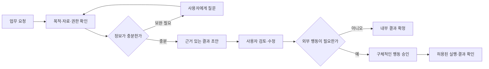

# 부서 에이전트 활용·업무 지시·지원 방식 공동 설계

- 작성: 2026-09-16 / 상태: **사용자와 함께 작성할 설계 문서**
- 상위 범위: [PRD §3-3 AG-01·§8·§10 #28](../PRD.md), [ADR-053](../ADR.md)
- 사용자 지시: 부서별로 도움을 줄 에이전트를 만들되, **활용 방식·작업 지시·업무 지원 설계는 사용자와 함께 진행한다.**
- 이 문서의 부서·업무·동선 예시는 제안이다. 첫 대상 부서, 실제 업무 범위, 실행 권한은 아직 정하지 않았다.

## 1. 함께 정할 목표

각 부서에서 반복되는 업무 하나를 고르고, 사람이 에이전트에게 무엇을 맡기며 어떤 결과를 받아 무엇을 결정할지부터 정한다. 결과가 좋았는지 실제 사례로 확인한 뒤 다음 업무로 넓힌다.

현재 사수에는 부서 기록 검색, 결정 카드, 원장, 질문 대화, S8 문서 기준표 평가가 있다. S8 역할은 문서 평가용 지시문·기준표이며, 임의의 업무를 받아 Slack·메일·외부 시스템에서 실행하는 범용 에이전트가 이미 구현된 것은 아니다.

## 2. 공동 설계 순서

| 회차 | 함께 볼 것 | 결정할 결과 |
|---|---|---|
| 1 | 실제 부서 1개, 반복 업무 1개, 최근 업무 사례 | 누구의 어떤 불편을 해결하는지, 무엇을 받으면 도움이 되는지 |
| 2 | 사람이 지금 사용하는 자료와 처리 순서 | 입력 자료·부서 원칙·판단 기준·모르는 경우의 질문 |
| 3 | 사용자가 할 지시와 받고 싶은 결과 | 지시문 예시·산출물 양식·대화 수정 방식·완료 조건 |
| 4 | 실행 중 생기는 승인·예외·실패 | 할 수 있는 일·승인받을 일·사람에게 넘길 일·중단 조건 |
| 5 | 합성 또는 승인된 실제 사례로 사람이 먼저 따라 해보기 | 출력의 유용성·누락·오판·권한 문제·개선점 |
| 6 | 첫 구현 범위 선택 | PRD/ADR 확정 → phase step 작성 → 검증 → 운영 반영 |

처음부터 모든 부서의 설계를 채우지 않는다. 다음 대화는 **“어느 부서에서 어떤 일을 가장 자주 반복하며, 어떤 결과물을 받으면 바로 쓸 수 있는가?”** 한 사례부터 시작한다.

## 3. 부서별 후보 사례 — 선택 전 예시

| 부서 후보 | 맡길 수 있는 업무 예시 | 참고할 자료 | 기대 결과 예시 | 사람이 결정할 부분 |
|---|---|---|---|---|
| 영업 | 견적 변경·고객 요청 검토 | 고객 요구·견적·가격 원칙·과거 승인 | 변경점, 빠진 정보, 원칙과의 충돌, 고객 회신 초안 | 가격·계약 조건·고객 발송 |
| 개발 | 회의/이슈에서 결정·의존성 정리 | 요구사항·회의 전사·기술 결정·진행 기록 | 미결 사항, 의존성, 검토 질문, 작업 초안 | 일정 약속·우선순위·코드/배포 실행 |
| 고객지원 | 문의 원인 분류·답변 준비 | 승인된 FAQ·제품 문서·이전 해결 사례 | 근거 있는 답변 초안, 확인 필요 정보, 담당자 전달안 | 예외 보상·고객 발송·정책 변경 |
| 경영지원 | 구매/비용 요청의 자료 누락 점검 | 구매 원칙·요청서·견적·승인 원장 | 누락 항목·비교표·승인 요청 초안 | 구매 승인·지출·외부 계약 |

자료 연결 가능 여부, 실제 필요성, 부서 이름은 사용자와 확인한다. 메일·티켓·코드 도구가 모두 연결돼 있다고 가정하지 않는다. 구성원 인사평가·자동 합불 판단을 이 요구에 추가하지 않는다.

## 4. 에이전트 한 개를 정의하는 양식

| 설계 항목 | 함께 채울 내용 | 결정 상태 |
|---|---|---|
| 대상 부서·이용자 | 어느 부서의 누가 쓰는가 | 미정 |
| 업무 목적 | 어떤 반복 업무를 어떤 결과물로 돕는가 | 미정 |
| 발동 방식 | 사용자가 직접 요청 / 정기 요청 / 특정 이벤트 후보 알림 | 미정 |
| 사용 자료 | 허용된 채널·확정 전사·확정 문서·원장·부서 원칙 | 미정 |
| 판단 기준 | 필수 기준, 예외 기준, 기준 충돌 시 우선순위 | 미정 |
| 지시 입력 | 자유 문장 / 업무 양식 / 양식에 자연어 보충 | 미정 |
| 결과물 | 검토표·답변 초안·결정 카드·체크리스트 등 | 미정 |
| 실행 권한 | 조회/초안 작성/내부 등록/외부 변경 각각의 허용 범위 | 미정 |
| 확인 담당자 | 검토·승인·반려·대체 담당자를 누가 맡는가 | 미정 |
| 질문할 조건 | 자료 부족·조건 충돌·모호한 대상·권한 부족 | 미정 |
| 실패 대응 | 재시도·중단·수동 인계·기한 초과 안내 | 미정 |
| 성공 기준 | 사람이 바로 쓸 수 있는 결과의 예와 금지되는 결과 | 미정 |

부서가 다르다는 것은 이름만 바뀐 프롬프트가 아니다. 참고 자료, 원칙, 업무 양식, 결과 검토자, 실행 권한을 실제로 달리 정의해야 한다. 정의를 바꾸면 버전을 남겨 과거 작업이 어떤 기준으로 만들어졌는지 추적한다.

## 5. 작업을 지시하는 방법

첫 구현은 **사용자 요청 → 초안 → 사람 확인** 방식부터 검토하는 제안이다. 이벤트 자동 실행이나 정기 브리핑은 동일 업무의 유용성과 권한 경계를 확인한 뒤 결정한다.

```text
[목적] 이번에 무엇을 해결하려는가?
[자료] 어떤 문서·전사·대화·원장을 참고하는가?
[결과물] 어떤 형식과 깊이로 받고 싶은가?
[판단 기준] 반드시 지킬 원칙·예외·우선순위는 무엇인가?
[기한] 언제까지 필요한가?
[진행 범위] 이번에 초안까지만 만들지, 승인 후 무엇까지 실행할지?
[확인할 것] 모르면 추정하지 말고 먼저 물어볼 항목은 무엇인가?
```

예시 지시문 — 확정된 업무가 아닌 시연용 초안:

> 업로드한 두 견적과 부서 구매 원칙을 비교해 주세요. 금액·업무 범위·납기 변경과 누락된 정보를 표로 정리하고, 승인 전에 물어볼 질문 세 개를 작성해 주세요. 각 사실에는 근거를 붙여 주세요. 고객에게 보낼 회신은 초안으로 준비하고 제가 확인할 수 있게 해주세요.

자유 지시문을 받은 뒤 에이전트는 이해한 목적·자료 범위·결과물·다음 행동을 사용자에게 보여준다. 대상이 모호하거나 실행 권한을 바꾸는 요청은 확인하고, 자료가 부족하면 필요한 자료/질문을 구체적으로 제시한다. 요청 문장에 적힌 이름·부서·직책만으로 권한을 부여하지 않는다.

후속 지시 예: “납기 위험을 먼저 보여줘”, “이 문서는 제외하고 다시 검토해줘”, “초안을 수정했으니 이 버전으로 다시 확인해줘”. 수정한 내용은 새 작업/산출물 버전으로 남기고, 승인 후 내용이 바뀌면 해당 승인을 재사용하지 않는다.

## 6. 업무 지원 동선 제안



진행 중에는 `자료 확인 중 / 결과 작성 중 / 사용자 확인 대기 / 실행 중 / 완료 / 실패 / 중단`을 구분하는 안이다. 사용자가 기다려야 할 이유와 다음 행동을 보여주고, 검토 대기를 실행 완료로 표시하지 않는다. 긴 작업은 재접속 후에도 상태·실패·재시도를 확인할 수 있어야 한다.

제안하는 결과물 공통 구조:

1. 요청과 검토 범위.
2. 확인된 사실과 항목별 근거.
3. 선택지·제안·추론 — 확인된 사실과 구분.
4. 아직 모르는 점과 확인할 질문.
5. 사용자가 결정/승인해야 하는 일.
6. 다음 행동과 현재 실행 여부.

자동 실행 범위가 정해지기 전에는 외부 발송·외부 파일 수정·티켓 생성·구매/지출·배포 등을 작업 성공 조건에 넣지 않는다. 실행을 허용하더라도 승인 대상·수신처·내용·비용·자료 버전에 변경이 생기면 다시 검토해야 한다. 실행 성공 여부는 외부 응답/저장 결과로 확인하고 요청을 보낸 것만으로 완료 처리하지 않는다.

## 7. 자료 검토·기록 보존과의 연결

- [음성·문서 검토](자료검토_음성전사_요구사항.md)에서 확정된 버전만 새 업무의 근거로 선택한다. 전사 초안·읽기 실패 문서를 에이전트가 임의로 확정하지 않는다.
- [Slack 보존](Slack_기록보존_백업_운영안.md)의 기록은 원문과 보관본을 구분하고, 현재 허용된 자료만 읽는다. 보관되어 있다는 사실이 누구나 볼 수 있다는 뜻은 아니다.
- 외부 문서/Slack 메시지 안의 지시문은 업무 자료다. 역할 지시문·사용자 권한·발송 승인·도구 사용 권한을 바꾸는 명령으로 취급하지 않는다.
- 질문/작업 요청자 권한을 처리 시작·근거 검색·확정/실행 단계에서 다시 확인한다. 긴 작업 중 권한이 회수되면 이전 조회 결과를 그대로 내보내지 않는다.
- 수정/삭제된 자료의 인용과 오래된 결과는 재검토하고, 예전 생성 답변 자체를 새로운 사실 근거로 재사용하지 않는다.
- 부서 간 공유, 조직 전체 검색, 원칙 자동 변경은 별도의 공동 설계 대상이다. 현 `can_see()`·동의·마스킹·게스트 무쓰기·append-only 원칙을 유지한다.

## 8. 첫 회차에서 사용자와 채울 업무 사례

아래는 아직 답을 받지 않은 양식이다. 대화에서 나온 표현과 결정만 채운다.

```text
대상 부서:
주로 지시하는 사람과 결과를 쓰는 사람:
최근 실제로 반복한 업무 한 가지:
현재 사람이 하는 순서:
사용한 자료와 확인해야 하는 기준:
에이전트가 만들어주면 좋은 결과물:
사람이 반드시 직접 결정해야 하는 부분:
잘못됐을 때 생기는 문제:
잘된 결과의 예 / 받아들일 수 없는 결과의 예:
다음 검토에서 같이 볼 샘플:
```

공동 설계의 첫 산출물은 이 업무 사례와 에이전트 정의 한 장이다. 이후 동일 샘플로 기대 답안·실패 사례를 만들고, 결과의 근거·수정량·소요 시간·실행 성공률을 측정한다. 목표 수치는 실제 기준선을 본 뒤 합의하며 미리 성과 개선을 주장하지 않는다.

## 9. 결정 기록과 구현 전환

| ID | 결정할 내용 | 상태 | 다음 행동 |
|---|---|---|---|
| AG-D1 | 첫 부서와 반복 업무 | 미정 | 사용자 실제 사례 듣기 |
| AG-D2 | 자료 범위·원칙 우선순위 | 미정 | 사례 자료와 확인 기준 정리 |
| AG-D3 | 작업 지시 형식·산출물 양식 | 미정 | 지시문/결과 예시 함께 수정 |
| AG-D4 | 초안 작성·승인·외부 실행 경계 | 미정 | 행동별 권한과 확인자 지정 |
| AG-D5 | 실패/취소/재시도·담당자 인계 | 미정 | 사례의 예외 상황 따라 해보기 |
| AG-D6 | 성공 기준·첫 구현 범위 | 미정 | 기대 결과와 검증 사례 합의 |

합의된 결정에는 날짜·사용자 확인·관련 자료·이유를 남긴다. PRD §3·§8과 ADR에 반영한 후에만 구현 계약으로 취급하고 `phases/`로 넘긴다. 이 문서를 만들었다고 에이전트 활용 설계가 끝났다고 표시하지 않는다.
