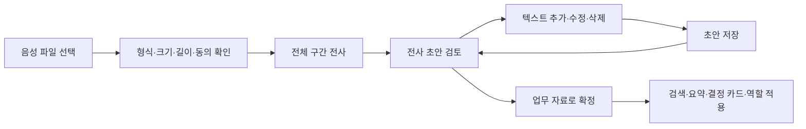

# 음성 파일 전사 관리와 문서 읽기 결과 검토

- 작성/갱신: 2026-09-16 / 상태: **ADR-054에 따라 개발·로컬 실제 연동 검증. 운영 적용 전**
- 상위 범위: [PRD §3-3·§8](../PRD.md), [ADR-053](../ADR.md)
- 관련 문서: [Slack 기록 보존](Slack_기록보존_백업_운영안.md), [부서 에이전트 공동 설계](부서_에이전트_공동설계.md)

## 1. 사용자 요구

1. 음성 파일을 올리면 해당 파일 전체를 텍스트로 바꾸고, 전사 내용을 추가·수정·삭제할 수 있는 페이지가 필요하다.
2. 문서를 넣은 뒤 시스템이 실제로 어떻게 읽었는지 사용자가 한 번 더 확인하고 승인할 수 있어야 한다.
3. 검토한 자료가 부서 에이전트의 근거가 되도록 연결한다.

네이버 클로바노트는 원하는 사용 경험의 참고다. 공급자를 바꾸거나 화자 생체 식별·녹음·협업 기능 전체를 복제하자는 결정은 아니다. “전체 전사”는 지원하는 파일의 시작부터 끝까지 처리 상태를 책임진다는 뜻이며, 인식 정확도 100%를 약속한다는 뜻이 아니다.

## 2. 개발 전 기능과 추가 요구

아래 표는 개발 전 기준과 확장 요구를 비교한다. 새 구현 결과는 [실행 기록](../verification/reviewed-materials-2026-09-16/README.md), 운영 기존 기능은 [기존 검증 기록](../verification/continuity-production-2026-09-16.md)을 참조한다.

| 영역 | 현재 구현 | 추가할 요구 |
|---|---|---|
| 음성 | `/api/d/[dept]/voice`가 파일을 받아 `llm.transcribeAudio()`로 텍스트 반환. 질문 입력 용도, 원본 비저장, 앱 한도 10MB | 파일별 전사 목록·전체 처리 진행·저장 가능한 초안·편집·확정·삭제 |
| 회의 | `.vtt/.txt` 전사 업로드 후 기존 회의 처리 | 음성 파일 자체에서 전사를 만들고 검토한 뒤 회의 자료로 확정 |
| 문서 | TXT/MD/CSV/JSON/PDF/DOCX, 앱 한도 20MB. 추출·chunk 생성 뒤 저장/처리 | 저장된 요약만 보는 것이 아니라 **추출문을 먼저 검토·정정·승인** |
| 변경 반영 | 원문 버전·오래된 파생물 무효화·삭제 처리 기반 존재 | 검토 초안과 업무에 사용 중인 확정 버전을 연결하는 발행 흐름 |

현재 코드 근거: [voice route](../../app/api/d/[dept]/voice/route.ts), [voice validation](../../lib/adapters/voice.ts), [document route](../../app/api/d/[dept]/documents/route.ts), [document extraction](../../lib/adapters/document.ts). 위 한도는 현재 앱의 제한이며 새 기능의 목표 한도가 아니다.

## 3. 화면 구성 제안

`음성·자료 검토` 메뉴의 `/d/[dept]/reviews`와 `/d/[dept]/reviews/[id]`에 목록/업로드와 상세 검토를 구현했다. 음성과 문서의 편집/확정 절차를 공유한다.

| 화면 | 목적 | 핵심 요소 |
|---|---|---|
| 음성 기록 목록 | 올린 음성과 전사의 처리/검토 상태 관리 | 제목·파일명·길이·처리 상태·검토 상태·소속 부서·공개 범위·최종 수정일·다시 열기 |
| 전사 검토 상세 | 전체 전사를 읽고 수정한 뒤 확정 | 구간별 텍스트, 구간 추가/삭제/수정, 검색, 저장 상태, 수정 취소, 확정/사용 중지, 내보내기 |
| 문서 읽기 결과 검토 | 원문과 추출문을 비교하고 오류 교정 | 파일 정보, 원본 위치, 추출문, 읽기 실패/누락 안내, 수정·재추출·확정 |

사용자가 **원본 보관 후 다시 듣기**를 선택했다. 비공개 Storage에 원본을 보관하고 재접속 후 재생·구간 이동을 제공한다. 음성은 50MB·30분, 구간은 60초+경계 1초 중첩이다. 문장별 정확한 시각이나 자동 화자 식별을 제공하지 않는다. 모든 참여자의 현재 동의를 업로드 전에 확인한다.

## 4. 음성 전사 사용자 흐름

| ID | 요구사항 | 수용 기준 |
|---|---|---|
| A-01 | 업로드 전에 지원 형식·크기·길이·공개 범위·원본 보관 방침을 안내 | 제한 초과는 실제 처리 전 안내. 일부만 처리하고 완료 표시하지 않음 |
| A-02 | 지원 길이 전체 처리 | 파일 총 길이, 완료/실패/미처리 구간을 구분. 마지막 구간까지 처리했음을 검증 가능 |
| A-03 | 긴 음성 분할·중단 복구 | 구간별 작업 ID와 진행 상태 유지. 겹친 구간 중복·잘린 문장·순서 오류 검사. 실패 구간만 재시도 가능 |
| A-04 | 전사 편집 | 문장/구간 추가·수정·삭제, 제목 수정, 초안 저장, 재접속, 최신 저장 상태 확인 |
| A-05 | 전사와 사용자 메모 구분 | 직접 추가한 문장은 `사용자 추가`, 교정한 문장은 `수정됨`. 실제 발언 시각이 없는 문장에 시각을 꾸며 붙이지 않음 |
| A-06 | 검토 후 확정 | 최신 저장 버전과 사용자 확인 버전이 일치할 때만 확정. 이중 클릭·재전송으로 중복 자료가 생기지 않음 |
| A-07 | 확정 후 정정 | 새 초안 버전에서 수정 후 재확정. 이전 결정/인용을 조용히 덮어쓰지 않음 |
| A-08 | 삭제 종류 구분 | 텍스트 구간 삭제, 전사 전체 삭제, 음성 원본 삭제를 별도 안내. 연관 근거 영향과 보존되는 결정 인용을 고지 |
| A-09 | 확인한 전사 내보내기 | TXT/MD 제안. 구간 시간이 유효하면 VTT 추가 검토. 부서·공개 범위·출처·확정 버전·작성/확정 시각 포함 |

전사 도중 취소하면 후속 job과 늦은 완료를 무효화한다. 원본을 이미 폐기하여 재시도가 불가능하면 파일 재업로드를 안내한다. 전사 모델이 불명확한 구간을 알려주면 검토 표시를 제공하되, 모델이 제공하지 않은 신뢰도 숫자를 만들어내지 않는다. 무음·잡음·겹침 발언을 근거 없이 보충하지 않는다.

## 5. 문서 읽기 결과 검토 흐름

**업로드 → 추출 → 읽기 결과 확인 → 수정/재추출 → 확정 → 업무 활용** 순서다. 사용자가 보고 승인해야 하는 대상은 요약이 아니라 실제 근거로 저장될 텍스트다.

| ID | 요구사항 | 수용 기준 |
|---|---|---|
| D-01 | 읽힌 내용을 빠짐없이 확인 | 전문을 구간별로 탐색 가능. 화면 표시·LLM 입력 한도가 전체 저장/처리 범위를 조용히 자르지 않음 |
| D-02 | 읽힌 위치 추적 | PDF 페이지, DOCX 문단/표, TXT/MD 줄, CSV 행·열, JSON 경로 등 추출기가 실제 제공하는 위치만 표시. 알 수 없으면 `위치 정보 없음` |
| D-03 | 실패·누락을 드러냄 | 스캔 PDF, 표 순서 뒤섞임, 암호화/손상 파일, 빈 추출 결과 등을 검토 대상으로 표시. OCR 미지원 자료를 읽었다고 표시하지 않음 |
| D-04 | 텍스트 교정과 재추출 | 변경 전후를 비교. 사용자가 고친 부분을 재추출 결과가 덮어쓰지 않도록 선택·충돌 처리 |
| D-05 | 확정 전 차단 | 초안은 검색·결정 카드·문서 역할 평가의 입력에서 제외. 검토 화면의 예상 요약이 있다면 초안임을 표시 |
| D-06 | 확인 기록 | 확인자·확인 시각·정확한 버전·공개 범위 기록. 실제 재확인 없이 기존 자료를 `사용자 확인 완료`로 이관하지 않음 |
| D-07 | 요약과 근거의 분리 | 확정된 추출문을 근거로 요약. AI가 원문에 없는 설명을 추가한 경우 원문 텍스트에 섞지 않음 |

OCR, PPTX, XLSX, 이미지 파일은 지원하지 않는다. TXT/MD/CSV/JSON/PDF/DOCX의 20MB 이하 문서를 보관하고 전문을 추출한다. 빈 추출/손상은 실패로 표시한다. 문서 원본 다운로드와 변환문 비교를 제공하며 추출기가 제공하지 않은 페이지/행/표 좌표는 `위치 정보 없음`으로 표시한다.

## 6. 공통 상태·권한·버전 제안

처리 상태와 업무 공개 상태를 별도로 둔다. DB는 `uploading/processing/ready/failed/cancelled/deleted`와 `revision/published_revision/published_source_id`로 관리한다.

- 처리: `업로드 중 → 대기 → 변환 중 → 검토 가능`, 실패/부분 실패/취소는 각각 원인과 재시도 동선 제공.
- 검토: `초안 → 검토 중 → 확정`; 공개 여부: `사용 전 / 업무에 사용 중 / 사용 중지 / 삭제`.
- 확정본 편집은 새 초안이다. 기존 확정본을 계속 사용할 경우 **“이전 확정본 사용 중”**을 명확히 표시하며, 잘못된 근거를 발견하면 즉시 `사용 중지`할 수 있어야 한다. 새 확정본 교체·이전 파생물 무효화·재처리 예약은 원자적으로 수행한다.
- 삭제된 버전으로 진행하던 전사·요약·임베딩 작업이 뒤늦게 완료돼도 자료를 복원하거나 발행하지 못한다.
- 검토 권한은 현재 부서 멤버십으로 판정한다. 현재 문서/회의 업로드가 lead 전용인 점을 기준으로 유지하고, 멤버의 초안 작성 허용 및 최종 확인자 역할은 사용자와 결정한다. 조직 관리자 권한만으로 전사·문서 내용을 읽지 못한다.
- 사용자 입력으로 부서·작성자·확인자를 위조하지 못하게 한다. 원본 파일·초안·미리보기·다운로드에도 같은 부서/공개 범위 검증을 적용한다. 새로운 저장 객체의 RLS도 SQL `can_see()`의 공통 판정을 사용하도록 설계하며 별도 애플리케이션 권한 판정을 복제하지 않는다.
- 추출/전사 텍스트는 마스킹하고 로그에는 ID·길이·상태·오류 코드만 남긴다. 승인된 원본 파일은 비공개 보관 예외다. 여러 사람의 녹음은 모든 참여자를 동의 완료 멤버에서 선택하고 확인해야 한다. 한 명이라도 동의를 철회/탈퇴하면 전체 녹음·전사·검색 근거를 삭제 처리한다. 결정 인용은 기존 정책을 유지한다.
- 원장 결정은 append-only다. 정정·삭제된 근거와 기존 결정 인용의 관계는 ADR-022·052를 유지하고, 변경 안내 및 현재 유효 근거 재검증을 적용한다.

구간별 기존 `jobs`/워커와 attempt/lease를 사용한다. 작업당 2분 실패 정리, 취소 후 늦은 완료 차단, 실패 구간 재시도를 구현했다. 원본과 변환 구간으로 다시 이어갈 수 있으며, 원본 업로드 자체가 끝나지 않았으면 재업로드를 안내한다. 중첩부 중복은 검토자가 원본과 대조한다. 30분을 초과한 파일을 일부만 처리하여 완료 표시하지 않는다.

## 7. 사용 전 합의할 항목

| 결정 | 후보/논점 | 현재 상태 |
|---|---|---|
| 음성 지원 목표 | 50MB·30분, 브라우저가 디코딩 가능한 형식 | 초기 구현. 한국어 TTS 실제 검증 |
| 원본 보관 | 비공개 보관·재접속 재생, 삭제/동의 철회 시 차단·제거 | 사용자 선택 반영 |
| 편집·확정 권한 | 동의한 현재 부서장 | 초기 구현 |
| 문서 한도·OCR | 20MB, 기존 여섯 형식, OCR 미지원 | 실제 업무 복잡한 표/스캔 품질은 후속 검증 |
| 수정 이력 | 저장 버전 목록·최초 변환문 비교·편집 취소·재추출 후보 선택 | 임의 과거 버전 자동 복구/수정 사유 입력은 후속 |
| 삭제·복원 | 원장 인용 유지, 최신 삭제·동의 복원 시 재적용 | 운영 백업 기간/파기 시차는 미정 |
| 우선순위 | 자료 검토와 보존 기반 개발, 부서 에이전트 업무는 공동 설계 | 사용자 개발 지시 반영 |

## 8. 후속 개발의 검증 시나리오

- 음성: 전체 길이 처리, 긴 파일 마지막 구간, 무음/손상/한도 초과, 구간 실패 후 재시도, 중복 업로드, 취소 후 늦은 완료, 재접속 편집 복구.
- 편집: 추가 문장의 출처 구분, 두 창의 동시 수정 충돌, 저장 전 닫기 안내, 확정 버전 변경 중 요청 경합, 확정본 사용 중지.
- 문서: 표·다단 PDF·한국어·CSV/JSON·빈 문서·스캔 PDF·깨진 파일, 추출 누락 표시, 재추출과 사용자 교정 충돌.
- 권한: 다른 부서·권한 회수 사용자·초안 무단 접근, 원본 다운로드 URL, 게스트 무쓰기·LLM 0회.
- 파생물: 확정 전 검색/카드/역할 평가 제외, 교체·삭제 후 오래된 임베딩/카드 무효화, 기존 원장 보존.

실제로 실행한 항목과 한계는 [검증 기록](../verification/reviewed-materials-2026-09-16/README.md)에 둔다. 검증 계획 목록 전체가 실제 실행됐다고 간주하지 않는다. 운영 적용 절차는 [설정 가이드](../setup-reviewed-materials.md)를 따른다.

2026-09-17 후속 검증: 원본만 삭제할 때 미저장 편집 유지, 부분 실패 중 나머지 구간의 진행 확인, 늦은 상태 조회의 덮어쓰기 방어는 [phase 22 기록](../verification/review-state-recovery-2026-09-17/README.md)에 별도로 남긴다.
