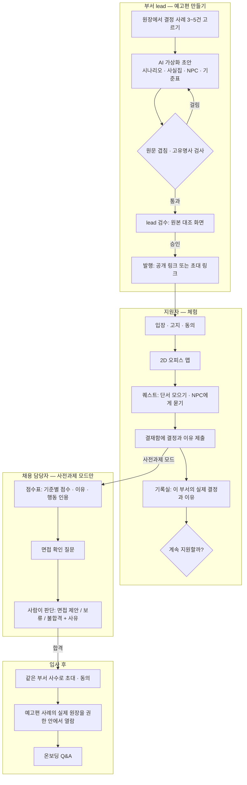

# 채용 예고편 — 사수 로드맵 ④ 컨셉

- 문서 버전: 0.2 · 작성일: 2026-09-14 · 갱신: 2026-09-15
- 착수 갱신: 사용자 요청으로 합성 콘텐츠 기반 R1 체험 슬라이스를 개발한다. 확정 범위는 [PRD §3-1](../PRD.md), 변경 이유는 [ADR-040](../ADR.md). 아래 R0의 구현 유보 및 Phaser 후보는 이 범위에 한해 대체된다. 실데이터 가상화·발행과 R2는 후속이다.
- 범위 확대 (2026-09-15 사용자 결정, [PRD §3-2](../PRD.md)·ADR-045): 실데이터 발행(원장 → 가상화 → 결정적 검사 → **항목별 공개 승인** → **조직 공개 허용** 시 발행)과 **합성 지원자** 채점을 9/20 제출에 포함한다. 실제 지원자 초대·동의·채점은 여전히 법률 자문 전 비활성이다. 상세 계약은 [planning/메인웹사이트_관리자콘솔_설계.md](../planning/메인웹사이트_관리자콘솔_설계.md) §C. 아래 본문의 "9/20 제출물에는 넣지 않는다"는 이 범위에 한해 대체된다.
- 지위: **로드맵 컨셉 문서이며 구현 계획이 아니다.** 범위의 권위는 [PRD](../PRD.md) §3·§8-1에, 결정 이유는 [ADR-039](../ADR.md)에 있다. 9/20 제출물과 게스트 모드에는 넣지 않는다. 구현에 들어가려면 PRD에 범위를 올리고 ADR과 ARCHITECTURE(권한·불변식)를 먼저 고친다.
- 출발점: 2026-09-14 사용자 아이디어 "직업예고편"(입사 전에 실제 직무를 게임처럼 체험하는 웹)을 사수와 비교한 뒤 두 아이디어를 결합하기로 했다. 기획서 v3 §09 로드맵 ④ "인사평가 보조"를 대체한다.
- 재사용하는 사수 자산: 결정 원장(PRD §6-4) · 원칙 문서 · ROLES 기준표 평가(ADR-038) · 인용 문자열 검증(ADR-013·035) · 게스트 모드 원칙(ADR-019) · 정규식 마스킹

---

## 0. 한 문장

> 사수는 우리 부서가 어떻게 결정하는지 안다. 그래서 **입사 전에는 그걸 게임으로 미리 보여주고, 입사 후에는 그걸 알려준다.**

---

## 1. 왜 사수와 합치나

### 1-1. 풀려는 문제

| 누구 | 지금 겪는 일 |
|---|---|
| 지원자 | 공고(JD) 문장만으로는 실제로 어떤 판단을 하며 일하는지 모른다. 입사한 뒤에야 "생각한 일과 다르다"는 걸 안다 |
| 채용 담당자 | 직무마다 사전과제를 새로 설계하기 어렵고, 결과물만으로는 일하는 방식을 알 수 없다. 생성형 AI가 결과물을 대신 써줄 수 있어 과제 결과를 믿기도 어려워졌다 |
| 부서 (합격 이후) | 신입은 부서의 과거 결정과 기준을 몰라 같은 질문을 반복한다. 사수가 원래 풀려던 문제(PRD §0)와 뿌리가 같다 |

조기 퇴사율 같은 수치는 출처를 확인한 뒤에만 쓴다 `(확인 필요)`.

### 1-2. 따로 두면 남는 빈틈

| | 직업예고편 단독 | 사수 단독 |
|---|---|---|
| 약점 | 회사가 업무와 문서를 매번 따로 입력해야 한다. 적합도를 검증할 정답 데이터가 없다. 가상 직무 체험·게임형 역량검사와 겹친다 | 원티드 본업(채용)과 멀다. 입사 전 단계가 없다 |

### 1-3. 결합 논리 — 사수에 쌓인 것이 예고편의 재료다

| 예고편에 필요한 것 | 사수에 이미 있는 것 |
|---|---|
| 실제 업무 상황 | 결정 요청 카드, 결정 원장(`decisions.outcome`·`rationale`) |
| 부서의 판단 기준 | 노션 원칙 문서(`sources.is_principles`) |
| 채점 기준표 | ROLES 기준표(`agent_roles.criteria`, ADR-038) |
| 사실을 지어내지 않는 NPC | ASK의 인용 강제와 refused 패턴 |
| 입사 후 이어지는 경험 | 같은 부서 사수의 권한 인지 Q&A |

---

## 2. 두 가지 모드

| | 공개 예고편 | 사전과제 예고편 |
|---|---|---|
| 언제 | 지원 전 | 지원 후, 담당자가 초대 |
| 누가 | 누구나 (로그인 없음) | 초대 링크를 받고 동의한 지원자 |
| 목적 | 지원자가 자기에게 맞는지 판단(자기 선택) + 회사 소개 | 담당자가 일하는 방식을 참고 |
| NPC | 발행 때 lead가 승인한 선택지 대화만 | 사실집 안에서 답하는 자유 질문 (LLM) |
| 채점 | 없음 | 기준별 점수·이유·인용, 참고용 |
| 수집하는 개인정보 | 없음 | 동의 범위 안의 답변과 행동 로그 |
| 플레이 중 LLM 호출 | 0회 (게스트 모드 원칙 계승) | NPC 질문 상한 + 채점 1회 |
| 규제 부담 | 낮음 `(고영향 AI 해당 여부 확인 필요)` | 높음 (§9) |

**공개 예고편을 먼저 만든다(R1).** 개인정보도 채점도 없는 상태에서 "실제 같은 체험"과 "기밀 가상화"가 되는지부터 검증한다.

---

## 3. 전체 흐름

---

## 4. 시나리오 만들기 — 결정 원장에서 게임으로

### 4-1. 입력 경계

- 입력은 **`leads_only` 소스를 인용하지 않은(가시성 `dept`) 결정 원장 행과 원칙 문서**뿐이다. 경영회의처럼 좁은 소스가 섞인 결정은 후보 목록에 아예 뜨지 않는다.
- 슬랙·회의 원문 발언(`items`)은 시나리오 생성에 넣지 않는다. 구성원 동의(`consented_at`)는 부서 안에서 쓰는 것에 대한 동의라서, 외부 지원자용 콘텐츠의 재료로 쓰면 목적 외 이용이 된다. 결정 행은 결정권자가 남긴 업무 기록이라 경계가 더 분명하다 `(확인 필요: 결정 기록을 채용 과제에 쓸 때 동의문 개정이 필요한지)`.
- `supersedes_id`로 정정된 결정은 최신 행만 쓴다.

### 4-2. 가상화

AI가 초안을 만들고 사람이 승인한다.

| 바꾸는 것 | 방법 |
|---|---|
| 사람 이름·직함 | 역할 이름으로 치환 ("재무 담당", "협력사 영업") |
| 회사·고객사·협력사 이름 | 가상의 이름 |
| 금액·수량·날짜 | 비율과 순서는 유지하고 값만 변형 (12% 인상 → 14% 인상) |
| 제품·프로젝트 코드명 | 가상의 이름 |
| **판단 구조** | **그대로 유지** — 원칙, 이해관계자, 트레이드오프, 실제 결정과 이유 |

산출물은 네 가지다: ① 시나리오 본문 ② **사실집**(NPC와 오브젝트가 말할 수 있는 사실 목록) ③ NPC 배역 ④ 기준표 초안.

### 4-3. 발행 게이트 — 전부 통과해야 발행된다

1. **원문 겹침 검사**: 시나리오나 사실집에 원장·원칙 문서·인용 quote와 연속 N자 이상 같은 구간이 있으면 발행을 막는다. 문자열 검사라서 결과가 결정적이다(ADR-013과 같은 철학). N은 R1에서 정한다 `미정`.
2. **고유명사 검사**: 부서 멤버 표시명, 슬랙 채널명, lead가 등록한 고객사·협력사 사전과 일치하는 문자열이 있으면 막는다.
3. **정규식 마스킹 재적용**: 전화·이메일·계좌 같은 기존 마스킹 규칙을 한 번 더 돌린다.
4. **lead 검수**: 왼쪽에 원장 원문, 오른쪽에 가상화본을 두고 문장 단위로 승인한다. 이 대조 화면은 lead 세션에서만 열린다.
5. **변형본 로테이션**: 한 사례에서 수치와 순서를 바꾼 변형본을 여러 개 발행한다. 시나리오가 외부에 공유돼도 효과가 한꺼번에 무너지지 않게 하려는 것이다.

---

## 5. 게임 UI — ZEP풍 2D 오피스

### 5-1. 시각과 조작 문법

ZEP이나 Gather 같은 2D 메타버스에서 익숙한 문법을 빌린다. 처음 들어온 사람도 설명 없이 움직일 수 있다는 점이 이 문법의 장점이다.

- **탑뷰 픽셀 아트** 오피스 맵 (타일 크기 `미정`, 32px 기준으로 검토)
- **아바타 이동**: 방향키나 WASD, 또는 바닥을 클릭해서 이동
- **오브젝트 상호작용**: 가까이 가면 `[F] 살펴보기` 같은 프롬프트가 뜬다 (키는 구현 때 확정)
- **NPC 대화**: 말풍선과 하단 대화창
- **아바타 꾸미기는 최소한**: 색과 머리 모양 몇 가지뿐이고, 사진이나 얼굴 업로드는 없다. 외모가 평가에 섞일 여지를 처음부터 없앤다(채용절차법 제4조의3 취지)
- **ZEP의 에셋·로고·UI를 가져다 쓰지 않는다.** 문법만 참고하고 에셋은 직접 만들거나 CC0 타일셋(예: Kenney)을 쓴다. 대회 유의사항의 타인 권리 침해 금지와도 맞물린다
- UI 색은 사수 브랜드 토큰(심녹색 `#17614A`)을 쓴다. 한글 픽셀 폰트는 OFL 계열(예: Galmuri)을 후보로 둔다 `(라이선스 확인 필요)`

### 5-2. 맵 — 사수의 개념이 방이 된다

| 사수의 개념 | 맵의 장소 | 지원자가 하는 일 |
|---|---|---|
| 노션 원칙 문서 | **서고** · 원칙 문서 책장 | 부서 원칙을 읽는다 |
| 회의 보류 안건 | **회의실** · 화이트보드 | 지난 회의에서 왜 보류됐는지 본다 |
| 슬랙 스레드 | **메신저 단말** · 가상 사내 메신저 | 팀원이 남긴 질문을 읽는다 |
| 이해관계자 | **부서 사무실** · 동료 NPC 2~3명 | 궁금한 것을 묻는다 |
| 결정 카드 | **팀장실** · 결재함 | 결정과 이유를 제출한다 |
| 결정 원장 | **기록실** (엔딩) | 이 부서의 실제 결정과 이유를 본다 |
| 사수 Q&A | **휴게실** · 사수 NPC | 조작법과 진행 힌트를 듣는다 (평가와 무관) |

맵 배치 초안 (3×3, 위가 북쪽):

| 서고 · 원칙 문서 책장 | 회의실 · 보류 안건 화이트보드 | 팀장실 · 결재함 |
|:---:|:---:|:---:|
| **휴게실** · 사수 NPC | **부서 사무실** · 동료 NPC | **메신저 단말** · 가상 스레드 |
| (비움) | **로비** · 입장·고지·아바타 | **기록실** · 엔딩 |

동선이 로비 → 사무실 → 주변 방 → 팀장실 → 기록실 순서로 자연스럽게 흐르도록 배치했다. 순서를 강제하지는 않는다. 어떤 방을 먼저 들르는지도 판단 과정의 일부다.

### 5-3. HUD

- **좌상단 퀘스트 트래커**: 예) "협력사 단가 인상 건 — 결재함에 결정 올리기"
- **우상단 단서 수첩**: 살펴본 오브젝트와 NPC 답변이 자동으로 쌓인다. 결정 이유를 쓸 때 여기서 골라 인용할 수 있다
- **좌하단 미니맵**: 아직 안 가본 방이 표시된다
- **하단 대화창**: NPC 말풍선. 사전과제 모드에서는 자유 질문 입력창이 붙는다
- **우하단 목록형 모드 전환 버튼**: 항상 보인다 (§5-6)
- **남은 시간**: 기본으로는 표시하지 않는다. 담당자가 제한을 걸면 표시하고, 지원자가 연장을 요청할 수 있다

### 5-4. 퀘스트 한 판 — 예시

PRD §2-3 "외주사 B 견적"을 가상화한 버전이다.

1. **로비** — 사수 NPC: "오늘 결재함에 올라온 건이 하나 있어요. 마감 전에 결정해서 올려주세요."
2. **메신저 단말** — 팀원 메시지: "파란물류가 단가를 14% 올려달라는데, 받아도 돼요?"
3. **회의실 화이트보드** — "파란물류 단가 인상 — 재무 회신 대기로 보류"
4. **서고** — 원칙 문서: "연 10% 이상 인상 요청은 재입찰을 검토한다"
5. **부서 사무실** — 재무 담당 NPC에게 "올해 물류 예산 여유 있어요?"라고 물으면 사실집에 있는 답만 한다. 협력사 영업 NPC는 "3년 거래했고 품질 문제는 없었다"는 사실을 알고 있다
6. **팀장실 결재함** — 선택지 셋(수용 / 재입찰 검토 / 부분 수용으로 협상) 중 하나를 고르고 이유를 쓴다. 단서 수첩에서 인용할 수 있다
7. **기록실** — "이 부서는 **재입찰 검토**로 결정했습니다. 이유: 원칙 문서의 연 10% 기준 초과." 옆에 내 선택이 요약된다. 실제 결정과 달라도 틀렸다고 표시하지 않는다. 다른 판단도 합리적일 수 있고, 채점하는 것은 판단 과정이다(§6)

### 5-5. NPC 대화 규칙

- NPC는 **사실집에 있는 사실만** 말한다. 답변마다 사실집 항목을 인용하고, 인용 문자열이 사실집에 없으면 그 문장은 버린다. ASK의 인용 검증(ADR-013·035)과 같은 규칙이다.
- 사실집에 없는 질문에는 "그건 제가 모르겠어요" 같은 고정 문구로 답한다. NPC가 지원자마다 다른 사실을 지어내면 모두가 같은 과제를 푼 게 아니게 된다. 이건 공정성 문제다.
- 공개 모드는 발행 때 lead가 승인한 선택지 대화만 쓴다(LLM 0회).
- 사전과제 모드의 자유 질문은 `llm.structured("trailer_npc", …)`로만 호출한다. 질문 수 상한은 `미정`이고, 모델은 R2에서 지연과 품질을 재보고 정한다.

### 5-6. 접근성과 공정성

- **목록형 모드**: 같은 오브젝트, NPC, 결재함을 맵 없이 버튼 목록으로 제공한다. 시나리오·사실집·기준표는 게임 모드와 똑같다. 게임 조작이 어려운 지원자, 스크린리더 사용자, 모바일 사용자를 위한 동등한 경로다 `(확인 필요: 장애인차별금지법의 정당한 편의 제공 요건)`.
- **조작은 채점하지 않는다.** 이동 경로, 이동 시간, 조작 실수는 기록하지 않는다(§6-1).
- 색으로만 정보를 구분하지 않는다. NPC 대사는 항상 텍스트로 남는다.

### 5-7. 구현 방식 — 자체 구현, ZEP은 문법만 참고

| | ZEP 위에 구현 (ZEP Script) | 자체 구현 (Next.js 안) |
|---|---|---|
| 속도 | 빠르다. 맵·아바타·멀티플레이가 이미 있다 | 느리다. 맵·이동·충돌 처리를 직접 만들어야 한다 |
| 지원자 데이터 | 제3자 플랫폼을 거친다 `(확인 필요: 처리위탁, 지원자 계정 필요 여부)` | 우리 DB 안에서 끝난다 |
| 권한·인용 검증 | `can_see()`·RLS·인용 검증을 그 안에서 집행할 수 없다 | 사수 불변식을 그대로 적용한다 |
| 행동 로그 무결성 | 플랫폼 API가 허용하는 범위에 묶인다 | append-only로 설계할 수 있다 |
| **판단** | 기각 | **채택** |

자체 구현 후보 스택은 2D 웹 게임 엔진 **Phaser**(버전은 착수 때 확정)와 타일맵 편집기 **Tiled**(JSON 내보내기)다. 게임은 Next.js 클라이언트 컴포넌트로 불러오고 SSR에서는 뺀다. 한 사람이 혼자 푸는 과제라 멀티플레이는 필요 없다.

ZEP Script는 R1 착수 전에 조작감을 빨리 확인해 보는 프로토타입 용도로만 고려한다. 이때도 합성 데이터만 쓰고 실제 지원자는 받지 않는다.

---

## 6. 평가 — 결과가 아니라 과정 (사전과제 모드)

### 6-1. 무엇을 기록하나

행동 로그는 append-only 이벤트로 남긴다.

| 이벤트 | 내용 |
|---|---|
| `open_object` | 어떤 오브젝트를 열었나 (서고 원칙, 화이트보드 등) |
| `ask_npc` / `npc_answer` | 누구에게 무엇을 물었고 어떤 사실을 받았나 |
| `note` | 단서 수첩에 남긴 메모 |
| `choose` / `revise` | 결정 선택, 바꿨다면 이전 선택 |
| `submit` | 최종 결정과 이유 서술 |

**기록하지 않는 것**: 이동 좌표 궤적, 키 입력 속도, 마우스 움직임, 웹캠, 마이크. 붙여넣기 감지로 부정행위를 판정하지도 않는다.

### 6-2. 기준표 — ROLES 재사용

기준은 lead가 정한다. 형식은 ADR-038과 같다(기준 1~10개, 가중치 1~5). 예시는 다음과 같다.

| 기준 | 설명 | 근거가 되는 것 |
|---|---|---|
| 원칙 확인 | 부서 원칙을 확인하고 판단에 반영했나 | 서고 `open_object` 이벤트 + 이유 서술 속 원칙 언급 |
| 이해관계자 확인 | 영향받는 사람에게 필요한 것을 물었나 | `ask_npc` 이벤트 |
| 트레이드오프 서술 | 비용·관계·품질 중 둘 이상을 비교했나 | 이유 서술 인용 |
| 결정의 명확성 | 무엇을 할지, 그다음에 뭘 할지가 분명한가 | 이유 서술 인용 |

### 6-3. 채점 규칙 (ADR-038 계승)

- 채점은 job `score_trailer_attempt`가 `llm.structured`를 1회 호출해서 한다. 기준마다 점수(0~5 또는 null), 이유, 인용을 받는다.
- **인용은 지원자 본인의 것만 인정한다.** 이유 서술 속 문자열이면 포함 여부를, 행동 로그 이벤트 번호면 존재 여부를 검증한다. 검증에 실패한 기준은 "근거 없음 (0점 반영)"으로 처리한다.
- 총점은 모델이 아니라 코드가 계산한다. 분모는 전체 기준의 가중치 합이다.
- **실제 부서 결정과 같은지는 점수에 넣지 않는다.** 담당자 화면에 참고로만 표시한다.
- 직무 무관 특성(나이·성별·출신지역·학교 서열 등) 가드를 시스템 프롬프트에 고정하고, lead 지시문이 이를 덮어쓸 수 없게 한다.
- 합격·불합격·추천 필드는 스키마에 두지 않는다.

### 6-4. "AI가 추린다"는 말의 뜻

AI는 지원자를 거르지 않는다. **사람이 거를 수 있도록 근거를 정리할 뿐이다.**

| AI가 하는 일 | 사람이 하는 일 |
|---|---|
| 기준별 점수·이유·인용 작성 | 점수표를 읽고 판단한다 |
| 기준 점수로 정렬·필터 (예: "이해관계자 확인 근거 없음"만 보기) | 지원자별 상태(면접 제안 / 보류 / 불합격)를 바꾸고 사유를 적는다 |
| **면접 확인 질문** 생성 (예: "재무 담당에게 묻지 않고 결정한 이유는?") | 면접에서 되묻고 확인한다 |

- **일괄 불합격 기능은 없다.** 점수로 한꺼번에 떨어뜨리는 버튼은 사람이 누르더라도 사실상 자동화된 결정에 가깝다(개인정보보호법 제37조의2 쟁점).
- 화면에는 S8과 같은 고정 문구 "참고용 · 최종 판단은 담당자"를 둔다.

### 6-5. 생성형 AI로 대신 풀면

막을 수 있다고 주장하지 않는다. 대신 영향을 줄인다.

- 채점의 무게를 결과물(이유 서술)에서 과정(무엇을 확인하고 누구에게 물었나)으로 옮긴다. 과정은 게임 안에서 직접 움직여야만 남는다.
- 면접 확인 질문으로 사람이 한 번 더 되묻는다.
- 변형본 로테이션으로, 시나리오 답안이 돌아다녀도 그대로 가져다 쓰기 어렵게 한다.

---

## 7. 입사 후 — 같은 사수가 온보딩한다

- 합격자는 같은 부서의 사수 워크스페이스에 초대되고, 기존 동의 흐름(S0)을 똑같이 거친다.
- 예고편에서 본 사례의 **실제 원장**을 권한(`can_see()`) 안에서 열람한다. 게임에서 겪은 그 건이 실제로는 어떻게 결정됐는지 확인하는 순간, 온보딩 첫날의 질문이 이미 준비돼 있는 셈이다.
- **예고편 결과는 입사 후 평가에 쓰지 않는다.** 점수표는 채용 절차가 끝나면 보관 기간이 지난 뒤 파기한다(§9). 본인이 원하면 자기 예고편 리포트(내 선택과 실제 결정의 비교, 점수는 제외)를 온보딩 노트로 가져올 수 있다. 기획서 §09 ⑤의 본인 소유 원칙과 같다.
- 게임 점수와 입사 후 성과의 관계를 보는 타당도 연구는 R4다. 집계·익명 분석만 하고, 개인 단위 비교 결과는 회사에 주지 않는다. 별도 동의와 법률 검토가 먼저다.

---

## 8. 불변식 — 구현할 때 ARCHITECTURE로 올릴 후보

1. 지원자 화면에는 가상화한 시나리오만 나간다. 원문(슬랙·회의·문서·원장) 문자열은 발행 게이트(§4-3)를 통과하지 못하면 밖으로 나갈 수 없다.
2. 시나리오 입력은 가시성 `dept`인 결정 원장과 원칙 문서뿐이다. `leads_only`와 원시 발언(`items`)은 뺀다.
3. 발행에는 lead 승인이 필요하다. AI 초안이 곧바로 공개되는 경로는 없다.
4. 합불·추천 필드, 자동 탈락, 자동 발송, 일괄 불합격은 없다.
5. 모든 기준 점수에는 지원자 본인의 답변 인용이나 행동 이벤트가 붙는다. 없으면 근거 없음(0점)이다.
6. NPC는 사실집 밖의 사실을 말하지 않는다.
7. 게임 조작은 채점 입력이 아니다. 목록형 모드도 같은 기준으로 채점한다.
8. 구성원은 평가하지 않는다. 예고편 결과를 입사 후 평가에 쓰지 않는다.
9. 공개 예고편은 개인정보를 수집하지 않고, 플레이 중 LLM을 호출하지 않는다.
10. 지원자의 권한 판정도 `can_see()`를 확장해서 한다. 판정 로직을 애플리케이션 코드에 복제하지 않는다(프로젝트 CLAUDE.md 아키텍처 규칙).

---

## 9. 법적·윤리 전제

법률 자문을 받기 전의 설계 기본값이다. **사전과제 모드(R2)는 자문을 받은 뒤에 연다.**

| 근거 | 쟁점 | 설계 대응 | 상태 |
|---|---|---|---|
| AI 기본법 제2조 제4호 사목 (2026.1.22 시행) — "채용, 대출 심사 등 개인의 권리·의무 관계에 중대한 영향을 미치는 판단 또는 평가" | 사전과제 모드는 고영향 AI 영역에 들어갈 가능성이 높다 | 위험관리방안, 설명방안, 이용자 보호, 사람의 관리·감독, 문서 작성·보관 체계를 R2 전에 갖춘다 | 공개 모드(채점 없음)가 해당하는지, 시행령의 세부 의무 `확인 필요` |
| 개인정보보호법 제37조의2 | 완전히 자동화된 결정에 대한 거부권·설명 요구권 | 사람이 최종 판단, 일괄 불합격 없음, 기준별 근거로 설명 | 자문 |
| 채용절차법 제4조의3 | 직무 수행과 무관한 개인정보 요구 금지 | 사진·얼굴 없는 아바타, 직무 무관 특성 가드 | 적용 |
| 채용절차법 제11조 | 채용서류 반환·파기 | 채용 종료 후 보관 기간을 정하고 행동 로그·점수표 파기 | 게임 기록이 채용서류에 해당하는지 `확인 필요` |
| 장애인차별금지법 | 채용 과정에서의 정당한 편의 제공 | 목록형 모드, 시간 연장 | `확인 필요` |
| 구성원 개인정보 | 원장에 담긴 구성원 정보의 목적 외 이용 | 원시 발언 제외, 이름 치환, lead 승인 | 동의문 개정 필요 여부 `확인 필요` |
| 회사 기밀 | 내부 결정이 외부에 노출됨 | 발행 게이트 5단계(§4-3) | — |

---

## 10. 경쟁과 차별점

공개 자료를 기준으로 요약했다. 기능 범위는 발표나 제안서에 쓰기 전에 다시 확인한다 `(확인 필요)`.

| 서비스 | 하는 일 | 예고편과 다른 점 |
|---|---|---|
| 잡다 AI역량검사 | 범용 역량검사 (게임형 과제 포함) | 회사·부서 맥락이 없는 공통 과제 |
| Pymetrics (Harver) | 게임으로 인지·성향 특성 측정 | 실제 업무 상황이 아니다 |
| Vervoe | 직무 기반 과제와 자동 채점 | 결과물 채점 중심이고 회사의 실제 결정 이력과 연결되지 않는다 |
| Forage | 기업 브랜드의 가상 직무 체험 | 공통 콘텐츠이고 채용 평가·입사 후와 이어지지 않는다 |
| 수작업 사전과제 | 회사가 직접 설계 | 설계 비용이 크고, 결과물 중심이라 AI 대리 작성에 약하다 |

차별점은 다음 네 가지로만 말한다.

1. 재료가 **우리 부서의 실제 결정**이다(가상화 후).
2. **과정**을 채점하고, 모든 점수에 **지원자 본인의 행동·답변 인용**이 붙는다.
3. 공개 모드에서 지원자가 **자기에게 맞는지 스스로 판단**한다.
4. 합격하면 **같은 사수**가 온보딩한다.

"게임이라 부담이 없다"는 차별점으로 쓰지 않는다. 게임형 과제는 이미 시장에 있다.

---

## 11. 단계별 로드맵

| 단계 | 범위 | 완료 판정 | 멈추는 조건 |
|---|---|---|---|
| **R0** 대회 기간 (~10/17) | 이 문서, 발표 로드맵 한 줄, 본선 Q&A. 구현과 목업은 없음 | 발표 자료에서 "로드맵"으로 구분돼 있음 | — |
| **R1** 공개 예고편 | 원장 → 가상화 → 발행 게이트 → 맵 1장, 퀘스트 3개, 선택지 NPC, 기록실. 개인정보 0, 플레이 중 LLM 0 | 발행된 시나리오의 원문 겹침 0건 · 파일럿 lead 검수에서 "실제 업무와 닮았다" 판정 · 체험 완주율 · 체험 후 "지원하겠다 / 안 맞는다" 응답 수집 (수치 임계는 R1 착수 때 정한다) | lead 과반이 "실제와 다르다"고 판정하거나, 발행 게이트 차단이 계속돼 가상화가 성립하지 않을 때 |
| **R2** 사전과제 예고편 | 초대·동의, 사실집 NPC, 행동 로그, 기준표 채점, 점수표, 면접 확인 질문, 목록형 모드, 보관·파기, 고영향 AI 의무 체계. **선행 조건: 법률 자문** | 담당자 블라인드 평가와 점수의 일치도 · 직무 무관 특성만 다른 합성 지원자의 점수 차 ≤ 0.5 · 게임/목록형 모드의 점수 차 ≤ 0.5 · 합불 필드 0개 · NPC가 사실집 밖 사실을 말한 사례 0건 | 자문 결과, 필수 의무를 1인 규모로 감당할 수 없을 때 |
| **R3** 입사 후 연결·원티드 | 합격자 사수 초대, 본인 리포트 가져오기, 공고 링크 연결 (원티드 제휴는 별도 협의) | 초대 → 동의 → 원장 열람 E2E 통과 · 입사 후 화면 어디에도 예고편 점수가 없음 | — |
| **R4** 타당도 연구 | 집계·익명 분석, 별도 동의 | 자문을 통과한 뒤에만 착수 | 개인 단위 결과를 요구받으면 중단 |

---

## 12. 미확인 가설

| # | 가설 | 틀리면 | 확인 방법 | 단계 |
|---|---|---|---|---|
| T1 | 체험이 지원자의 지원 판단을 바꾼다 (자기 선택) | 공개 모드의 가치가 회사 홍보 수준으로 줄어든다 | 체험 후 응답, 지원 전환율 | R1 |
| T2 | 가상화해도 "실제 같음"이 남는다 | 일반 역량검사와 다를 게 없어진다 | lead 검수, 지원자 설문 | R1 |
| T3 | 발행 게이트가 기밀 누출을 막는다 | 회사가 원장을 예고편에 쓰지 않는다 | 겹침 검사 차단 사례 기록, 레드팀 | R1 |
| T4 | 과정 점수가 담당자 판단과 맞는다 | 점수표가 참고할 가치가 없다 | 블라인드 평가 비교 | R2 |
| T5 | 조작 숙련도와 직무 무관 특성이 점수에 섞이지 않는다 | 차별 소지가 생긴다 | 합성 지원자 A/B, 모드 간 비교 | R2 |
| T6 | 사전과제 모드의 법적 의무를 1인 규모로 감당할 수 있다 | R2 불가 → 공개 모드만 운영 | 법률 자문 | R2 전 |
| T7 | 원티드 같은 채용 플랫폼과 연결할 수 있다 | 공고 링크 수준에 머문다 | 사업 협의 | R3 |
| T8 | 게임 결과가 입사 후 적응을 예측한다 | "예측"이라는 표현을 못 쓴다. 기준표 대비 점수로만 말한다 | 집계 타당도 연구 | R4 |

---

## 13. 발표·Q&A에서 쓰는 문장

**로드맵 한 줄** (기획서 §09 ④와 같은 문장):

> 채용 예고편 — 사수가 아는 우리 부서의 실제 결정 사례를 가상화해, 지원자가 입사 전에 게임처럼 체험하는 사전과제. AI는 거르지 않고 근거를 붙이며, 합격하면 같은 사수가 온보딩을 맡는다.

**예상 Q&A**

| 질문 | 답변 골자 |
|---|---|
| "원티드와 무슨 관계가 있나요?" | 채용 전에는 예고편, 입사 후에는 사수입니다. 공고가 말해주지 못하는 "이 부서가 실제로 어떻게 결정하는지"를 지원자가 먼저 겪어봅니다. |
| "AI가 지원자를 거르는 것 아닌가요?" | 거르지 않습니다. 합불 필드도, 일괄 불합격 버튼도 없습니다. AI는 기준별 점수에 지원자 본인의 행동과 답변을 인용해 붙이고, 판단은 담당자가 합니다. |
| "ChatGPT로 풀면 끝 아닌가요?" | 막을 수 있다고 말하지 않습니다. 대신 결과물이 아니라 무엇을 확인하고 누구에게 물었는지를 봅니다. 그 과정은 게임 안에서 직접 움직여야 남고, 면접에서 되물을 질문도 함께 드립니다. |
| "회사 내부 결정이 밖으로 새지 않나요?" | 경영진 전용 자료가 섞인 결정은 후보에서 빠집니다. 이름과 금액을 가상화한 뒤에도 원문과 겹치는 문장이 있으면 발행이 막히고, 마지막 승인은 부서장이 합니다. |
| "게임을 잘하는 사람이 유리하지 않나요?" | 이동이나 조작은 채점하지 않습니다. 같은 과제를 목록형 화면으로도 풀 수 있고, 두 화면 모두 같은 기준으로 채점합니다. |

---

## 14. 하지 않는 것

- 9/20 제출물(제출서 §5, 스크린샷, 게스트 모드)에 예고편 화면이나 기능을 넣지 않는다. 컷된 기능을 만든 것처럼 쓰지 않는다는 원칙(PRD §8-3)과 같다.
- 구성원 인사평가는 로드맵에서도 뺀다(ADR-039).
- 가설 T8이 확인되기 전까지 게임 점수를 "적합도 예측"이라고 부르지 않는다. "기준표 대비 점수"라고 부른다.
- 웹캠, 음성, 표정, 이동 궤적 같은 비언어 신호는 평가하지 않는다.
- ZEP의 에셋과 브랜드를 쓰지 않는다.

---

## 부록: 데이터 모델 스케치 (구현 시 PRD §6-1로 옮긴다)

| 테이블 | 역할 |
|---|---|
| `trailers` | 예고편 1건: 부서, 모드(`public`/`assignment`), 상태(`draft`/`published`/`closed`), 발행 승인자 |
| `trailer_scenarios` | 가상화 시나리오와 변형본. 원본 `decision_id`는 lead만 조회 |
| `trailer_facts` | 사실집 항목. NPC와 오브젝트가 인용하는 단위 |
| `trailer_invites` | 사전과제 초대: 토큰 해시, 만료 시각 |
| `trailer_attempts` | 지원자의 체험 1회: 동의 시각·버전, 모드(`game`/`list`), 상태 |
| `trailer_events` | append-only 행동 로그 (§6-1) |
| `trailer_scores` | 기준별 점수·이유·인용. `agent_role_results`와 같은 모양 |

---

## 출처

- AI 기본법 고영향 AI 영역(제2조 제4호 사목)과 사업자 의무 요약: [헬프미 — AI 기본법 사업자 의무 정리](https://www.help-me.kr/blog/article/korea-ai-act-2026-compliance-guide/) · 법령 원문: [국가법령정보센터 — 인공지능 발전과 신뢰 기반 조성 등에 관한 기본법](https://www.law.go.kr/lsInfoP.do?lsiSeq=268543)
- ZEP Script (ZEP 위 앱·미니게임 개발): [ZEP Guidebook (KR)](https://docs-kr.zep.us/)
