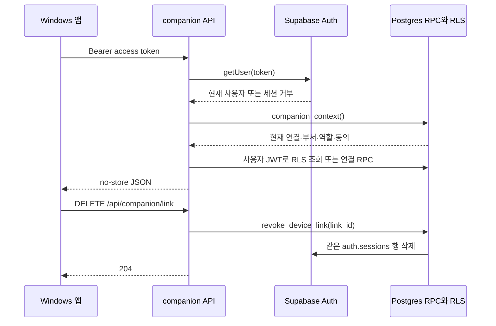

# Desktop companion step 2 — companion auth

- 날짜: 2026-10-01 KST
- 범위: phase 43 step 2만
- 운영 DB·배포: 변경하지 않음

## 구현 계약

- `lib/supabase/bearer.ts`는 공개 Supabase URL·anon key와 요청의 access token만 사용한다. `Authorization: Bearer …` 전역 헤더를 설정하고 세션 저장·자동 갱신·URL 세션 감지를 모두 끈다. 쿠키 API와 `next/*`를 import하지 않는다.
- `requireBearerUser()`는 토큰 없음과 Auth 세션 거부를 각각 JSON 401 `no_token`, `session_invalid`로 바꾼다. `requireDeviceContext()`는 매 요청 `companion_context()`를 호출하고 0행을 JSON 401 `device_revoked`로 바꾼다. 실패는 redirect나 throw로 표현하지 않는다.
- 부서 ID·이름·역할·동의는 `companion_context()`의 현재 행에서만 만든다. 연결 전 E01만 본인 `members`와 RLS로 보이는 `departments`를 읽는다.
- E01~E04는 인증 컨텍스트·Zod·RPC·응답 변환만 한다. 모든 JSON 응답과 204 응답에 `Cache-Control: private, no-store`를 넣는다.
- `CompanionLinkInput`과 E01~E03 응답은 `lib/contracts.ts`의 strict 스키마다. 추가 입력 필드는 거부한다.
- ESLint는 `device-context`와 Bearer 클라이언트 import를 companion 경로와 테스트 밖에서 막는다. `device-context`가 Bearer 클라이언트를 만드는 한 곳만 구현 의존으로 허용하며, 그 파일에도 service-role import 금지를 유지한다.



위 흐름은 설계 대조용 Mermaid다. Archify 실행 파일과 연결 도구는 이 세션에 없어 Archify 렌더 결과로 간주하지 않는다.

## TDD와 API 실행 증거

첫 실행에서 `tests/companion/context.test.ts`와 `device-context.test.ts`는 새 모듈을 찾지 못해 두 suite가 red였다. 구현 뒤에는 컨텍스트 변환, no-store 응답, strict 계약, Bearer 파싱, 토큰 검증, 세션 없음, 연결 해제, RPC 오류를 포함한 19개 검사가 통과했다.

`node scripts/verify-companion-auth.mjs`는 로컬 Supabase와 `node scripts/review-qa.mjs dev`만 사용했다. OTP로 같은 부서의 팀장·팀원 세션을 만들고 다른 부서와 데모 부서를 준비했다. 결과:

```json
{"noToken":401,"cookieOnly":401,"departments":200,"linked":201,"nonmember":403,"demo":403,"context":200,"revoked":204,"revokedContext":401,"authSessionRejected":true,"webBearerAccepted":false,"failed":0}
```

해제 뒤 같은 access token의 Supabase JS `getUser(token)`도 사용자 없이 실패했다. 기존 `/api/d/<dept>/ask`에 쿠키 없이 Bearer만 보낸 요청은 202가 아니었고 로그인 경계에서 거부됐다.

## Graft 코드 관계 확인

호스트와 WSL에는 Graft 실행 파일이 없었다. 읽기 전용으로 마운트한 Linux Node 컨테이너에서 `@nanonets/graft@0.20.0`을 실행했다.

- 전체 713파일을 새로 파싱해 3,261노드·8,181관계를 만들었고 `graft check`가 `graph check: OK`를 반환했다.
- `requireDeviceContext`의 제품 호출자는 `app/api/companion/link/route.ts`의 POST·GET·DELETE 세 곳뿐이었다. 나머지는 `tests/companion/device-context.test.ts`였다.
- `createBearerSupabaseClient`는 nullish-coalescing으로 기본 생성기에 담겨 Graft가 incoming edge를 만들지 못했다. 원문 import 검색으로 `lib/companion/device-context.ts` 한 곳만 확인했다.
- 제한 모듈 import를 `app/api/companion/**`, 테스트, 위 구현 의존 밖에서 검색한 결과는 0건이었다. Graft 호출 두 번의 추정 절약량 합계는 약 2,975토큰이다.

## 보안 체크리스트

| 확인 | 결과 |
|---|---|
| `app/api/companion/**`, `lib/companion/**`의 service 문자열 | 0건 |
| 요청 경로 service-role import·키 | 0건 |
| 토큰·이메일·요청 본문 로그 | 0건 |
| 새 `lib/companion` 모듈의 선행 테스트 | 2파일, 19검사 |
| `proxy.ts`의 `/api/companion` 분기·매처 | 0건 |
| 기존 쿠키 클라이언트·`requireMembership`의 Bearer 분기 | 변경 없음 |
| 부서 권한 출처 | 연결 전 본인 멤버십, 연결 뒤 `companion_context()`만 |

## Acceptance Criteria

| 명령 | 결과 |
|---|---|
| `npx vitest run tests/companion` | PASS — 2파일, 19검사 |
| `npm run lint` | PASS — ESLint 오류·경고 0, 문구 차단 0·기존 검토 경고 80 |
| `npm run build` | PASS — Next.js 16.3.4, E01·E02~E04 경로 포함 |
| `npm run test` | PASS — 174파일, 1,807검사 |
| `node scripts/verify-device-links-sql.mjs` | PASS — 8/8, 격리 PGlite rollback |
| `node scripts/verify-companion-auth.mjs` | PASS — 로컬 API·Auth 11항목, failed 0 |
| `git diff --check` | PASS |

로컬 Supabase의 합성 fixture만 사용했고 운영 마이그레이션, 원격 API, 외부 발신은 실행하지 않았다.
