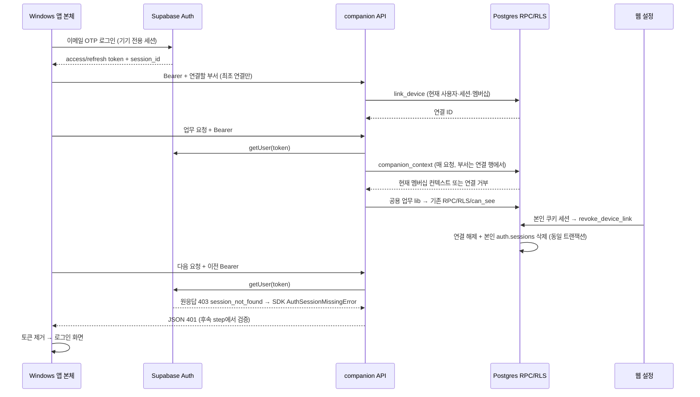

# Step 0 코드 관계 확인 (2026-10-01)

이 기록은 실제 파일을 읽어 확인했다. 현재 세션의 도구 목록에 Graft·Archify가 없고 `Get-Command graft,archify -ErrorAction SilentlyContinue`에서도 실행 파일이 발견되지 않았다. Graft 그래프의 최신성 검사와 Archify 렌더·레이아웃 검사는 수행하지 못했다. 아래 Mermaid는 설계와 코드의 수동 대조이며 도구 실행 결과가 아니다.

## 기존 요청 경로

| 진입점 | 확인한 호출·의존 | 후속 추출 범위 |
|---|---|---|
| `lib/supabase/membership.ts` | `createServerSupabaseClient` → `auth.getUser` → `members`에서 본인·부서 조회, 실패 시 Next `redirect` | 앱은 이 함수를 호출하지 않고 JSON 오류를 반환하는 기기 컨텍스트를 사용 |
| `app/api/d/[dept]/ask/route.ts` | 멤버십 → `AskQuestionInput` → `mask` → `ask_question` RPC → 파이프라인 핸들러 등록 → `kickWorker` | step 4 `startAsk` 추출, 기존 응답 유지 |
| `app/api/d/[dept]/answers/[id]/route.ts` | 본인·부서 `answers` → `citations` → 현재 RLS로 원문·결정 조회 → 원문 포함 검사·자료 위치 링크 → 근거 부족 시 refused | step 4 `readAnswerView`, 인용 재검사 유지 |
| `app/api/cards/[id]/decide/route.ts` | 카드 RLS 조회 → 멤버십·담당 확인 → 기존 결정 확인 → `decide_request` RPC → 상태·중복·오류 매핑 | step 5 `decideCard`, 앱 컨텍스트의 부서 일치 확인 추가 |
| `app/api/d/[dept]/meetings/transcript/route.ts` | lead 확인 → 파일·전사 파싱 → 데모 거부 → 현재 동의 멤버의 발언만 → 세션으로 source/meeting, 수집 어댑터 `insertUploadedItems` → 분류·임베딩·요약 job | step 5 `ingestTranscript`, 미동의 발언 저장 금지·수집 insert 예외 유지 |
| `app/(auth)/d/[dept]/cards/[id]/page.tsx` | 부서 카드 → 인용·충돌 → 현재 items/decisions·reviewed_materials → 원문 링크 → 근거·상태·담당에 따른 표시 | step 5 `loadCardView`, 렌더링은 페이지에 유지 |
| `lib/supabase/server.ts` | anon key + Next `cookies` 기반 SSR 클라이언트, Bearer 헤더를 읽는 분기 없음 | 기존 웹 인증 경로 유지 |

## 기기 연결·요청·해제 설계 대조

## 실행으로 확인한 인증 전제

`node scripts/verify-companion-gates.mjs`의 로컬 재실행에서 G1/G2 PASS, 원응답 403·`session_not_found`, SDK `AuthSessionMissingError`·사용자 없음, refresh 거부를 확인했다. 설치된 `node_modules/@supabase/auth-js/src/lib/fetch.ts:138`이 해당 코드의 변환 지점이다. 당시 사용자 요청 API와 `device_links`는 아직 구현하지 않았으므로 앱 API의 401 자체는 후속 검증 대상이다.

루트 검증: Git Bash 훅 계약 30건, lint blocking 0(기존 경고 80), production build, Vitest 172파일·1788검사 통과. 검증에 사용한 Python은 PATH의 Python 2.7 대신 `C:/Users/이주호/AppData/Local/Programs/Python/Python310/python.exe -m pytest scripts/test_hooks.py -q`다.
