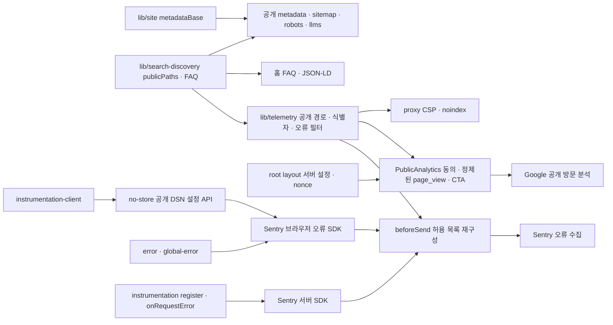

# 코드 관계와 도구 누락

2026-10-07. Graft·Archify 실행 파일과 MCP가 현재 세션에 없어 실행 결과를 얻지 못했다. 아래는 실제 파일의 import와 호출을 읽어 확인한 관계이며, 해당 도구의 결과로 간주하지 않는다. 기존 `lib/search.ts` 업무 검색 모듈에는 변경이 없다.

기존 `next.config.ts`는 security-headers를 상대 경로로 읽기 때문에 이 모듈은 `@/` 별칭 모듈에 의존하지 않게 유지했다. Sentry 빌드 설정은 소스맵·release 업로드를 끈다. 브라우저 DSN은 서버 설정 API에서만 전달하며 인증 토큰은 브라우저로 전달하지 않는다. 데이터베이스·업무 검색·SQL 가시성 판정은 변경하지 않았다.

Graft 구현 전후 그래프와 Archify 렌더 검증은 미실행이다. 구현 검증과 별도로 이 개발 절차 게이트를 남긴다.
