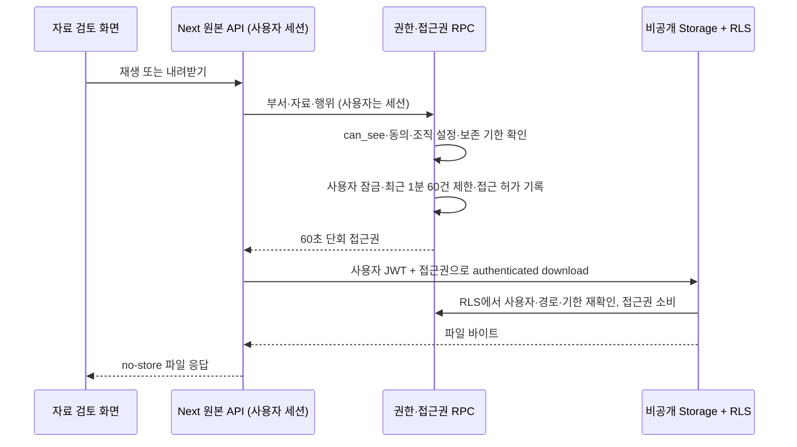

# 원본 접근·보존 구현 맥락 — 2026-09-18

Graft·Archify 연결 도구와 실행 파일을 찾지 못했다. 아래는 실제 파일과 호출자를 확인한 수동 구조도이며 도구 생성 결과가 아니다.

- 기존 `original/route.ts`의 createSignedUrl과 `ReviewDetail.retry`의 직접 download/list가 영향 대상이다.
- 원본 파기 sweep은 기존 `purge_review_files` 작업을 예약하며 `original_deleted_at`·진행 중 구간 lease를 함께 변경한다. 전사·리비전·확정 source는 유지한다.
- 조직 설정은 `/admin` 세션 RPC, 원본 보존 기간은 기존 부서 보존 화면에서 설정한다. 조직 관리자는 파일 내용을 읽지 않고 접근 기록의 ID·행위·시각만 읽는다.
- 기존 사용자 변경(보안 헤더·CSP Report-Only·홈페이지 가이드·녹음 실험)은 보존한다. 운영 DB 변경·배포는 이번 로컬 검증의 결과가 아니다.

공식 구현 확인: [Storage scope](https://github.com/supabase/storage/blob/master/src/internal/database/postgres/scope.ts)는 request.headers와 storage.operation을 DB에 전달한다. [Storage 원본 API](https://github.com/supabase/storage/blob/master/src/storage/object.ts)는 DB 조회 이후 별도로 서명한다. 새 RLS는 authenticated download만 허용하고 sign/list/copy를 거부한다. 실제 운영 Storage 버전의 헤더 전달·operation·트랜잭션 호환성은 배포 전 격리 Storage 통합 테스트가 필요하다.
