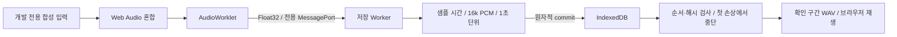

# Phase 23 step0 — 합성 입력 기술 검증

2026-09-17 / Windows / Playwright Chromium 153.0.8010.12. **부분 구현이며 step0 완료가 아니다.** PRD 1.13·ADR-057 추가 시점부터 step4-A를 우선하고 실제 입력 버튼을 제거했다.

## 구현 및 코드 관계

- `lib/recording/pcm.ts`: 정수 위상의 스트리밍 16kHz 리샘플, 1~2개 입력 혼합 이득, PCM16 → 독립 WAV. 박스 필터 방식이며 실제 음성 청취 품질·CER 검증은 남아 있다.
- `lib/recording/session.ts`: 샘플 기준 시간, 1초 체크포인트, commit 뒤 저장 확인, 일시정지/재개, 5초 backlog 중단, 저장 실패/timeout, 29분 알림·30분 자동 종료. 두 순수 모듈은 테스트 실패를 먼저 확인한 뒤 구현했다.
- `lib/recording/browser/*`: MediaStream 입력·트랙 정리, Web Audio/AudioWorklet ↔ MessageChannel ↔ Worker, IndexedDB 트랜잭션, 해시/순서 검사, 24시간 정리, Web Locks+IDB lease+BroadcastChannel. 공유 영상은 저장하지 않고 frameRate 힌트만 최소화한다.
- `scripts/recording-lab/`: localhost 개발 전용 합성 440Hz+880Hz 입력, 복구·재생·폐기 화면. 현재 마이크·화면 소리 시작 UI가 없다. 앱 라우트·제품 기능으로 연결하지 않았다.
- Worklet은 `lib/recording/browser/capture.worklet.js`이며 `new URL(..., import.meta.url)`로 로드한다. public JS 파일 없음. Vite에서 로딩 검증했고 Next 제품 화면 통합은 아직 없다.
- ARCHITECTURE §8·TDD guard는 브라우저 SDK 어댑터만 예외로 추가했다. 순수 로직은 계속 mirrored test가 필요하다.

수동으로 확인한 실행 관계:

Graft·Archify 도구와 CLI를 사용할 수 없었다. 실제 파일/호출자를 수동 확인한 위 기록으로 범위를 남긴다. **Graft 결과 및 Archify 생성·레이아웃 검증 결과는 없다.**

## 실행 결과

| 검증 | 결과·증거 |
|---|---|
| 전체 Vitest | 89파일, 1,076개 통과 — `vitest.txt`. 녹음 관련 순수/입력 테스트 19개 포함 |
| 훅 회귀 | `py -3 -m pytest scripts/test_hooks.py -q`, 29개 통과 — `hooks.txt` |
| ESLint / Next 프로덕션 빌드 | 통과 — `lint.txt`, `build.txt` |
| 녹음 E2E 전체 | `$env:E2E_RECORDING_REALTIME='1'; npm run e2e:recording`, 8개 통과 — `recording-e2e.txt` |
| 최종 합성 전용 UI 회귀 | `npm run e2e:recording`, 7개 통과·3분 테스트 1개 옵션 skip — `recording-final-e2e.txt` (3분 실행은 위 전체 로그에 있음) |
| 실제 3분 합성 캡처 후 새로고침 | 180,700ms, 2,880,000개 저장 샘플 / 180개 체크포인트 복구, interrupted 표시 — `realtime-recovery.json`, `realtime-recovery.png` |
| 가속 30분 저장 | 48kHz 입력 → 28,800,000개 PCM 샘플, 1,800개 체크포인트, 불일치 0, 단일 체크포인트 최대 32,000B, 29분 경고·30분 종료 — `endurance.json` |
| 메모리 | 위 가속 테스트의 GC 후 JS heap 증가 약 130KB. 브라우저 전체 RSS나 실제 30분 기기 녹음 메모리 측정이 아니다 |
| 복구/오류 | 브라우저 IDB 실제 commit·reload·손상·누락·중복·잘못된 순번·두 탭·다른 사용자·24시간 정리·트랜잭션 abort 검증 |
| 재생 | 복구 WAV에 HTMLAudioElement.play() 성공, media error 없음 — `synthetic-recovery.png`. 사람의 실기기 청취 시험은 하지 않았다 |
| 기존 SQL 회귀 | 격리 PGlite 156개 + 권한 행렬 2,016개 통과 — `sql.txt`. pg_cron/pg_net 제외, 운영 DB 적용 없음 |

실행 중 기존 dev 서버가 `.next` 산출물을 재생성해 prod smoke 서버의 파일이 사라졌다. `SASU_VERIFY_BUILD=1`일 때 `.next-verify`를 쓰도록 분리했고 기본 개발 빌드는 `.next`를 유지한다. 기존 사용자 dev 서버는 종료하지 않았다.

SQL 하니스는 최신 0036 적용 후 예전 0026 down으로 private schema를 지우려다 실패했다. rollback 시험을 0028 직후의 트랜잭션 안으로 옮겨 당시 계약을 검증하고 rollback한 뒤 최신 스키마 전체 검증을 계속한다. migration·운영 DB를 바꾸지 않았다.

## 미충족 게이트

- V01~V06 실제 Windows Chrome/Edge의 마이크·Meet 탭·Zoom 공유 소리, 기기 분리·권한 거절 UI·절전·브라우저 프로세스 강제 종료 검증이 남았다. Track ended/권한 거절은 합성 이벤트·mock 테스트로만 확인했다.
- 실제 30분 경과 녹음·앞/뒤 청취·CER, background 장치 동작·wake lock·입력 프로파일은 미검증/미구현이다.
- 현재 IDB 저장은 **합성 검증용 평문**이다. SEC-06 AES-GCM·서버 HKDF 세션 키·철회 후 재발급 거부가 구현되기 전 실제 입력에 사용하면 안 된다. 자동 테스트는 실제 대화·LLM·서버 업로드를 사용하지 않았다.
- step4-A DB 보호, step1 구간 원본·키 발급·RLS, step2 제품 UI, step4-B 정확률, step3 데모 통합은 남아 있다. 서버 업로드 구현으로 진행 가능한 완료 판정을 내리지 않았다.
