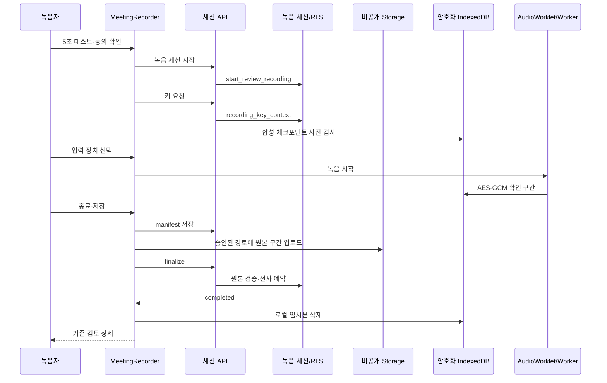

# Step 2 녹음 화면·검토 연결 — 진행 기록 (2026-09-28)

상태: **부분 구현, 완료 게이트 미충족, 운영 미반영**. 입력은 [step2 명세](../../../phases/23-browser-meeting-recording/step2.md), ADR-070, [상세 설계](../../planning/웹회의_녹음_설계.md)다. 이 기록은 이전 step1 서버 구현의 완료 판정을 바꾸지 않는다.

## 이번 구현

- `회의 녹음` 진입과 `/d/[dept]/reviews/record`를 연결했다. 서버에서 동의한 팀장 멤버십을 확인한다. 화면에서 제목·방식·회의 출처·동의 참석자·확정 후 가시성을 고정한 다음 서버 세션 → 키 → 암호화 저장소 사전 검사 → 별도 사용자 클릭의 실제 입력 선택 순서로 녹음한다. 입력 선택 뒤 첫 샘플 저장 직전에 키를 다시 받아 동의·조직 스위치를 재검증한다. 중간 준비 실패 시 서버 세션을 폐기한다.
- 5초 테스트는 브라우저 메모리의 MediaRecorder 결과로만 재생한다. 서버 전송·IndexedDB 기록 없이 입력별 음량을 보여 준다. 사용자가 들었다고 확인해야 녹음 준비가 가능하며, 준비 성공 시 테스트 URL을 폐기한다.
- AudioWorklet·Worker 녹음의 샘플/확인 저장 타이머, 입력별 음량, 중단 사유, 일시정지·종료, `devicechange`/`mute` 안내와 화면 절전 방지 요청을 연결했다. 온라인 회의 마이크는 AEC·NS·AGC, 마이크 단독은 AEC·NS를 요청한다. 입력 종료는 기존 캡처 엔진이 중단한다.
- 새로고침 후 서버 세션의 키를 다시 발급받아 같은 계정·부서·녹음 ID의 로컬 확인 구간을 복호화한다. 다른 계정/24시간 만료 로컬 기록은 지운다. 부분 기록은 명시적 확인을 요구한다. 저장은 manifest v1 → 구간별 비공개 업로드 → finalize → 서버의 전 구간 검증 완료를 기다린 뒤 로컬 삭제·검토 화면 이동이다. 업로드/검증 실패 구간은 같은 ID에서 다시 올린다.
- 기존 검토 상세의 `audio_segments`는 구간 번호 API로 현재·다음 원본을 받아 Web Audio로 순서 재생하고 구간 시각으로 이동한다. 전사 재시도는 서버의 `parts` 재요청만 하며 기존 단일 파일의 `parts/` 업로드를 건너뛴다. 단일 파일 경로는 유지한다.
- 저장소 사전 검사는 실제 녹음 ID를 생성하지 않도록 분리했다. 일시정지 여부는 음성 원문이 없는 로컬 헤더에 보존한다. 음성 청크는 AES-GCM 암호문이다.

## 코드 관계·흐름

Graft/Archify 명령과 MCP 도구는 현재 환경에서 찾지 못했다(`Get-Command graft,archify`, 도구 목록 검색 결과 없음). 아래는 실제 파일과 호출을 수동으로 읽어 작성한 구조도이며 Archify 결과로 간주하지 않는다.

변경 전후 수동 관계 확인: `reviewed-materials` → 새 페이지/`MeetingRecorder` → 녹음 API → `review_recordings`/`review_original_segments`; 캡처는 `browser/inputs` → `capture` → `storage.worker` → `storage` → `original-segments`; 재생은 `ReviewDetail` → `RecordingSegmentPlayer` → 구간 원본 API다. 기존 단일 파일 검토 경로는 `ReviewDetail`의 `original_layout` 분기로 남는다.

## 실행 검증

| 검사 | 결과 | 범위 |
|---|---|---|
| `npm run test` | 145파일·1,592 통과 | 최종 코드의 단위·기존 회귀 |
| `npm run e2e:recording -- tests/recording/storage.spec.ts tests/recording/capture.spec.ts` | 6 통과, 사전 검사 신규 검사 포함 재실행 5 통과 | Vite 녹음 실험실, 합성 입력·실제 브라우저 IndexedDB/Worker |
| `npm run e2e:review-controls` | 11 통과 | 제품 컴포넌트와 기존 단일 파일 검토 회귀. fixture API·합성 오디오, 새로고침 복구·구간 재생·재시도 |
| `npm run lint`, `npm run build` | 통과 | 최종 코드. 문구 검사 blocking 0·기존 경고 77, Next 16.3.4 빌드·타입 검사 통과 |
| Next 프로덕션 빌드 산출물 확인 | `turbopack-worker-*.js` 부트스트랩과 Worker 청크 생성 | 번들 존재 확인. 실제 Next 페이지 로딩/CSP 검사는 아님 |

UI 캡처: [준비 화면](step2-prepared-synthetic.png), [새로고침 복구 화면](step2-recovered-synthetic.png). 두 장 모두 Vite 실험실의 합성 서버 응답이다. 실제 로그인·Storage·Groq 완주 화면으로 주장하지 않는다.

## 완료 전 남은 게이트

- step0 V01~V06 실제 Windows/macOS 마이크·탭/시스템 입력/복구와 5초 테스트 청취 확인. 모바일·키보드 사용 흐름 확인.
- Docker 엔진이 현재 연결되지 않아 로컬 Supabase 실서버 세션/Storage와 실제 구간 업로드·검증·전사·확정 E2E를 이번 변경 후 다시 실행하지 못했다. `docker info`와 `npx supabase status`가 엔진 파이프 부재로 실패했다. 실 Groq 결과·CSP 강제 모드의 새 Worklet/Worker 로딩도 미검증이다.
- 설계 §11~§12의 입력별 1초 음량 프로파일·클리핑 비율 저장, 회의 이어 녹음 연결, WAV 결합 내려받기, 실제 원본에서 재추출 경합, 조직 스위치 동시 변경 경고, 기기별 권한/접근성 검증이 남았다.
- Graft 전후 그래프와 Archify 구조 산출물이 없다. 운영 DB `0058~0060` 확인·반영 및 배포는 하지 않았다. 운영 반영에는 기존 승인 게이트가 남아 있다.
