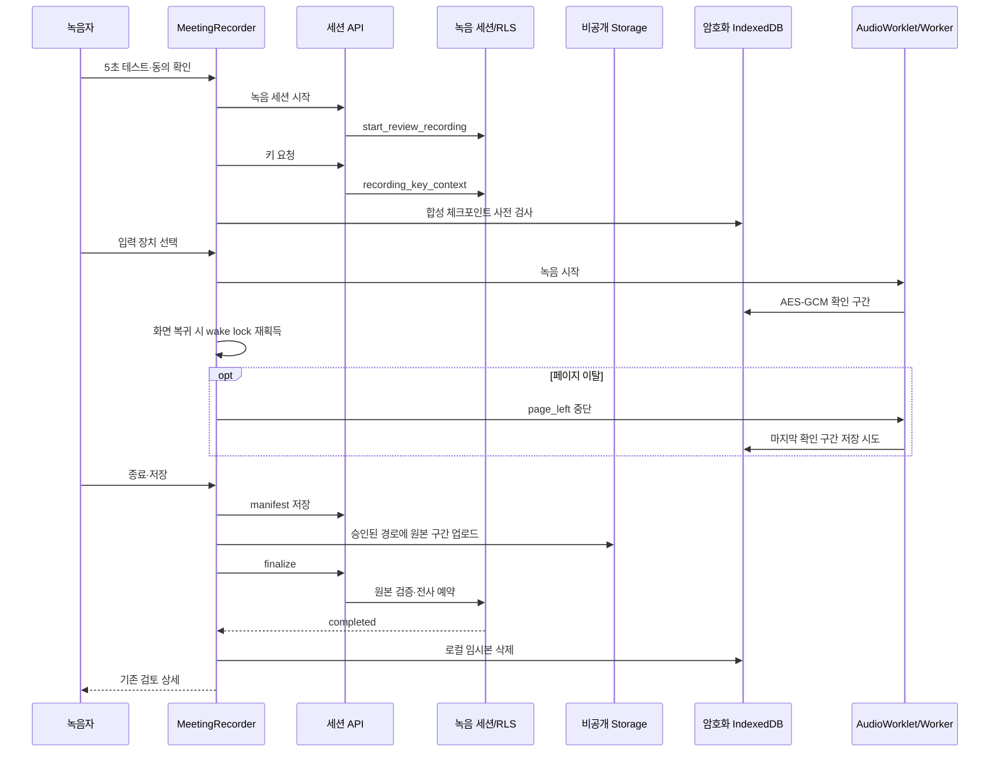

# Step 2 녹음 화면·검토 연결 — 진행 기록 (2026-09-28)

상태: **기능 구현·로컬 제품 검증 완료, 실기기 범위·운영 반영 미완료**. 아래 초기 기록은 당시 상태이며, 최신 판정은 맨 아래의 `최신 검증`을 따른다. 입력은 [step2 명세](../../../phases/23-browser-meeting-recording/step2.md), ADR-070, [상세 설계](../../planning/웹회의_녹음_설계.md)다.

## 이번 구현

- `회의 녹음` 진입과 `/d/[dept]/reviews/record`를 연결했다. 서버에서 동의한 팀장 멤버십을 확인한다. 화면에서 제목·방식·회의 출처·동의 참석자·확정 후 가시성을 고정한 다음 서버 세션 → 키 → 암호화 저장소 사전 검사 → 별도 사용자 클릭의 실제 입력 선택 순서로 녹음한다. 입력 선택 뒤 첫 샘플 저장 직전에 키를 다시 받아 동의·조직 스위치를 재검증한다. 중간 준비 실패 시 서버 세션을 폐기한다.
- 5초 테스트는 브라우저 메모리의 MediaRecorder 결과로만 재생한다. 서버 전송·IndexedDB 기록 없이 입력별 음량을 보여 준다. 사용자가 들었다고 확인해야 녹음 준비가 가능하며, 준비 성공 시 테스트 URL을 폐기한다.
- AudioWorklet·Worker 녹음의 샘플/확인 저장 타이머, 입력별 음량, 중단 사유, 일시정지·종료, `devicechange`/`mute` 안내와 화면 절전 방지 요청을 연결했다. 온라인 회의 마이크는 AEC·NS·AGC, 마이크 단독은 AEC·NS를 요청한다. 입력 종료는 기존 캡처 엔진이 중단한다.
- 새로고침 후 서버 세션의 키를 다시 발급받아 같은 계정·부서·녹음 ID의 로컬 확인 구간을 복호화한다. 다른 계정/24시간 만료 로컬 기록은 지운다. 부분 기록은 명시적 확인을 요구한다. 저장은 manifest v1 → 구간별 비공개 업로드 → finalize → 서버의 전 구간 검증 완료를 기다린 뒤 로컬 삭제·검토 화면 이동이다. 업로드/검증 실패 구간은 같은 ID에서 다시 올린다.
- 기존 검토 상세의 `audio_segments`는 구간 번호 API로 현재·다음 원본을 받아 Web Audio로 순서 재생하고 구간 시각으로 이동한다. 전사 재시도는 서버의 `parts` 재요청만 하며 기존 단일 파일의 `parts/` 업로드를 건너뛴다. 단일 파일 경로는 유지한다.
- 저장소 사전 검사는 실제 녹음 ID를 생성하지 않도록 분리했다. 일시정지 여부는 음성 원문이 없는 로컬 헤더에 보존한다. 음성 청크는 AES-GCM 암호문이다.

## 코드 관계·흐름

초기 실행 당시 Graft/Archify 명령과 MCP 도구가 없었다(`Get-Command graft,archify`, 도구 목록 검색 결과 없음). 아래는 실제 파일과 호출을 수동으로 읽어 작성한 구조도이며 Archify 결과로 간주하지 않는다. 이후 도구 시도 결과는 최신 검증에 기록한다.

변경 전후 수동 관계 확인: `reviewed-materials` → 새 페이지/`MeetingRecorder` → 녹음 API → `review_recordings`/`review_original_segments`; 캡처는 `browser/inputs` → `capture` → `storage.worker` → `storage` → `original-segments`; 재생은 `ReviewDetail` → `RecordingSegmentPlayer` → 구간 원본 API다. 기존 단일 파일 검토 경로는 `ReviewDetail`의 `original_layout` 분기로 남는다.

## 실행 검증

| 검사 | 결과 | 범위 |
|---|---|---|
| `npm run test` | 145파일·1,592 통과 | 최종 코드의 단위·기존 회귀 |
| `npm run e2e:recording -- tests/recording/storage.spec.ts tests/recording/capture.spec.ts` | 6 통과, 사전 검사 신규 검사 포함 재실행 5 통과 | Vite 녹음 실험실, 합성 입력·실제 브라우저 IndexedDB/Worker |
| `npm run e2e:review-controls` | 11 통과 | 제품 컴포넌트와 기존 단일 파일 검토 회귀. fixture API·합성 오디오, 새로고침 복구·구간 재생·재시도 |
| `npm run lint`, `npm run build` | 통과 | 최종 코드. 문구 검사 blocking 0·기존 경고 77, Next 16.3.4 빌드·타입 검사 통과 |
| Next 프로덕션 빌드 산출물 확인 | `turbopack-worker-*.js` 부트스트랩과 Worker 청크 생성 | 번들 존재 확인. 실제 Next 페이지 로딩/CSP 검사는 아님 |

UI 캡처: [준비 화면](step2-prepared-synthetic.png), [새로고침 복구 화면](step2-recovered-synthetic.png). 두 장 모두 Vite 실험실의 합성 서버 응답이다. 실제 로그인·Storage·Groq 완주 화면으로 주장하지 않는다.

## 완료 전 남은 게이트

- step0 V01~V06 실제 Windows/macOS 마이크·탭/시스템 입력/복구와 5초 테스트 청취 확인. 모바일·키보드 사용 흐름 확인.
- Docker 엔진이 현재 연결되지 않아 로컬 Supabase 실서버 세션/Storage와 실제 구간 업로드·검증·전사·확정 E2E를 이번 변경 후 다시 실행하지 못했다. `docker info`와 `npx supabase status`가 엔진 파이프 부재로 실패했다. 실 Groq 결과·CSP 강제 모드의 새 Worklet/Worker 로딩도 미검증이다.
- 설계 §11~§12의 입력별 1초 음량 프로파일·클리핑 비율 저장, 마이크 분리 후 재선택, 회의 이어 녹음 연결, WAV 결합 내려받기, 실제 원본에서 재추출 경합, 조직 스위치 동시 변경 경고, 기기별 권한/접근성 검증이 남았다.
- Graft 전후 그래프와 Archify 구조 산출물이 없다. 운영 DB `0058~0060` 확인·반영 및 배포는 하지 않았다. 운영 반영에는 기존 승인 게이트가 남아 있다.

## 2026-09-28 후속 수집 안정화

- 온라인 회의 화면 공유 요청에 `systemAudio: include`, `selfBrowserSurface: exclude`, `surfaceSwitching: include`, `monitorTypeSurfaces: include`를 힌트로 추가했다. 확보한 오디오 트랙 검사는 그대로 두어 힌트를 브라우저의 실제 지원으로 오인하지 않는다. 마이크/화면 입력 테스트가 요청 옵션을 검증한다.
- 녹음 중 wake lock이 해제되거나 요청이 거절되면 화면에 경고한다. 탭이 다시 보일 때 녹음이 계속 중이면 재획득을 시도하고, 녹음이 끝난 뒤 늦게 도착한 잠금은 즉시 해제한다. 화면 이탈·컴포넌트 해제 시 캡처에 `page_left` 중단을 보내 마지막 구간의 저장을 시도한다. 합성 브라우저 테스트에서 잠금 재획득 2회와 중단 후 새로고침 복구를 확인했다. 실제 브라우저 종료 시 마지막 미확인 구간 저장은 보장하지 않는다.
- 파일 가져오기에서 `.m4a`와 음성 포함 `.mp4`를 명시해 선택할 수 있게 했다. 기존 브라우저 디코드·50MiB·30분 검사는 유지한다. 특정 운영체제/브라우저 코덱의 실제 디코드 성공은 확인하지 못했다.
- 수동 의존 관계 확인: `MeetingRecorder` → `captureInputs` → 화면/마이크 스트림, `MeetingRecorder` → `startRecording` → Worklet/Worker → 암호화 IndexedDB. `visibilitychange`는 wake lock만 다시 잡고, `pagehide`는 캡처를 중단한다. 파일 가져오기는 `ReviewedMaterials` → `decodeAudioData` → 기존 검토 API 경로다. Graft/Archify CLI와 MCP 도구가 없어 그래프·시각화 산출물은 만들지 못했다.
- 최종 검증: `npm run lint` 통과(문구 차단 0·기존 경고 77), `npm run build` 통과(Next 16.3.4·타입 검사), `npm run test` 145파일·1,613 통과, `npm run e2e:review-controls` 11 통과, `npm run e2e:recording` 18 통과·장시간 실시간 검사 1건 기존 skip. 모두 현재 코드에서 실행했다. 브라우저 E2E는 Vite 실험실·합성 입력/fixture API이며 새 [화면 이탈 복구 캡처](step2-recovered-synthetic.png)를 남겼다. `docker version`은 엔진 파이프 부재로 실패해 실제 Storage/Groq 전사 검증은 미실행이다.

## 2026-09-28 최신 검증

초기 기록의 Docker·Groq 미실행 및 §11 프로파일 미구현 표기는 현재 상태가 아니다. Docker Desktop을 켜고 별도 로컬 Supabase(55321/55322)를 띄워 `0061` 회의 이어 녹음·`0062` 입력 프로파일 migration을 적용했다. `tests/rls/recording-step2.sql`로 이어 녹음의 권한·동일 요청 재시도·메타데이터·조직 스위치 차단을 실제 Postgres에서 확인해 통과했다.

세션 RPC·화면은 이전 녹음 연결, 마이크 손실 후 재선택, 원본 WAV 결합 내려받기, 관리자 녹음 스위치 동시 진행 건수 안내를 포함한다. AudioWorklet은 입력별 1초 RMS·클리핑을, Worker와 화면은 확인 저장 지연·대기 샘플·긴 무응답을 기록한다. 복구 헤더에 프로파일을 남기고 최종 `capture_metadata`로 보낸다. 상세 화면은 12dB 이상 차이일 때 입력 측을 표시하고 클리핑 5% 초과를 알려 준다.

| 검사 | 최신 결과 |
|---|---|
| `npx tsc --noEmit --pretty false` | 통과 |
| `npm run lint` | 통과, 문구 차단 0·경고 79 |
| `npm run test` | 148파일·1,624 통과 |
| `npm run e2e:recording` | Chrome 20 통과, 3분 실시간 장기 검사 1건 기존 skip. 암호화 저장·새로고침 프로파일 복구 포함 |
| `npm run e2e:review-controls` | Chrome 13 통과. 기존 단일 원본 접근·기한·설정, 녹음 복구, 두 구간 재생·WAV 결합·서버 재추출 |
| `node scripts/verify-local-microphone.mjs` | Windows Chrome 실제 마이크 5초 live, 48kHz, RMS 0.00044~0.00087. 음성 바이트 저장 없음 |
| `npm run build -- --webpack` | Next 16.3.4 프로덕션 빌드·TypeScript 통과. 기본 Turbopack 빌드는 자원 경합으로 중단했고 이전 코드에서는 통과한 기록이 있음 |
| Chrome 제품 E2E, CSP 보고·강제 각각 | 인증된 8초 합성 입력 → 실제 로컬 Supabase Storage 구간 업로드·검증 → Groq 전사 → 사람 교정·확정 → 인용 요약·분류까지 두 모드 모두 통과. `capture_metadata.levels`·`health` 저장, CSP 위반 0, 페이지 오류 0. [실제 제품 캡처](step2-product-local-synthetic.png) |

Graft 공식 CLI는 Windows와 WSL 양쪽에서 설치를 시도했으나 `tree-sitter-kotlin@0.3.8` 설치 오류로 실행하지 못했다. 따라서 전후 의존 그래프는 없고 수동 호출 관계만 확인했다. Archify는 코드 커밋 `d52c002`의 실제 소스 범위를 고정해 [녹음·검증 흐름도](archify-step2/recording-flow.html)를 생성했다. [최종 검사 요약](archify-step2/width-review/recording-flow.finalize-summary.json)의 validate·deliver·check·browser-check가 모두 통과했고, [Chrome 1440px 캡처](archify-step2/width-review/visual-check/recording-flow.visual-check.1440x900.light.png)를 직접 확인했다. 실제 Windows Chrome 마이크 트랙은 확인했으나 실기기 시스템 소리·macOS·모바일 실기기·운영 DB 반영·배포는 아직 확인하지 않았다. 검토 화면 Vite 실험실은 의존성 자동 탐색 지연을 제한하고 React 진입점만 미리 처리한 뒤 13건을 재실행해 통과했다.

최종 webpack 프로덕션 빌드를 다시 만들고 TypeScript·lint(문구 차단 0)까지 통과했다. 이 빌드의 CSP 강제 모드에서 Chrome 제품 E2E가 다시 통과했다. 첫 재실행은 로컬에 매분 Cron이 없어 선행 대기 작업 뒤의 `verify_review_segment`가 `queued`로 남아 화면이 검증을 기다렸다. 테스트가 실제 `/api/jobs/run`을 반복 호출하게 보강하자 38.8초에 녹음·업로드·검증·Groq 전사·교정·확정·인용 요약·분류를 완주했다. 운영 워커의 매분 트리거 자체는 이 로컬 검사로 증명되지 않는다.
