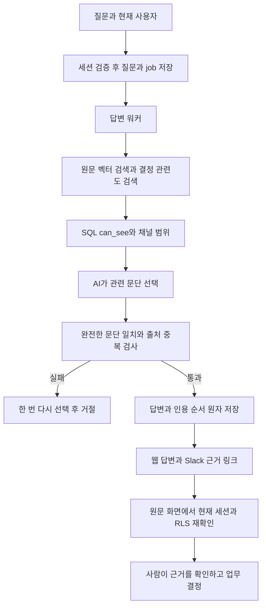

# 코드 관계와 구조 검토

Graft·Archify MCP와 PATH 실행 파일, 작업 주변 vendor/skills를 확인했으나 사용 가능한 실행 도구를 찾지 못했다. 아래는 실제 파일과 import/호출 검색으로 작성한 대체 기록이다. 도구 실행 결과·Archify 렌더는 누락이다.

| 변경 전 | 변경 후 | 영향 범위 |
|---|---|---|
| answerQuestion → searchAs + recentDecisionsAs(3) | searchAs + searchDecisionsAs(벡터·질문·scope·8) → SQL can_see | 웹 ASK, Slack 채널·DM, 후속 질문 |
| AnswerDraft.answer + quote 포함 검사 | AnswerDraft.citations → verifyAnswerCitations → groundAnswer → complete_answer | 새 답변 본문·거절·저장·Slack 전달 |
| complete_answer → 순서 없는 citations | citations.ordinal 원자 저장 → API/Slack 정렬 | 번호와 근거 연결, 기존 답변 호환 |
| 업로드 자료 인용 href=# | evidence 페이지 → API → 세션/RLS items + sources | 현재 원문·삭제·권한 회수·연결 해제 |

수정 후 확인: AnswerDraft 호출자는 answerQuestion 한 곳이다. 새 검색은 이 호출 경로에서만 사용하며 최근 결정 RPC는 기존 소비자용으로 유지한다. 0053은 0012 complete_answer와 0029 claim_slack_answer_delivery의 기존 권한·재검증·원자성을 유지하며 인용 순서와 원문 ID만 추가한다. 기존 시드·게스트 답변은 재생성하지 않았다.

React 검토: 독립 검색은 Promise.all을 유지한다. 원문 화면은 요청을 취소·10초 만료하며 경로 변경 시 이전 데이터가 표시되지 않게 한다. HTML은 텍스트로 렌더한다. 오류 안내에 role=alert, 로딩에 role=status를 두고 390px 가로 넘침을 검사했다.
