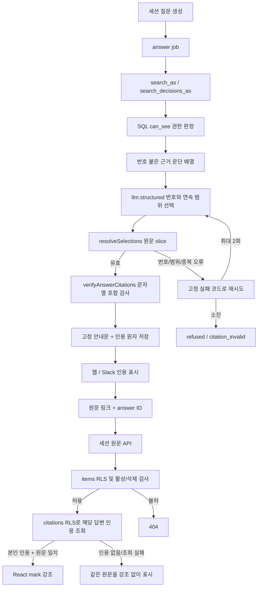

# 코드 관계와 실행 흐름

Graft·Archify MCP 도구 검색 결과는 0개이고 PATH에서도 실행 파일을 찾지 못했다. 구현 전후 실제 파일과 호출처를 읽었으며, 아래 그림은 수동 Mermaid다. Graft 의존 그래프·Archify 생성물 및 두 도구의 검증 결과는 **누락**이다. 도구 실행을 대신했다고 주장하지 않는다.

- `contracts.AnswerDraft` → `pipeline/answer.answerQuestion`, `scripts/sample-llm-style.ts`, 계약 테스트. 카드의 `Citation`·`CardDraft`는 변경하지 않았다.
- `buildAnswerEvidence` → 번호 붙은 문단 배열과 서버 전용 ID/원문 목록. 모델 입력은 JSON 인코딩 한 번이며 원문 중복 필드가 없다.
- `resolveSelections` → 문단 offset으로 연속 범위 추출 → 기존 `verifyAnswerCitations` → `complete_answer`. 저장 계약과 DB 고유 인덱스를 유지한다.
- 웹 답변 API·즉시 Slack·내구성 Slack → 원문 URL에 답변 ID만 전달 → 페이지 → `EvidenceDetail` → 세션 원문 API → 기존 항목/인용 RLS.
- `0054`는 `0053.search_decisions_as`의 terms CTE만 변경한다. 후보 WHERE부터 점수·정렬·한도·grants까지 문자열 동일 비교를 통과했다([기록](sql-permission-comparison.txt)).
- 구현 후 호출처 위치 목록: [dependency-search.txt](dependency-search.txt). `lib/app/tests/scripts`의 `groundAnswer` 참조는 0개다.

AI는 관련 문단을 고른다. 코드는 권한·번호·원문 경계·저장을 검증한다. 문단의 업무 적합성과 원문 사실성은 사람이 판단한다. 운영 DB·앱 반영도 사용자 승인 단계다.
