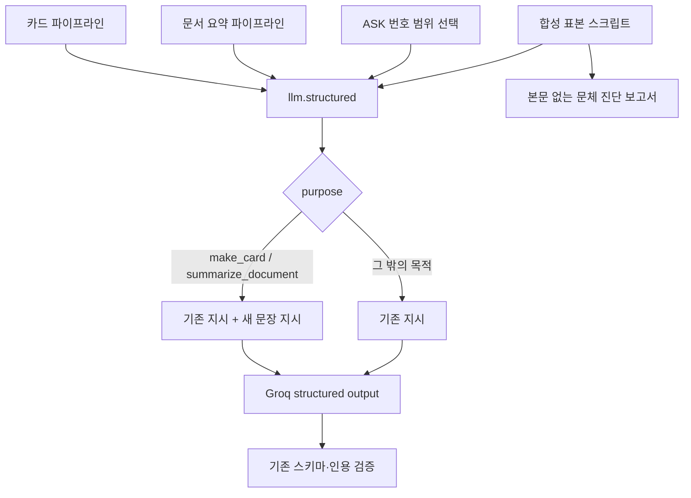

# 카드·요약 문체 후속 검증 — 2026-09-23

사용자 요청 “다음 개발”에 따라 phase31 step9를 진행했다. 기존 PRD §3-7·§10 #21 / ADR-065의 70% 목표를 유지한다. phase32 구현·로컬 검증은 완료 상태이며 운영 적용은 별도 승인 조건이다.

## 구현과 범위

- `lib/llm.ts`에서 `make_card`·`summarize_document`에만 새 문장 작성 지시를 추가했다. 짧은 여러 문장·쉬운 용어·끝맺음과 조건/부정/숫자 보존을 명시한다. 기존 공통 지시는 이번 변경에서 유지했다.
- 문체를 실패 조건으로 쓰거나 원문/생성 문장을 후처리하지 않는다. `quote`와 원문 복사 필드, 스키마·거절·호출 재시도는 유지한다.
- 표본 보고서에 생성 본문 없이 고정 사전 규칙·필드·건수·토큰 수를 기록한다. `SASU_LLM_STYLE_REPORT`로 실행별 파일을 분리하고 기존 `model-resume-2026-09-23/` 보고서 경로는 쓰기를 막았다.
- step6 대조 중 남아 있던 Slack 진행/실패·작성자/시각·리마인더 안내를 정리했다. payload·action ID·발송 로직·canonical refusal는 유지한다. 실제 Slack 발송은 하지 않았다.

## 실제 모델 문체 측정

격리된 로컬 DB의 합성 자료와 실제 Groq `openai/gpt-oss-120b`를 사용했다. 매 실행은 원문 선택 답변 5건·예상 거절 1건·카드 3건·요약 2건이다. 생성 문장 평가 분모는 카드·요약 **5건**이며, 원문 선택 답변은 별도 인용 검사만 한다. 사전·40자 기준·끝맺음 검사·표본·분모·기대값을 완화하지 않았다.

| 실행 | 문체 준수 | 40자 초과 문장 | 끝맺음 위반 | 사전 금지어 발견 |
|---|---:|---:|---:|---:|
| [변경 전](before.json) | 3/5 (60%) | 2 | 0 | 4 |
| [변경 후 1](after-1.json) | 4/5 (80%) | 0 | 1 | 0 |
| [변경 후 2](after-2.json) | 4/5 (80%) | 0 | 1 | 1 |

두 후속 실행은 같은 코드로 각각 목표를 통과했다. 11건씩 모두 생성/예상 거절·인용 원문 일치 검사를 통과했다. 이전 [40% 기록](../model-resume-2026-09-23/README.md)은 별도 과거 실행이며 덮어쓰지 않았다. 이번 변경 전 60%와 차이가 있어 모델 변동성도 확인됐다.

남은 위반은 후속 1의 card-1 끝맺음, 후속 2의 card-2 끝맺음과 제목의 `미루기` 사전 규칙이다. 100% 준수나 사람의 독해 검수 통과로 해석하지 않는다. [항목별 비교](comparison.json), 실행 로그 [전](before.txt)·[후1](after-1.txt)·[후2](after-2.txt).

## ASK 조건·예외 회귀

문체 변경의 대상이 아닌 ASK도 실제 `answerQuestion` + Groq로 평가했다. 검색·임베딩·저장은 모의 객체이며, 실제 DB/브라우저 완주 기록과 구분한다.

- [첫 회귀](answer-regression.json): 9/10. A09가 인용 문자열 검증은 통과했으나 필요한 사실을 포함하지 못했다. 실패 [로그](answer-regression.txt)를 보존했다.
- phase32 step1에서 허용한 두 번의 프롬프트 보완 중 **마지막 1회**를 사용했다. `lib/pipeline/answer.ts`에 일반 기준 1번/예외 2번이면 1~2를 선택한다는 번호 범위 예시를 추가했다. 서버의 원문 추출이나 평가 기대값은 바꾸지 않았다.
- 동일한 최종 코드로 [후속 1](answer-after-1.json)·[후속 2](answer-after-2.json) 모두 **10/10**, 각각 10회 호출로 통과했다. [로그1](answer-after-1.txt)·[로그2](answer-after-2.txt).

phase32 누적 프롬프트 보완은 2/2회다. 두 번의 통과가 모델의 의미 선택을 결정적으로 보장하지는 않는다. 원문 일치와 권한 검증만으로 의미적 완전성을 증명할 수 없으며 사람 읽기 검수는 남아 있다.

## 검증

- 진단 규칙 선행 테스트: [red](diagnostic-red.txt) → [green](diagnostic-green.txt).
- 전용 문체 지시 선행 테스트: [red](prompt-red.txt). 최종 [관련 단위](targeted-final.txt) **18파일·191검사 통과**. 지시 목적 분리·원문 보존·문체 위반 시 추가 호출/실패 없음·Slack 문자열 회귀를 포함한다.
- 최종 Slack 문구 수정을 포함한 코드로 lint → build → 전체 단위를 순서대로 실행했다. 이전 빌드는 [별도 보존](build-before-slack-text.txt)하고 최종 코드로 다시 빌드했다.

| 최종 명령 | 결과 | 실행 기록 |
|---|---|---|
| `npm run lint` | 통과, 209파일·차단 0·기존 경고 77 | [lint.txt](lint.txt) |
| `SASU_VERIFY_BUILD=1 node scripts/review-qa.mjs build` | 프로덕션 빌드·TypeScript 통과 | [build.txt](build.txt) |
| `npm run test -- --maxWorkers=2 --testTimeout=30000` | 139파일·1,391검사 통과 | [unit.txt](unit.txt) |

빌드는 QA 래퍼가 로컬 URL/인증 정보를 설정한 환경에서 실행했다. 전체 테스트는 기존 Windows 녹음 시뮬레이션 시간 변동을 고려한 worker 2개·30초 제한으로 한 번에 통과했다. 테스트 기대값은 완화하지 않았다. phase31 step6·step9는 `completed`, step7은 사람 검수·운영 조건 때문에 `blocked`다.

## 코드 관계와 검증 한계

[실제 코드 검색](dependency-search.txt)으로 호출처를 확인했다. Graft·Archify 도구는 제공되지 않아 두 도구의 실제 실행 결과는 **누락**이다. 아래는 수동 흐름도다.



RLS·SQL·렌더링 구조를 이번에 바꾸지 않아 SQL·브라우저 E2E는 반복하지 않았다. phase32의 [실제 로컬 DB/브라우저 기록](../grounded-answer-selection-2026-09-23/live/README.md)은 앞선 실행이다. 운영 DB·배포·실제 Slack 발송·비개발자 읽기·쇼케이스 판단은 이번 결과에 포함하지 않는다. 커밋하지 않았으며 기존 작업 트리를 보존했다.

## 재현 명령

```powershell
$env:SASU_LLM_STYLE_REPORT='docs/verification/llm-style-followup-2026-09-23/new-run.json'
node scripts/review-qa.mjs llm-style
$env:SASU_ANSWER_EVAL_ISOLATED='1'
$env:SASU_ANSWER_EVAL_REPORT='docs/verification/llm-style-followup-2026-09-23/new-answer-run.json'
node node_modules/vitest/vitest.mjs run --config vitest.eval.config.ts tests/evals/answer-live.eval.ts
npm run lint
$env:SASU_VERIFY_BUILD='1'
node scripts/review-qa.mjs build
npm run test -- --maxWorkers=2 --testTimeout=30000
```

실제 모델 재현에는 로컬 QA DB와 유효한 제공자 인증 정보가 필요하며 호출 비용이 발생한다. 기존 실행 파일을 덮어쓰지 않는 새 보고서 이름을 사용한다.
