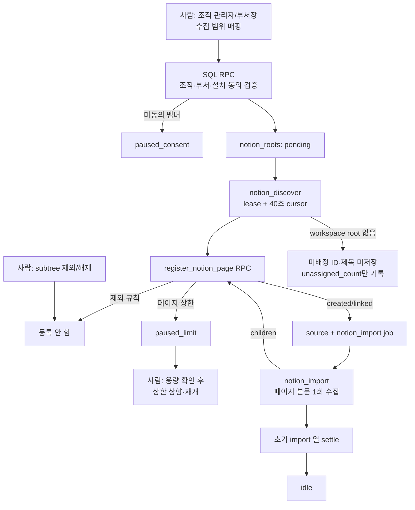

# Phase 25 · Step 4 검증 기록 — roots-discover

검증일: 2026-09-18  
상태: **completed**

## 변경 파일

- `supabase/migrations/0041_notion_roots_discover.sql` — 수집 범위·제외·페이지 상한·미배정 개수 스키마, 직접 쓰기를 막는 RLS, 관리자/부서장 root RPC, service-role 발견·커서·lease RPC를 추가했다. 기존 migration은 수정하지 않았다.
- `lib/pipeline/notion-discover.ts` — `{rootId}` payload, root lease, workspace search, subtree/database 발견, 40초 커서 체크포인트, 429 재시도 위임, 미지원 database 안전 집계, 미배정 개수만 기록하는 job을 추가했다.
- `lib/pipeline/notion-import.ts` — root에 연결된 source import 완료 후 자식 page/database를 `register_notion_page` 경로로 넘기고, 초기 import 열이 끝나면 root를 settle하도록 했다.
- `lib/jobs.ts`, `lib/worker.ts` — `notion_discover` job kind·handler·Notion token 해결·최종 실패 소유자 매핑을 추가했다.
- `app/api/d/[dept]/settings/notion/route.ts` — `include_children=true`일 때 세션 RPC `lead_upsert_notion_root`로 subtree root를 만들고 `notion_discover`를 예약한다. 직접 등록 기존 경로는 유지했다.
- `tests/pipeline/notion-discover.test.ts` — 구현 전에 추가한 job 단위 테스트로 workspace/subtree/database, data source 중복 방지, 커서, 429, 미지원 DB, 미배정 집계를 검증한다.
- `tests/pipeline/notion-import.test.ts`, `tests/notion-import.test.ts`, `tests/notion-reimport-route.test.ts`, `tests/jobs.test.ts`, `tests/worker.test.ts` — root child 연계, 라우트 옵션, job 실패 매핑·등록 회귀를 검증했다.
- `scripts/verify-notion-roots-sql.mjs`, `scripts/verify-security-sql.mjs` — 기존 격리 PGlite 보안 하니스에 Step 4 SQL/RLS 시나리오를 추가했다.
- `docs/verification/notion-collection/step4.md`, `phases/25-notion-collection/index.json` — 이 실행 기록과 Step 4 상태만 갱신했다.

## migration 번호 확인

`supabase/migrations/` 최대 번호가 다른 세션의 `0040_trailer_invites.sql`임을 확인한 뒤 다음 빈 번호 `0041_notion_roots_discover.sql`을 사용했다. `0040`을 포함한 기존 migration은 수정하지 않았다.

## 코드 관계·구조 확인

- `notion_discover` 본체는 페이지 본문을 다시 읽지 않고 root page와 database 행을 등록한다. page 하위 트리는 각 `notion_import`가 반환한 `children`이 재등록하여 어어간다.
- workspace 검색 결과의 `data_source` object는 page로 등록하지 않는다. 더 가까운 subtree root, 제외, 동의 게이트와 상한은 SQL RPC가 한 트랜잭션에서 판정한다.
- `include_new=false` root는 초기 발견/import 열이 끝나 `idle`이 된 뒤에는 새 자식을 등록하지 않는다.
- Graft·Archify는 PATH에서 찾지 못했다. `rg`와 실제 호출 파일 읽기, 전체 build·PGlite 실행으로 의존 관계와 실행 흐름을 확인했으며 두 도구의 실행 결과는 없다.

## 실행 명령과 결과

| 명령 | 결과 |
|---|---|
| `npx vitest run tests/pipeline/notion-discover.test.ts` (구현 전) | 예상 실패 — `lib/pipeline/notion-discover` module not found. 새 `lib/` 모듈의 TDD red를 확인했다. |
| `npx vitest run tests/pipeline/notion-discover.test.ts tests/pipeline/notion-import.test.ts tests/notion-import.test.ts tests/notion-reimport-route.test.ts tests/jobs.test.ts` | 성공 — 5 files, 45 tests. discover/import/route/job green과 회귀를 확인했다. |
| `npx vitest run tests/pipeline/notion-discover.test.ts tests/pipeline/notion-import.test.ts` | 성공 — Acceptance Criteria 2 files, 9 tests. |
| `npx eslint lib/pipeline/notion-discover.ts lib/pipeline/notion-import.ts lib/jobs.ts lib/worker.ts app/api/d/[dept]/settings/notion/route.ts tests/pipeline/notion-discover.test.ts tests/pipeline/notion-import.test.ts tests/notion-import.test.ts tests/notion-reimport-route.test.ts tests/jobs.test.ts tests/worker.test.ts scripts/verify-security-sql.mjs scripts/verify-notion-roots-sql.mjs` | 성공 — 출력 없음. |
| `npx tsc --noEmit` | 성공 — 출력 없음. |
| `node scripts/verify-security-sql.mjs 'D:/바이브코딩/.sasu-qa-db'` | 성공 — isolated in-memory PGlite 196 checks, failed 0. `0004_worker_cron.sql`은 `pg_cron`/`pg_net` 미지원으로 기존과 같이 제외. |
| `npm run lint && npm run build && npm run test` | 성공 — ESLint, Next.js 16.3.4 production build·TypeScript, 105 files / 1,169 tests. |

Vitest는 기존 Vite native config loader·`vite-tsconfig-paths` 경고를 출력했지만 실패는 없었다.

## PGlite SQL/RLS 확인

1. 3단계 트리의 page 12개 + database 1개의 행 30개가 source 43행으로 등록되고 중복은 0건이다. 중간 커서 저장 후 재개해도 결과가 같다.
2. root 밖 페이지는 source/item을 만들지 않고 `unassigned_count`만 증가한다. 미배정 page ID·제목은 DB와 커서에 남지 않는다.
3. 제외한 subtree는 기존 source/item이 소프트 삭제되고 재발견 후에도 source가 생기지 않는다.
4. 조직 상한 5에서 5건까지 등록한 뒤 `paused_limit`이 되며 추가 source는 0건이다.
5. 미동의 멤버가 있으면 root 생성이 `consent_required`로 거부되고, 진행 중 root는 다음 등록에서 `paused_consent`로 멈춘다. 동의 후 재개할 수 있다.
6. 다른 조직 관리자의 root 생성과 일반 멤버의 `lead_upsert_notion_root`는 모두 `42501`로 거부된다.
7. `admin_notion_roots()`는 root 메타데이터·집계만 반환하고 하위 페이지 ID·제목·오류 본문은 포함하지 않는다.
8. `notion_roots`·`notion_exclusions`의 세션 직접 쓰기는 막혀 있고 부서장 읽기는 `can_see(..., 'leads_only')`를 통해 집행된다. worker 보조 RPC는 service role만 실행한다.

## CRITICAL 점검

- 동의·조직/부서·제외·상한 판정을 SQL RPC에 두었다. 요청 본문의 `dept_id`를 신뢰하지 않고 세션 멤버십과 `can_see()`를 유지했다.
- 웹 라우트는 세션 클라이언트의 lead RPC를 사용하고, service-role RPC는 worker 내부 수집에만 사용한다.
- 미배정 페이지는 본문을 읽거나 제목·ID를 저장하지 않고 개수만 남긴다. root에 속한 제목은 `mask_review_text` 후에만 저장한다.
- 조직 관리자 목록은 하위 제목·ID·오류 상세를 노출하지 않는다. 로그에도 Notion 원문을 출력하지 않는다.
- 제외 적용은 source/item을 소프트 삭제하며 append-only decision을 수정·삭제하지 않는 기존 retire 규칙을 따른다.
- 화면 코드는 추가하지 않았다. 이 step은 RPC·job·route·test에만 한정했다.

## 미실행 항목

- 테스트 workspace token을 사용하는 실제 Notion API/외부 workspace 호출은 요청에 따라 실행하지 않았다. Notion 행동은 Vitest mock으로 검증했다.
- 로컬 Supabase 서비스는 실행하지 않았다. 사용자가 지정한 `verify-security-sql.mjs` 격리 in-memory PGlite 하니스로 migration·RPC·RLS 시나리오를 대체 검증했다.
- 운영 DB 조회/적용, `npx supabase db push`, 운영 배포, Vercel 작업, 커밋·push·stash·checkout·reset은 실행하지 않았다.
- 화면·E2E는 Step 7 범위이므로 구현·실행하지 않았다.
- Graft·Archify는 PATH에서 찾지 못해 실행하지 못했다.

## 오케스트레이터 리뷰 (2026-09-18, Claude)

- 결함 수정(0041 `register_notion_page`·`claim_notion_discovery`): "가장 가까운 조상 root" 판정이 **같은 부서 안의 root만** 비교하고 있어, `workspace` 범위(전체를 한 부서로)가 다른 부서의 `subtree` root에 속한 페이지까지 자기 부서로 복사했다. 예: 인사 규정을 인사팀 subtree로 매핑해도 영업팀 workspace root가 같은 페이지를 영업팀 소스로 만들어 영업팀 전원에게 검색됐다(설계 §4·PRD §8 "매핑한 부서가 곧 열람 범위" 위반). 수정: workspace root는 조직 전체의 subtree root와 조상 사슬(다른 부서 소스 포함)로 비교하고, 다른 부서 root가 더 가까우면 `excluded`로 건너뛴다. 또 workspace root의 발견은 조직의 다른 subtree root가 `pending`이거나 살아 있는 lease로 `discovering`인 동안 시작하지 않는다(lease가 만료된 채 멈춘 root는 막지 않음).
- 회귀 시나리오 추가(`scripts/verify-notion-roots-sql.mjs`): 인사팀 subtree(hr-page, hr-child) 뒤에 영업팀 workspace root가 hr-page·hr-child·hr-grandchild(조상 사슬로만 판정)를 모두 `excluded`, 일반 페이지는 `created`, 영업팀에 `hr-%` 소스 0건.
- 재실행: PGlite 하니스 197 passed / 0 failed. `npx vitest run tests/pipeline/notion-discover.test.ts tests/pipeline/notion-import.test.ts tests/jobs.test.ts` 통과.
- 남은 한계(기록): 같은 페이지가 두 부서에 각각 subtree로 매핑되면 설계대로 양쪽에 저장된다. workspace root가 먼저 등록한 뒤 다른 부서가 subtree를 추가하면 기존 workspace 소스는 자동으로 빠지지 않는다 — step 6 재조정에서 처리할 항목으로 남긴다.

