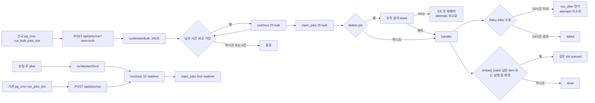

# Notion collection Step 5 검증 기록

- 실행일: 2026-09-18 (Asia/Seoul)
- 범위: `phases/25-notion-collection/step5.md`의 bulk lane, 조직별 Notion job 직렬화, `embed_batch`
- 신규 migration: `supabase/migrations/0042_notion_bulk_lane.sql`
- 운영 반영: 없음

## 구현 결과

- `jobs.lane`을 `realtime | bulk`로 분리하고 `claim_jobs(p_limit, p_lane)`을 추가했다. 기존 `claim_jobs(p_limit)`은 realtime만 claim한다.
- root에 연결된 `notion_import`, `notion_discover`, 향후 `notion_poll`, `embed_batch`를 bulk로 enqueue한다. 직접 등록한 root 없는 `notion_import`는 realtime을 유지한다.
- `/api/jobs/run?lane=bulk`는 인증을 그대로 유지하면서 한 번에 25건씩, 240초 예산 안에서 반복한다. 남은 시간이 30초 미만이면 새 claim을 시작하지 않으며 Route Handler의 `maxDuration`은 300초다.
- bulk job의 `retryAfterSeconds` 오류는 생성 후 24시간 안에는 attempts를 소모하지 않고 `run_after`만 늦춘다. 24시간이 지나면 안전한 오류 코드로 실패를 닫는다. realtime 재시도 분기는 바꾸지 않았다.
- `notion_installations`의 5분 job lease로 같은 조직의 Notion API job을 한 번에 하나만 실행한다. lease가 바쁘면 5초 뒤로 미루고 claim 때 증가한 attempts를 되돌린다.
- reference v2 item은 단건 `embed` 대신 부서별 고정 ID의 `embed_batch` 하나를 사용한다. 실행 중 새 변경이 오면 `rerun_requested`를 원자적으로 남겨 완료 직후 같은 job을 다시 queued로 만든다.
- `embedTexts()`를 추가하고 `embedText()`가 1개짜리 batch를 사용하도록 통합했다. 입력 본문은 로그에 남기지 않는다.

## Voyage 공식 상한

2026-09-18에 [Voyage embeddings API 공식 문서](https://docs.voyageai.com/reference/embeddings-api)를 확인했다.

- `input` 목록: 최대 1,000개
- `voyage-4-lite`의 한 요청 총량: 최대 1,000,000 tokens
- 구현 상한: 최대 64개, 각 document retrieval prompt를 포함한 UTF-8 바이트 합계 1,000,000 이하. 토큰 수를 사전 로깅하거나 원문을 외부에 한 번 더 보내지 않으면서 공식 토큰 상한을 넘지 않는 보수적 경계다.

## 코드 관계와 실행 구조

Graft와 Archify는 `Get-Command graft`, `Get-Command archify`에서 모두 발견되지 않았다. 따라서 `rg` 호출자 검색과 실제 파일 검토로 관계를 확인하고 아래 Mermaid 구조도로 대체했다.

- `claim_jobs` 애플리케이션 호출자는 `lib/jobs.ts`의 `runOnce()` 한 곳이다. SQL 하니스 외에는 직접 호출하지 않는다.
- `after()`는 `kickWorker()` → `runWorkerOnce()` → realtime claim으로 이어진다.
- 기존 `public.run_jobs_tick()`은 query 없는 `/api/jobs/run`을 그대로 호출한다. 신규 `public.run_bulk_jobs_tick()`만 `?lane=bulk`를 붙인다.
- `sweepPendingRows()`의 2분 cutoff는 answers, document summaries, agent role results, decision requests를 정리할 뿐 `jobs`, Notion root/source, item embedding 상태를 수정하지 않는다. 따라서 5분 job lease와 240초 bulk 실행을 2분에 실패 처리하지 않는다. `sweepReviewParts()`도 review part만 대상으로 한다.
- Next.js 16 로컬 문서에서 Route Handler의 route segment config `maxDuration`과 `after()` 사용 형태를 확인한 뒤 기존 Node 런타임을 유지했다.

## TDD 기록

구현 전에 새 동작 테스트와 SQL 시나리오를 먼저 추가했다.

1. `npx vitest run tests/jobs.test.ts tests/jobs-route.test.ts tests/embeddings.test.ts tests/pipeline/embed.test.ts`
   - RED: 12 failed, 34 passed. `embedTexts`, lane claim/route, bulk retry, `embed_batch`가 아직 없어 예상대로 실패했다.
2. `npx vitest run tests/worker.test.ts`
   - RED: 2 failed, 2 passed. bulk 반복 claim과 기한 중단 함수가 없어 예상대로 실패했다.
3. `node scripts/verify-security-sql.mjs 'D:/바이브코딩/.sasu-qa-db'`
   - RED: `jobs.lane`이 없어 신규 bulk SQL 시나리오가 실패했다.
4. 이후 구현과 migration 적용 뒤 아래 GREEN 결과를 얻었다.

## Acceptance Criteria 및 검증 결과

| 명령·시나리오 | 결과 |
|---|---|
| `npx vitest run tests/jobs*.test.ts tests/embeddings*.test.ts tests/pipeline/embed*.test.ts` | Windows + Vitest 5에서 glob을 파일명 필터로 확장하지 않아 `No test files found`(exit 1). 코드 실패가 아니며 바로 아래 명시적 동등 명령으로 보완했다. |
| `npx vitest run tests/jobs.test.ts tests/jobs-route.test.ts tests/embeddings.test.ts tests/pipeline/embed.test.ts` | PASS — 4 files, 46 tests |
| `npx vitest run tests/worker.test.ts` | PASS — 1 file, 5 tests |
| `npm run lint && npm run build && npm run test` | PASS — ESLint 성공, Next.js 16.3.4 production build/TypeScript 성공, 105 files·1,181 tests |
| `node scripts/verify-security-sql.mjs 'D:/바이브코딩/.sasu-qa-db'` | PASS — PGlite 201 checks, 2,016 assertions, 0 failed. `0004_worker_cron.sql`은 pg_cron/pg_net 부재로 기존 하니스 정책대로 제외했고 0042의 조건부 cron 분기는 운영에 적용하지 않았다. |
| `git diff --check -- <Step 5 추적 파일>` | PASS — whitespace 오류 없음. Git의 기존 LF→CRLF 안내만 출력됨. |

Acceptance 시나리오 연결:

- bulk 500건 + realtime 1건: PGlite에서 기본 `claim_jobs(1)`이 realtime 1건을 즉시 claim하고 bulk 500건은 그대로였으며, 명시적 bulk claim은 25건만 가져왔다. 즉 bulk 유무와 관계없이 같은 분의 realtime tick에서 처리할 수 있다.
- lane 없는 `/api/jobs/run`: route unit test와 기본 claim SQL 시나리오에서 bulk 0건을 확인했다.
- 429 세 번 뒤 성공: unit test에서 세 번 모두 attempts를 0으로 되돌리고 `Retry-After: 30`에 맞춰 재예약한 뒤 네 번째 실행이 성공했다. 생성 시각을 25시간 전으로 둔 경우 즉시 failed가 됐다.
- batch 도중 본문 변경: unit test에서 stale RPC 완료만 거절되고 해당 item만 pending으로 남아 requeue됐다. PGlite에서 `complete_item_embedding`의 이전 version은 false, 현재 version은 true임과 실행 중 변경의 `rerun_requested` 원자 전이를 함께 확인했다.
- 기존 임베딩·검색: 전체 Vitest와 PGlite의 v1 classify, v2 reference, `search_as` 시나리오가 모두 통과했다.

## 변경 파일

- 런타임: `app/api/jobs/run/route.ts`, `lib/jobs.ts`, `lib/worker.ts`, `lib/embeddings.ts`, `lib/pipeline/embed.ts`
- DB: `supabase/migrations/0042_notion_bulk_lane.sql`
- SQL 하니스: `scripts/verify-security-sql.mjs`, `scripts/verify-notion-bulk-lane-sql.mjs`, `scripts/verify-notion-import-v2-sql.mjs`, `scripts/verify-notion-roots-sql.mjs`
- 테스트: `tests/jobs.test.ts`, `tests/jobs-route.test.ts`, `tests/worker.test.ts`, `tests/embeddings.test.ts`, `tests/pipeline/embed.test.ts`
- 기록: 이 파일, `phases/25-notion-collection/index.json`의 step 5 항목

기능과 무관한 파일은 수정·정렬·되돌림하지 않았다. 저장소에 이미 있던 다른 세션의 추적/미추적 변경은 보존했다.

## CRITICAL 점검

- 사용자 요청 경로에 service role 사용을 추가하지 않았다. 신규 worker RPC는 service role만 실행 가능하며 PGlite 권한 시나리오로 확인했다.
- `complete_item_embedding`의 version fence를 우회하지 않고 item마다 RPC 결과에 맡겼다.
- realtime claim 한도 10과 일반 재시도 분기를 유지했다. bulk의 `retryAfterSeconds` 분기만 attempts를 되돌린다.
- 임베딩 입력 원문, Notion 본문, 질문/이벤트 본문을 로그에 출력하지 않는다.
- RLS의 가시성 판정과 `can_see()`를 변경하거나 복제하지 않았다.
- Supabase Edge Function, 외부 큐, 새 비밀값을 추가하지 않았다.

## 미실행 항목

- 실제 Voyage/Notion 외부 호출: 금지사항에 따라 미실행. 모든 fetch는 unit test mock만 사용했다.
- 운영 DB migration, `npx supabase db push`, 운영 pg_cron 변경, 운영 배포: 모두 미실행.
- 로컬/운영 Supabase의 pg_cron + pg_net 실호출: 운영 변경 금지 및 PGlite 확장 부재로 미실행. migration SQL과 URL/query/auth 경계는 코드·PGlite 권한·route unit test로 검증했다.
- E2E/브라우저 테스트: Step 5 AC에 없고 UI 변경이 없어 미실행.
- Graft/Archify 산출물: 실행 파일이 설치되어 있지 않아 미생성. 호출자 `rg` 검색과 위 Mermaid로 누락 범위를 대체했다.

## 오케스트레이터 리뷰 (2026-09-18, Claude)

- 확인: `claim_jobs(p_limit)` 기존 시그니처는 realtime만 claim(호환), `claim_jobs(p_limit,p_lane)`로 bulk 분리. SQL에서 넣는 job도 lane을 명시한다(root 소속 `notion_import`·`notion_discover`·`embed_batch`는 bulk, 직접 등록·classify는 realtime). `/api/jobs/run?lane=bulk`는 기존 인증 유지·`maxDuration=300`, pg_cron `sasu-jobs-bulk-tick` 매분(PGlite에서는 생략, 운영 Postgres에서만). bulk의 429는 시도 횟수를 되돌리고 24시간 기한 뒤 실패. Voyage 상한은 공식 문서로 확인(2026-09-18).
- 재실행: PGlite 하니스 201 passed / 0 failed. `tests/jobs*.test.ts`·`tests/embeddings.test.ts`·`tests/pipeline/embed.test.ts`·`tests/worker.test.ts`·`tests/pipeline/notion-discover.test.ts` → 6 files / 59 tests 통과. 수정 없음.
- 운영 반영 메모: 0042는 pg_cron 작업 1개를 추가한다. 운영 적용 뒤 `cron.job`에 `sasu-jobs-bulk-tick`이 생겼는지, 첫 틱이 `/api/jobs/run?lane=bulk`를 200으로 호출했는지 기록해야 한다.

