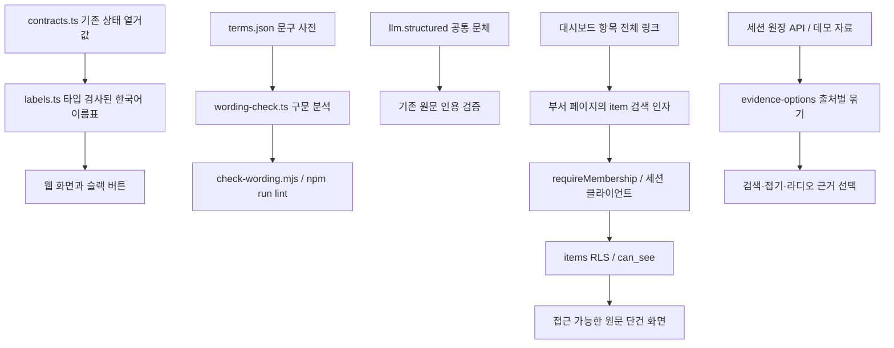

# 쉬운말 변경 의존 관계 검토

2026-09-20 로컬 구현 검토. Graft·Archify는 이 세션의 사용 가능한 도구 목록에서 발견되지 않았다. 따라서 두 도구의 실행 결과는 없으며, 아래는 파일·호출 관계를 직접 추적한 기록이다. 자동 의존 관계 분석이나 실제 Archify 출력으로 간주하지 않는다.

- 항목 링크는 새 수집 없이 저장된 원문을 세션 권한으로 읽는다. 다른 부서·삭제된 항목·잘못된 식별자는 404 화면을 표시한다. 목록의 분류나 최근 10개 제한과 독립적이다.
- 근거 목록은 동일 ID만 제거한다. ID가 없을 때만 출처·본문이 같은 항목을 제거한다. 다른 사람·시각의 같은 문장은 별개 근거로 남긴다. 본문은 수정하지 않는다.
- 근거 선택의 저장 계약은 기존 단일 `item_id`다. 검색·접기는 브라우저 표시만 바꾸며 쓰기 권한은 바꾸지 않는다.
- 문구 검사기는 JSX·문자열·템플릿을 읽는다. 경로·스타일·콘솔·코드 식별자는 제외한다. 실제 주석에 적힌 같은 줄의 `wording-ok` 사유만 예외로 인정한다.
- 상태의 내부 영문 값, DB 열거값, URL은 유지한다. 새로 생성하는 문장에만 공통 문체를 적용하며 인용 원문·동의 전문·개인정보 본문은 보존한다.
- Groq의 사용 한도 응답은 `llm_budget_exceeded`로 분류한다. 스키마 재시도를 하지 않으며 본문·비밀값을 로그로 남기지 않는다.

읽기 전용 보조 검토에서 확인한 조사 오류, 상태의 의미 과장, 근거 중복 제거와 원문 링크 결함을 수정했다. 운영 배포는 수행하지 않았다.
