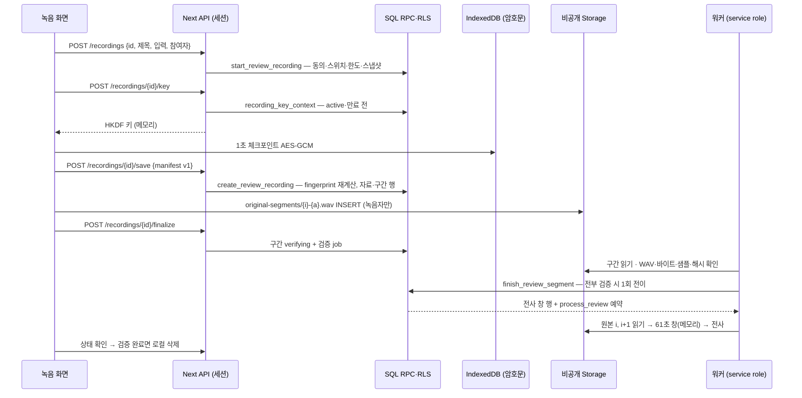

# 웹 회의 녹음 설계 검증 — 2026-09-25

요청: "설계 검증 해주고 미흡한 설계는 다시 해줘." 대상은 [웹 회의 녹음 설계](../../planning/웹회의_녹음_설계.md)(phase 23 상세 설계)다. 작업 트리에서 수정 중인 설계 문서가 이것뿐이다. step0 기록·step1 note·CSP 요약은 모두 "녹음 시작 전 영속 세션 생성 계약 미정"을 다음 단계의 차단점으로 남겼다.

이번 작업은 문서만 바꾼다. 코드·migration 작성, 운영 DB, 배포, 커밋은 하지 않았다. 재설계 결과는 [ADR-070](../../ADR.md), PRD §3-4·§6-8·§8·§11, ARCHITECTURE 녹음 절·§6-5, 상세 설계 §4~§6·§9~§11.2·§13·§14, [step1](../../../phases/23-browser-meeting-recording/step1.md)·[step2](../../../phases/23-browser-meeting-recording/step2.md)에 반영했다. 플랜과 게이트 판정은 `.claude/plans/recording-session-redesign-2026-09-25.*`에 있다.

## 확인한 자료

- 상위 문서: PRD §3-4(REC·ACC·COL·SEC)·§6-8·§8, ADR-054·056·057·058·068, ARCHITECTURE 녹음 절·§8, [원본 접근 구조](../browser-meeting-recording/access-design.md), [step0 기록](../browser-meeting-recording/step0.md), phase 23 README·step0~4.
- SQL: `0034_reviewed_materials.sql`, `0037_review_access_controls.sql`, `0052_recording_key_context.sql`, `0058_private_visibility_functions.sql`. 최신 정의를 기준으로 봤다.
- 코드: `lib/recording/**`, `app/api/d/[dept]/recordings/[id]/key/route.ts`, `app/api/d/[dept]/reviews/**`, `lib/pipeline/review-material.ts`, `components/reviewed-materials.tsx`·`review-detail.tsx`, `lib/security-headers.ts`, `proxy.ts`, `lib/adapters/review-audio.ts`, `lib/llm.ts`, `scripts/recording-lab/`, 관련 테스트.
- 운영 사실: 0052는 2026-09-23 운영 DB에 적용됐다([적용 기록](../release-completion-2026-09-23/README.md)). 로컬·원격 migration은 54개로 일치한다. 0058는 로컬에만 적용했다.
- 외부 공식 문서(2026-09-25 확인): [Groq speech-to-text](https://console.groq.com/docs/speech-to-text) — `timestamp_granularities`는 `word`·`segment`를 지원하고, prompt는 224토큰이며, 무료 등급 파일 한도는 25MB다. [Vercel Functions limits](https://vercel.com/docs/functions/limitations) — 요청·응답 본문 한도는 4.5MB이고 스트리밍 응답은 예외다. 원본 API는 `file.data.stream()`으로 스트리밍하므로 기존 50MiB 재생에는 해당하지 않는다. 구간은 1.92MB 이하다.

코드 사실 조사는 Explore 에이전트 2개(sonnet)에 맡겼고, 판단에 쓴 핵심 줄은 직접 다시 읽었다(`0037:97-159`, `lib/pipeline/review-material.ts`, `components/review-detail.tsx:216-284`).

## 결함

| ID | 심각도 | 내용 | 근거 | 처리 |
|---|---|---|---|---|
| B1 | 차단 | 녹음 세션을 언제 만드는지 없다. 자료 생성(`POST /recordings`)은 녹음이 끝나 manifest가 생긴 뒤인데, 키는 녹음 시작 때 필요하고 폐기 뒤에는 발급을 거부해야 한다. `recording_key_context`는 `status='uploading'`·`audio_segments` 행을 요구하는데 그런 행을 만드는 함수가 없다. 제품 경로에서 키 발급은 항상 실패한다(404). 키 route를 부르는 클라이언트도 없다 | 설계 §5.2(152행)·§13.2 SEC-06(341행), `0052:28-33`, `create_review` insert 목록(`0034:78`), 녹음 모듈 import는 key route의 `recording-key` 하나 | ADR-070 결정 1·2: 녹음 시작 때 `review_recordings` 세션 |
| B2 | 차단 | `private.review_original_available`이 `original_path is not null`을 요구한다. 설계는 구간 원본의 `original_path`를 비우므로 구간 업로드 정책·접근권 발급·소비·전사 예약이 모두 거부된다. §9 영향 목록에 이 함수와 발급·소비 함수가 없다 | `0037:97-103`, 사용처 `0037:115`·`143`·`156`·`196-202`, 설계 §5.1(146행)·§9(237행) | 결정 3·6: 형식별 원본 가용성 판정, 영향 목록 보강 |
| H1 | 높음 | 해시 불일치 때 "새 recording ID로 재전송"은 키 바인딩과 모순이다. 로컬 암호문은 이전 ID로 묶여 있고, 취소된 녹음에는 키를 주지 않는다. 30분 WAV(57.6MB)는 파일 가져오기 한도 50MiB도 넘어 대체 경로가 없다 | 설계 161행, `checkpoint-crypto.ts:19-34`(AAD에 recordingId), `recording-key.ts` HKDF info, `0034:67` | 결정 4: 같은 ID에서 구간만 attempt+1로 다시 올림 |
| H2 | 높음 | 구간 재생이 "60초 signed URL 목록"이다. ADR-058은 서명 URL을 금지하고 단회 접근권만 쓴다. 발급 함수는 경로 1개만 돌려주고, 소비 함수는 `original_path`만 허용한다. 구간별 발급·이벤트와 분당 60건의 관계가 정의되지 않았다 | 설계 156·163행, §13.3 SEC-07(347행), `0037:106-128`·`130-149` | 결정 6: 구간 번호가 붙은 단회 접근권 |
| H3 | 높음 | 업로드 재시도의 "기존 객체 해시가 일치하면 건너뜀"은 클라이언트가 객체를 읽을 수 없어 실행할 수 없다. SELECT는 접근권 소비만 허용한다 | 설계 161행, `0037:160-165` | 결정 4: 409 Duplicate는 업로드됨으로 보고 서버 검증이 판정(`review-detail.tsx:264-266`과 같은 관례) |
| H4 | 높음 | 경계 중복 제거가 segment 시작 시각 기준이다. 60초 전에 시작해 겹침 1초로 이어지는 segment의 단어가 다음 창 첫 segment와 겹쳐 PRD ACC-01 "경계 단어 중복 0"을 만족할 수 없다 | 설계 §11.2(284행), Groq 문서의 word 타임스탬프 | 결정 7: 단어 기준 소유 규칙 |
| M1 | 중간(개선) | 전사 창 WAV를 `parts/`에 따로 저장한다. 원본을 지우면 함께 지워져 기능상 이득이 없고, 저장량이 2배(116MB/30분)가 되며 Storage 정책·파기 분기가 늘어난다 | 설계 §4.3(129행)·§5.1·§5.3, ADR-056 | 결정 5: 워커가 검증된 원본에서 메모리로 조립 |
| M2 | 중간 | 버려진 녹음·업로드를 정리하는 기준이 없다. 기존 자료 검토함에도 `uploading` 방치 sweep이 없다. 로컬 자료를 잃은 서버 세션이 3·10건 한도를 차지해도 풀 방법이 없다 | 설계 §5.2·§5.3(169행), 방치 sweep 부재(`sweep_review_parts`·`sweep_review_originals`만 존재) | 결정 1: `expires_at` 하나로 통일, 서버 세션 목록·폐기 |
| M3 | 중간 | 구간별 검증 작업이 동시에 끝날 때 "전체 검증 성공 → 전사 예약"이 정확히 한 번 일어나는 계약이 없다 | 설계 §5.2(159행) | 결정 4: 자료 행 잠금 뒤 한 번만 전이 |
| M4 | 중간 | 녹음자를 참여자에 넣는 규칙이 없다. 동의 철회 trigger는 `participants`만 본다 | `0034:259-277`, 설계 §2.2 | 결정 1: 녹음자 자동 포함 |
| M5 | 중간 | 조직 녹음 스위치를 끄면 진행 중 녹음을 어떻게 할지 정하지 않았다(0052는 키만 막는다) | `0052:21-26`, 설계 SEC-11 | 결정 8: 시작·키·저장·업로드·확인 요청 모두 차단 |
| M6 | 중간 | 문서가 현재 상태와 다르다. §5는 "마이그레이션은 아직 없다"(0052 운영 적용), §4.1은 "PCM·체크섬"(현재 암호문과 GCM 태그), §13.3 SEC-07·08 표는 signed URL(머리 문단만 정정), 머리말은 "설계 완료"다. §4.2의 lease·BroadcastChannel은 코드에서 쓰기만 하고 판정은 Web Locks만 한다 | 설계 3·110·122·135·347·348행, `storage.ts:10-20`·`204-244` | 상세 설계 갱신 |
| M7 | 중간 | SEC 번호가 문서마다 다르다. 설계 SEC-04는 보안 헤더, PRD SEC-04는 접근 기록·스위치·보존이다. phase 노트의 "SEC-06"은 설계 번호, PRD 1.13의 "SEC-01·02·04"는 PRD 번호다 | 설계 §13, PRD §3-4 | 설계 §13에 대응표 추가, 다른 문서는 PRD 번호로 적음 |
| L1 | 낮음(검증 공백) | AudioWorklet·Worker의 Next 번들 로딩과 제품 CSP 강제 모드 동작이 검증된 적 없다. 녹음 실험실은 CSP 없는 Vite다. 정책상으로는 worklet이 `script-src 'strict-dynamic'`, worker가 `worker-src 'self'`로 허용될 것으로 보이지만 추론이다 | `lib/security-headers.ts:24-38`, `scripts/recording-lab/vite.config.ts`, `capture.ts:52-53` | step2 검증 항목 |
| L2 | 낮음 | 마이크 처리 옵션이 설계와 다르다. 설계(§11.1)는 컴퓨터 소리+마이크 모드에서만 AEC·NS·AGC를 켜는데, 구현은 두 모드 모두 AEC·NS이고 AGC가 없다 | `inputs.ts:18` | step2에서 모드별로 정하고 측정 |
| L3 | 낮음 | `RECORDING_KEY_SECRET` 회전 규칙이 없다. 회전하는 순간 진행 중 로컬 자료를 복호화할 수 없다 | `recording-key.ts`, `.env.example` | 결정 2: 세션에 키 버전 기록 |

## 유지할 설계

- ADR-058 접근권 구현은 ADR 서술과 정확히 일치한다: 60건/분, 60초 단회, 발급 기록 append-only, sign·list 거부.
- 60+1초 전사 계획, 30분·64MiB·구간당 1,920,044바이트 계산, 체크포인트 AES-GCM(AAD에 사용자·부서·녹음·순번·샘플 수), 24시간 로컬 만료, 다른 계정 자료 정리, Web Locks 단일 탭.
- 사용자 요청 경로는 세션 클라이언트만 쓰고, service role은 워커 안에서만 쓴다. 기존 5개 reviews/recordings route 모두 확인했다.
- 데모는 60초 메모리 녹음만 하고 서버 쓰기·LLM이 없다.

## 재설계 요약 (ADR-070)

1. `녹음 시작` 때 클라이언트 UUID로 `review_recordings` 세션을 만든다. 이 UUID는 멱등 키이자 이후 자료 ID이고, HKDF와 AAD에 쓰는 녹음 ID다. 생성 시 동의·스위치·한도·동의 스냅샷을 확인하고, 녹음자를 참여자에 자동 포함한다.
2. 키는 `active`·`saving` 상태이고 시작 후 24시간 안일 때만 발급한다. 검증 완료·폐기·만료·철회 뒤에는 거부한다. 세션에 키 버전을 기록한다.
3. 저장 때 step1a manifest v1의 canonical 문자열로 SQL이 fingerprint를 다시 계산하고, 자료 행과 구간 행을 한 트랜잭션으로 만든다. 원본 가용성은 형식별로 판정한다.
4. 구간은 `original-segments/{index}-{attempt}.wav`에 녹음자만 INSERT한다. 불일치하면 같은 ID로 attempt를 올린다(3회). 전 구간 검증은 한 번만 전이한다.
5. 전사 창은 워커가 메모리에서 만들고 `parts/` 객체는 없다. 30분 저장량은 약 57.6MB다.
6. 구간 재생·내려받기는 구간 번호가 붙은 단회 접근권으로 한다. 내려받기는 브라우저에서 합친다.
7. 경계는 단어 타임스탬프로 소유를 정한다.
8. 조직 스위치를 끄면 진행 중 녹음을 포함해 모두 차단한다.

## 동시 작업 관찰

2026-09-25 09:20~09:37 다른 작업(Codex로 추정)이 같은 작업 트리에서 step0 후속(`lib/recording/capture-watchdog.ts`, `storage.ts`·`storage.worker.ts`·`capture.ts`, `tests/recording/*`, [recording-capture 기록](../recording-capture-2026-09-25/README.md))과 `step1a-original-segments.md`를 만들었다. 이번 작업은 그 파일들을 수정하지 않았다. step1a의 manifest v1(`sasu-recording-manifest-v1\n` + `index:sample_count:bytes:sha256\n`)과 "검증된 원본 두 구간에서 60+1초 전사 WAV 생성" 범위는 ADR-070와 일치하므로 그대로 채택했다. 09:42에는 같은 작업이 상세 설계 §5.1.1을 추가했고, 09:54에는 `lib/contracts.ts`의 `ReviewRecordingStart`·`RecordingManifest`와 `lib/recording/recording-key.ts`의 키 버전 회전(`RECORDING_KEY_VERSION`·`RECORDING_KEY_PREVIOUS_*`)을 추가했다. 설계의 필드 이름을 그 코드(`meeting_provider`, 확인 필드 `consent_confirmed` 하나)에 맞췄다. 이 코드들의 검증 결과는 그 작업의 기록을 따른다.

## 도구

이 세션에는 Graft CLI와 Archify 도구가 없다. Docker CLI는 있지만 이전 기록에 따르면 엔진 연결이 불안정하다. 코드 관계는 파일·grep·Explore 조사로 확인했다. 구조도는 상세 설계와 아래의 수동 Mermaid이며 도구 출력이라고 주장하지 않는다. 구현 step에서 Graft 전후 그래프와 Archify 실행 흐름도를 만들어야 한다.

## 남은 게이트

- 구현 전: phase 23 step0의 실제 기기 V01~V06, 제공사 확인, 운영 CSP 1일 관찰·강제 승인, 0058 운영 반영.
- 구현(step1 서버 → step2 화면) 뒤: V05·V07~V10·V15·V17·V21. 운영 반영은 검증 기록과 사용자 승인 뒤에 한다.
