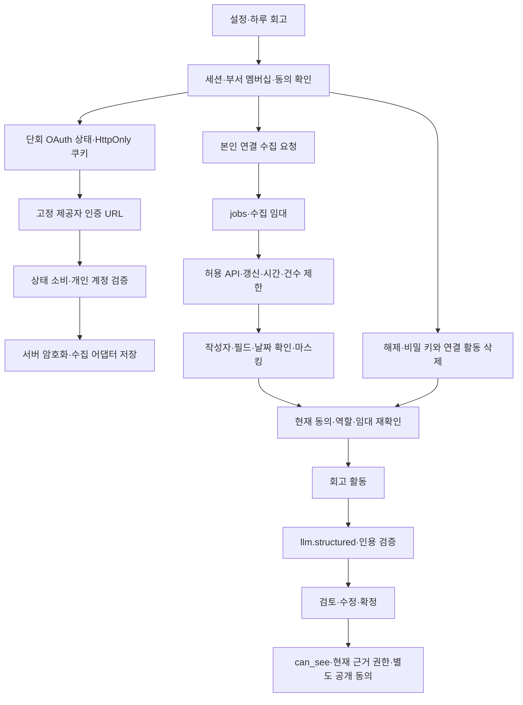

# 코드 의존 관계·구조 검토 — 2026-09-20

Graft·Archify를 도구 목록에서 찾았으나 이 세션에 호출 가능한 도구가 없었다. 아래는 실제 파일·호출자·SQL을 읽은 수동 검토이며 Graft 분석 또는 Archify 출력으로 간주하지 않는다. 도구 기반 최신 그래프·시각화 검증은 누락이다.

| 경계 | 읽은 파일·확인 결과 |
|---|---|
| 사용자 요청 | `app/api/retro/connect/[provider]/{start,callback}/route.ts`, `app/api/d/[dept]/retros/**`: 세션 membership·origin/state 검증. 검증된 credential만 수집 어댑터로 전달 |
| 인증·API | `lib/retro/connectors/{auth,http,registry}.ts`: 고정 도메인, redirect 차단, 4MiB 응답·20초 요청·전체 호출 수 제한. 임의 endpoint 금지 |
| 제공자 변환 | `map.ts`, `pull.ts`, `extended.ts`, `zendesk.ts`, `department.ts`, `mailchimp.ts`: 본인 활동/집계/부서 요약 구분. 원문 응답을 저장·로그로 넘기지 않음 |
| 비밀·수집 | `connection-crypto.ts`, `lib/adapters/retro-connection.ts`, `lib/pipeline/retro-pull.ts`: 사용자·부서·제공자에 묶인 암호문, 임대, 갱신 저장, 해제 이후 늦은 완료 차단 |
| DB | `0049_retro_connections.sql`, `0050_retro_connection_boundaries.sql`: 본인 RLS·비밀 열 SELECT 금지·공개 철회·현재 can_see·회사 요약의 현재 팀장 권한·삭제 |
| 생성·UI | `lib/pipeline/retro-draft.ts`, `lib/retro/{presets,verify}.ts`, `components/retro-*.tsx`: 정해진 LLM 경로, 인용 재검증, 부서 소식 분리, 실패·재시도 표시 |
| 롤백 | `supabase/rollback/0050_*`, `0049_*`: 격리 SQL 실행으로 phase 27과 append-only 결정을 보존함을 확인 |

부서 소식 차단은 프롬프트만 의존하지 않는다. JS 인용 검증과 SQL 저장 검증이 모두 집행한다. 권한 판정 자체를 앱에 새로 만들지 않고 기존 `can_see()`와 SQL 함수의 현재 상태 확인을 사용한다.
